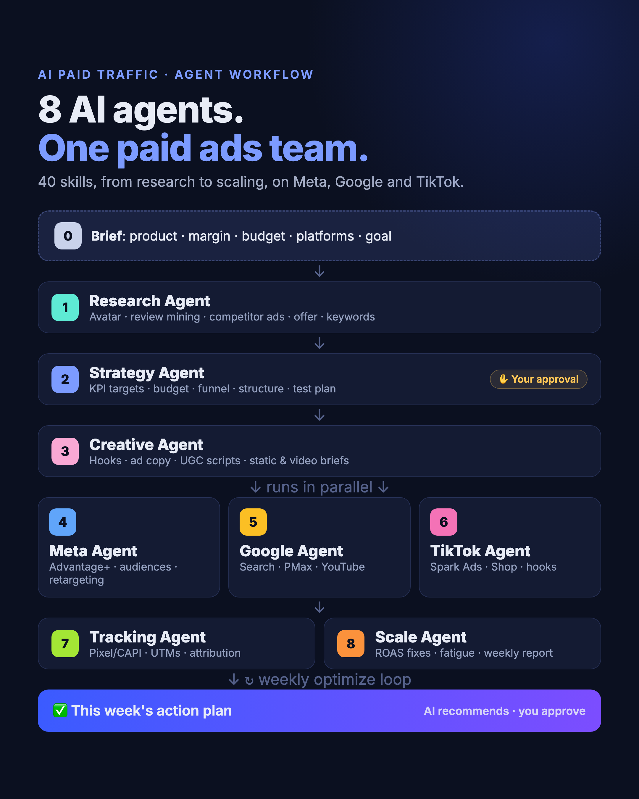
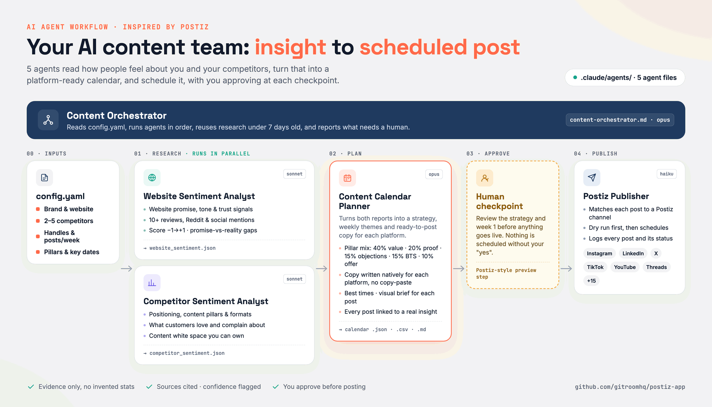

# AI Marketing Agents

Seven sets of Claude Code agents for marketing teams, in one repo: **paid ads**, **search visibility**, **tracking health**, **social content**, **email/SMS from first-party data**, **AI UGC video ads** and **website speed and site health audits**.

> **AI recommends. You approve.** None of these agents launch campaigns, change budgets, edit pages, publish GTM changes or send emails. The content agents schedule posts only after you approve, the Klaviyo agents save flows and campaigns as drafts, and the UGC agents never click Generate on Higgsfield without your OK. They write plans and reports; a human signs off on every change.

| Project | What it does | Agents |
|---|---|---|
| [AI Paid Traffic](ai-paid-traffic-agents/) | Runs paid ads end to end on Meta, Google and TikTok: research, strategy, creative, platform builds, tracking and scaling | 8 agents + 1 workflow |
| [AI Search Everywhere](ai-search-everywhere-agents/) | Visibility on Google and AI answer engines: SEO, AEO, GEO, AIO and SXO, with ranking targets and a weekly report | 7 agents + 8 skills |
| [GTM Health Agent](gtm-health-agent/) | Audits Google Tag Manager every Monday: flags tags that won't fire, explains why and recommends fixes | 1 weekly agent |
| [Content Agents](content-agents/) | Social media content calendar built from your own and your competitors' sentiment, scheduled through Postiz | 5 agents |
| [Klaviyo 1PD Agents](klaviyo-1pd-agents/) | High-converting email and SMS from first-party data: data audit, segments, revenue flows, campaigns and a weekly performance loop | 5 agents + 1 workflow |
| [AI UGC Ad Agents](ai-ugc-ad-agents/) | AI creator video ads on Higgsfield: creators, hooks, angles and scripts, paste-ready prompts, an ad-policy check, then image and video generation | 4 agents + 1 workflow |
| [Website Audit Agents](website-audit-agents/) | Audits site speed, Core Web Vitals, accessibility, technical SEO, keywords and backlinks with free PageSpeed Insights + Ahrefs Webmaster Tools, weekly and monthly via GitHub Actions | 10 agents + 1 workflow |

## AI Paid Traffic



Research → Strategy (you approve) → Creative → Meta / Google / TikTok in parallel → Tracking → Scale.
[Read more and install →](ai-paid-traffic-agents/)

## AI Search Everywhere


SEO + AIO → AEO + GEO → SXO → Rankings → weekly report every Monday.
[Read more and install →](ai-search-everywhere-agents/)

## GTM Health Agent


Weekly read-only GTM audit: 30+ checks, P0–P3 severity, health score per container, likely cause and fix, week-over-week comparison.
[Read more and set up →](gtm-health-agent/)

## Content Agents



Website + competitor sentiment → content calendar (you approve) → schedule in Postiz.
[Read more and install →](content-agents/)

## Klaviyo 1PD Agents


First-party data audit → segments (you approve) → revenue flows (drafts) → campaigns (drafts, you send) → weekly performance loop.
[Read more and install →](klaviyo-1pd-agents/)

## AI UGC Ad Agents


Brief → creators, hooks and scripts (you approve) → Soul 2.0 + Seedance prompts → compliance check → generate on Higgsfield (you approve each credit spend).
[Read more and install →](ai-ugc-ad-agents/)

## Website Audit Agents


Weekly speed check + monthly full audit → 10 agents (Core Web Vitals, slow revenue pages, speed backlog, tag bloat, accessibility, site health, broken links, striking-distance keywords, backlinks, alerts) → Claude summary → scorecard, GitHub Issue and Slack alerts. Read-only: it reports, your team fixes.
[Read more and set up →](website-audit-agents/)

## How they fit together

- **Tracking first:** the GTM Health Agent keeps conversion data correct, which the paid-traffic scale agent and the search weekly report both rely on.
- **Paid + organic:** keyword research from AI Search Everywhere feeds Google Search campaigns in AI Paid Traffic, and paid search terms show which organic pages to build.
- **Organic social:** the content agents' competitor research shares angles with the paid-traffic research agent; winning organic posts make good Spark Ads and creative tests.
- **First-party data:** the Klaviyo segment agent builds consented VIP and buyer seed audiences for paid-traffic lookalikes and exclusions, and GTM health keeps the onsite events Klaviyo flows trigger on firing.
- **Creative supply:** the UGC agents turn paid-traffic research angles into AI creator videos, and the compliance check screens them before they reach Meta or TikTok ads.
- **Site speed feeds conversion:** the website audit agents flag slow revenue pages and tag bloat that hurt paid-traffic landing pages, and their striking-distance keywords feed AI Search Everywhere.
- **One Monday routine:** GTM health report, search weekly report, website speed check and paid-traffic Optimize mode can all run at the start of the week.

## Get everything

```bash
git clone https://github.com/anishdagdu/ai-marketing-agents.git
```

Then follow the install steps in each project's README.

## Requirements

- [Claude Code](https://claude.com/claude-code)
- AI Paid Traffic uses the 40 **AI for Paid Traffic** skills by HeyOz (not included)
- GTM Health Agent needs the Google Tag Manager MCP connector
- Content Agents can schedule through a [Postiz](https://github.com/gitroomhq/postiz-app) account (optional)
- AI UGC Ad Agents use the 19 [Higgsfield skills](https://github.com/AKCodez/higgsfield-claude-skills) by AKCodez (not included), plus a Higgsfield account and the Playwright MCP for generation
- Website Audit Agents need a free PageSpeed Insights API key; Ahrefs Webmaster Tools exports, a Claude API key and a Slack webhook are optional

## License

Each project keeps its own license and notices. AI Search Everywhere is MIT; see its [LICENSE](ai-search-everywhere-agents/LICENSE) and [THIRD_PARTY_NOTICES](ai-search-everywhere-agents/THIRD_PARTY_NOTICES.md).
