# AI Marketing Agents

Thirteen sets of AI agents for marketing teams, in one repo: **paid ads**, **search visibility**, **tracking health**, **social content**, **email/SMS from first-party data**, **AI UGC video ads**, **website speed and site health audits**, **CRM with responsible-gaming guardrails**, **whole-store Shopify operations**, **HubSpot CRM, sales and marketing with Shopify, Stripe and Slack**, **Finnish-language ads and content calendars**, **Amazon Ads setup and optimization** and **mobile app measurement with AppsFlyer, Adjust and other MMPs**.

> **AI recommends. You approve.** None of these agents launch campaigns, change budgets, edit pages, publish GTM changes or send emails. The content agents schedule posts only after you approve, the Klaviyo agents save flows and campaigns as drafts, and the UGC agents never click Generate on Higgsfield without your OK. They write plans and reports; a human signs off on every change.

| Project | What it does | Agents |
|---|---|---|
| [AI Paid Traffic](ai-paid-traffic-agents/) | Runs paid ads end to end on Meta, Google and TikTok: research, strategy, creative, platform builds, tracking and scaling | 8 agents + 1 workflow |
| [AI Search Everywhere](ai-search-everywhere-agents/) | Visibility on Google and AI answer engines: SEO, AEO, GEO, AIO and SXO, with ranking targets and a weekly report | 7 agents + 8 skills |
| [GTM Health Agent](gtm-health-agent/) | Audits Google Tag Manager every Monday: flags tags that won't fire, explains why and recommends fixes | 1 weekly agent |
| [Content Agents](content-agents/) | Social media content calendar built from your own and your competitors' sentiment, scheduled through Postiz | 5 agents |
| [Klaviyo 1PD Agents](klaviyo-1pd-agents/) | High-converting email and SMS from first-party data: data audit, segments, revenue flows, campaigns and a weekly performance loop | 5 agents + 1 workflow |
| [AI UGC Ad Agents](ai-ugc-ad-agents/) | AI creator video ads on Higgsfield: creators, hooks, angles and scripts, paste-ready prompts, an ad-policy check, then image and video generation | 4 agents + 1 workflow |
| [Website Audit Agents](website-audit-agents/) | Audits site speed, Core Web Vitals, accessibility, technical SEO, keywords and backlinks with free PageSpeed Insights + Ahrefs Webmaster Tools, weekly and monthly via GitHub Actions | 10 agents + 1 workflow |
| [CRM Agents](crm-agents/) | Player 360, churn and LTV scoring, journeys, real-time triggers, uplift with control groups and bandit tests, with a Responsible Gaming Guardian that can veto any message | 10 agents + 5 skills + 1 workflow |
| [Shopify Agents](shopify-agents/) | An AI team for the whole Shopify store: setup, debugging, catalog, inventory, conversion, organic and paid traffic, email, tracking, profit, support and retention | 15 agents + 1 workflow |
| [HubSpot Agents](hubspot-agents/) | An AI team for the whole HubSpot portal: CRM setup and data hygiene, lead capture and scoring, sales pipeline, SEO/AEO, social, ads, email, workflows, help desk, reporting and Stripe revenue, connected to Shopify, Stripe and Slack | 15 agents + 1 workflow |
| [Finnish Marketing Agents](finnish-marketing-agents/) | Native Finnish ad copy for every campaign type on Google, Meta, LinkedIn and Snapchat, plus an organic + paid content calendar from website analysis, competitor sentiment and the Meta Ad Library, with English ↔ Finnish translation | 3 agents + 1 workflow |
| [Amazon Ads Agents](amazon-ads-agents/) | Sets up and optimizes Amazon Ads (Sponsored Products, Brands, Display and DSP): unit economics, keywords, competitor targets, a listing gate, bulk-ready builds and a weekly harvest, bid, budget and report loop | 12 agents + 1 workflow |
| [MMP Agents](mmp-agents/) | An AI team for AppsFlyer, Adjust and every mobile measurement partner: attribution, SAN reconciliation, SKAN and AdAttributionKit, postbacks, events, ad revenue, fraud, privacy, clean rooms, ROAS, LTV, creative, incrementality, deep links, audiences and AI alerts | 21 agents + 1 workflow |

## AI Paid Traffic

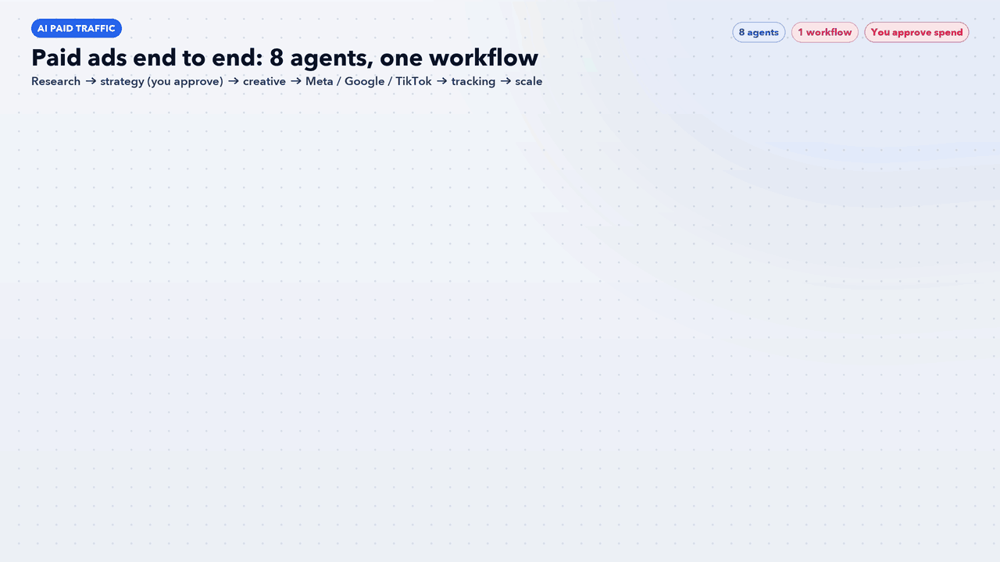

Research → Strategy (you approve) → Creative → Meta / Google / TikTok in parallel → Tracking → Scale.
[Read more and install →](ai-paid-traffic-agents/)

## AI Search Everywhere

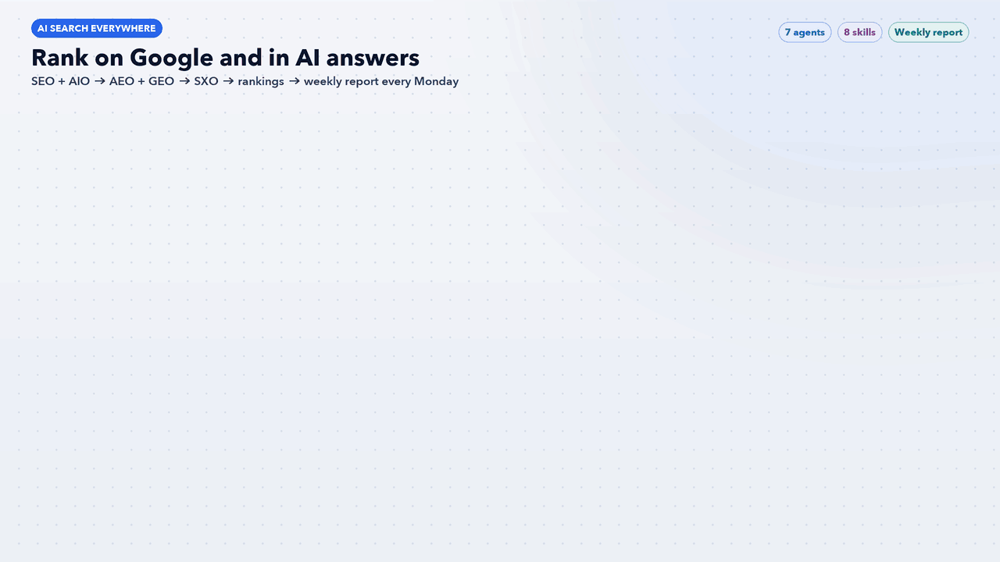

SEO + AIO → AEO + GEO → SXO → Rankings → weekly report every Monday.
[Read more and install →](ai-search-everywhere-agents/)

## GTM Health Agent

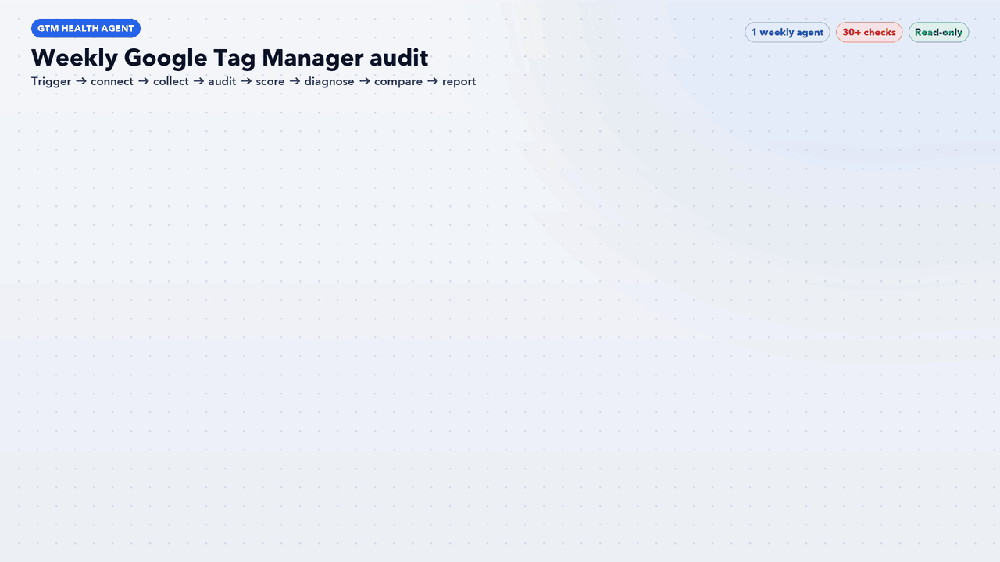

Weekly read-only GTM audit: 30+ checks, P0–P3 severity, health score per container, likely cause and fix, week-over-week comparison.
[Read more and set up →](gtm-health-agent/)

## Content Agents

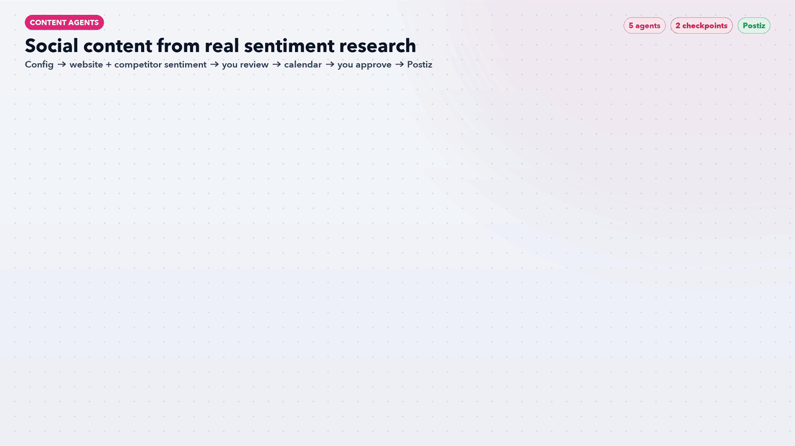

Website + competitor sentiment → content calendar (you approve) → schedule in Postiz.
[Read more and install →](content-agents/)

## Klaviyo 1PD Agents

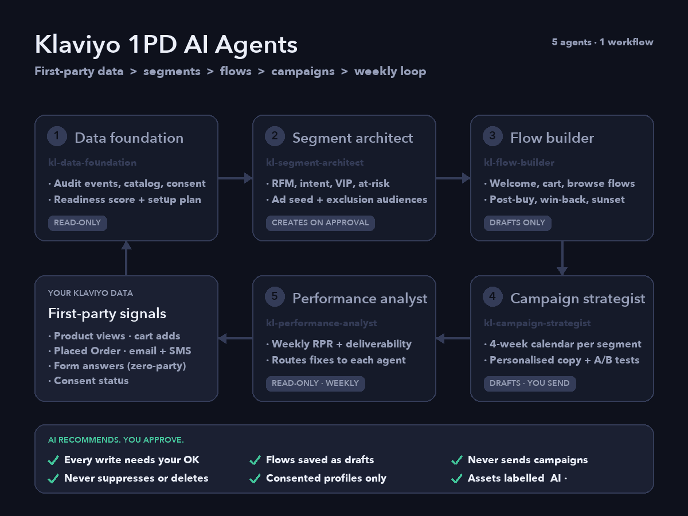

First-party data audit → segments (you approve) → revenue flows (drafts) → campaigns (drafts, you send) → weekly performance loop.
[Read more and install →](klaviyo-1pd-agents/)

## AI UGC Ad Agents

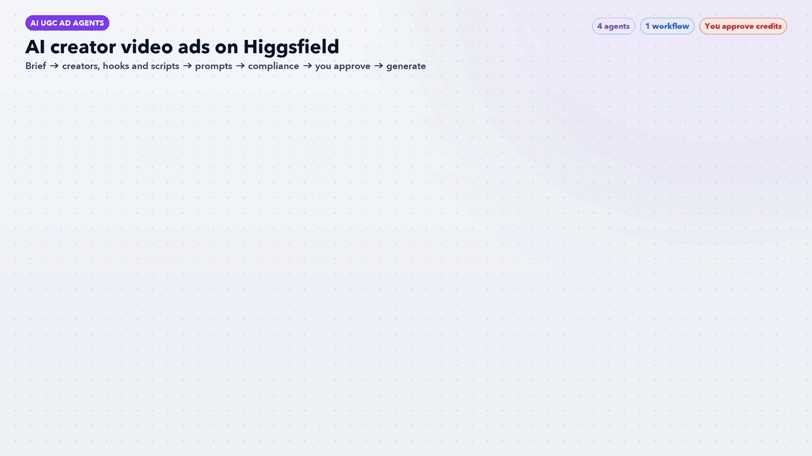

Brief → creators, hooks and scripts (you approve) → Soul 2.0 + Seedance prompts → compliance check → generate on Higgsfield (you approve each credit spend).
[Read more and install →](ai-ugc-ad-agents/)

## Website Audit Agents

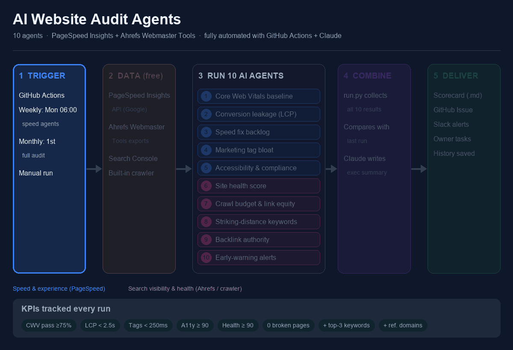

Weekly speed check + monthly full audit → 10 agents (Core Web Vitals, slow revenue pages, speed backlog, tag bloat, accessibility, site health, broken links, striking-distance keywords, backlinks, alerts) → Claude summary → scorecard, GitHub Issue and Slack alerts. Read-only: it reports, your team fixes.
[Read more and set up →](website-audit-agents/)

## CRM Agents

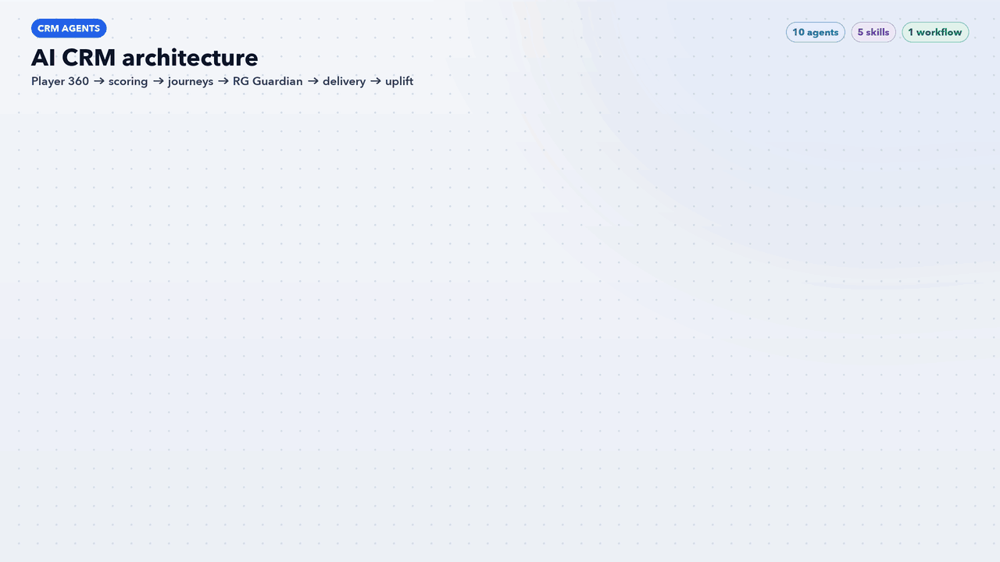

Data layer → Player 360 → scoring → journeys + real-time triggers → RG Guardian (veto) → contact policy → personalisation → uplift, testing and insights loop. Every decision is logged. You approve journeys; the agents never send.
[Read more and install →](crm-agents/)

## Shopify Agents

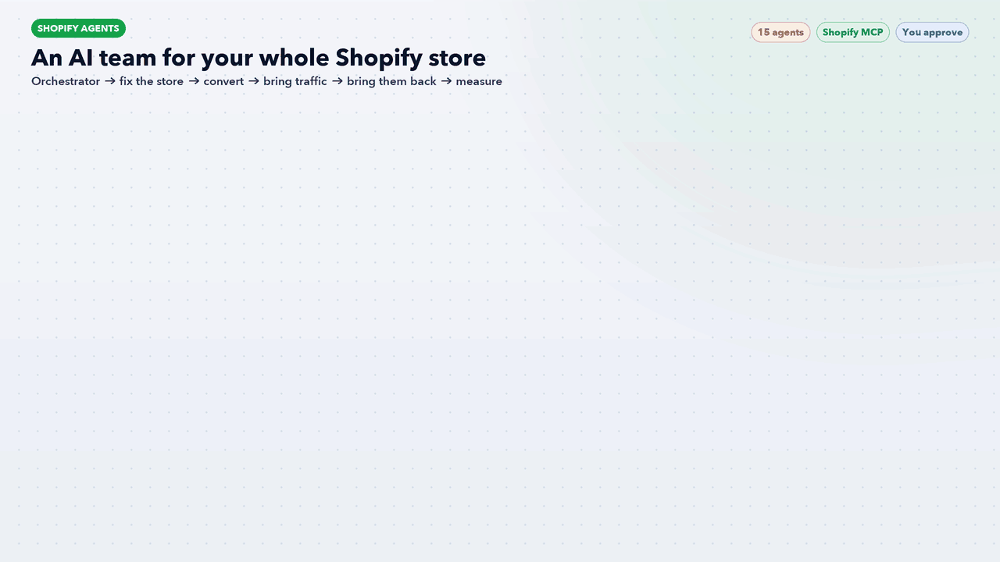

Orchestrator finds the biggest revenue leak → fix the store → convert → bring traffic → bring them back → measure and protect profit, every week.
[Read more and install →](shopify-agents/)

## HubSpot Agents

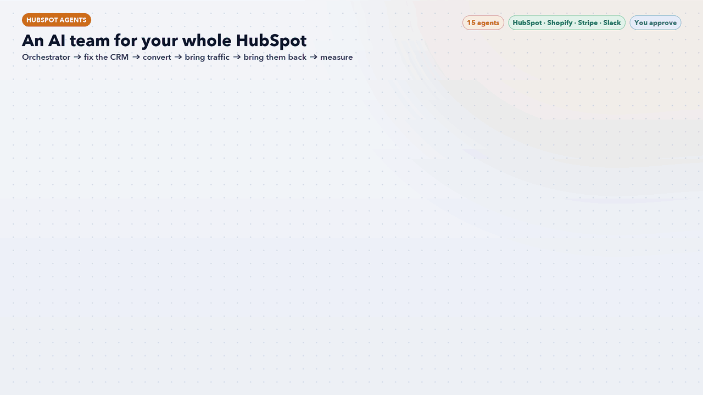

Orchestrator finds the biggest funnel leak → fix the CRM (with Shopify, Stripe and Slack synced) → convert → bring traffic → bring them back → measure revenue, every week.
[Read more and install →](hubspot-agents/)

## Finnish Marketing Agents

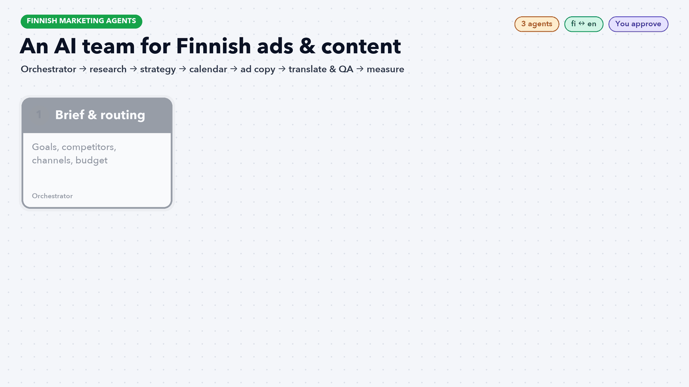

Brief → research: website, competitor sentiment and Meta Ad Library (you approve) → strategy (you approve) → content calendar in Finnish + English (you approve) → ad copy for Google, Meta, LinkedIn and Snapchat → translation and QA → you approve → measure.
[Read more and install →](finnish-marketing-agents/)

## Amazon Ads Agents

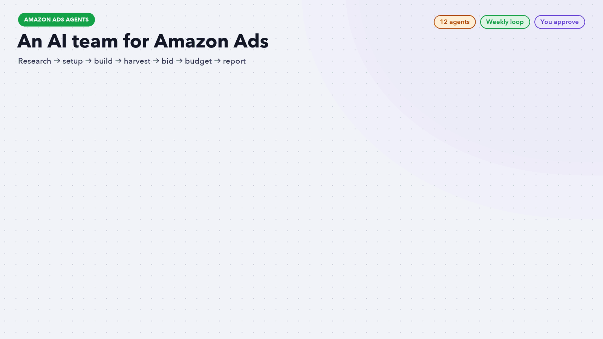

Unit economics → keywords + competitors → listing gate → account build (SP, SB, SD/DSP) → you approve and upload → every Monday: harvest search terms, tune bids, pace budgets, report.
[Read more and install →](amazon-ads-agents/)

## MMP Agents

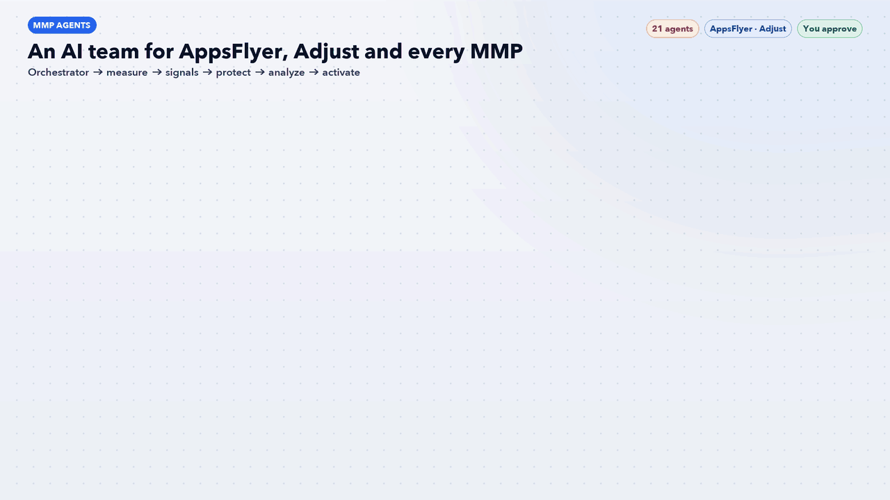

Orchestrator finds the biggest measurement gap → measure → signals → protect → analyze → activate, every week. Any change in AppsFlyer or Adjust waits for your OK.
[Read more and install →](mmp-agents/)

## How they fit together

- **Tracking first:** the GTM Health Agent keeps conversion data correct, which the paid-traffic scale agent and the search weekly report both rely on.
- **Paid + organic:** keyword research from AI Search Everywhere feeds Google Search campaigns in AI Paid Traffic, and paid search terms show which organic pages to build.
- **Organic social:** the content agents' competitor research shares angles with the paid-traffic research agent; winning organic posts make good Spark Ads and creative tests.
- **First-party data:** the Klaviyo segment agent builds consented VIP and buyer seed audiences for paid-traffic lookalikes and exclusions, and GTM health keeps the onsite events Klaviyo flows trigger on firing.
- **Creative supply:** the UGC agents turn paid-traffic research angles into AI creator videos, and the compliance check screens them before they reach Meta or TikTok ads.
- **Site speed feeds conversion:** the website audit agents flag slow revenue pages and tag bloat that hurt paid-traffic landing pages, and their striking-distance keywords feed AI Search Everywhere.
- **Retention:** the CRM agents' uplift results show which journeys add revenue, and their segments sit alongside the Klaviyo 1PD segments for lifecycle messaging.
- **Shopify hub:** the Shopify orchestrator hands paid work to AI Paid Traffic, SEO to AI Search Everywhere, social to Content Agents, email to Klaviyo 1PD Agents and tag checks to the GTM Health Agent.
- **HubSpot hub:** the HubSpot agents pull Shopify orders and Stripe payments onto CRM records, post alerts and weekly summaries to Slack, and hand ads to AI Paid Traffic, SEO to AI Search Everywhere, social to Content Agents and store fixes to Shopify Agents.
- **Finnish market:** the Finnish marketing agents write native Finnish copy for the campaigns AI Paid Traffic plans, and their Meta Ad Library scan shares competitor angles with the content and paid-traffic research agents.
- **Amazon:** the Amazon Ads agents share break-even math with the Shopify profit agent, and AI Search Everywhere keyword research seeds Amazon keyword clusters.
- **App measurement:** the MMP agents give AI Paid Traffic deduplicated ROAS and LTV by source, send creative winners to the UGC agents and share consented app audiences with Klaviyo and CRM segments.
- **One Monday routine:** GTM health report, search weekly report, website speed check, Amazon Ads optimize loop and paid-traffic Optimize mode can all run at the start of the week.

## Get everything

```bash
git clone https://github.com/anishdagdu/ai-marketing-agents.git
```

Then follow the install steps in each project's README.

## Requirements

- [Claude Code](https://claude.com/claude-code)
- AI Paid Traffic uses the 40 **AI for Paid Traffic** skills by HeyOz (not included)
- GTM Health Agent needs the Google Tag Manager MCP connector
- Content Agents can schedule through a [Postiz](https://github.com/gitroomhq/postiz-app) account (optional)
- AI UGC Ad Agents use the 19 [Higgsfield skills](https://github.com/AKCodez/higgsfield-claude-skills) by AKCodez (not included), plus a Higgsfield account and the Playwright MCP for generation
- CRM Agents need player, payment and RG-limit data exports (a simulator is included to try it without data)
- Shopify Agents need the Shopify MCP connector
- HubSpot Agents need the HubSpot MCP connector; Shopify, Stripe (read only) and Slack connectors are optional
- Amazon Ads Agents need Amazon Ads report exports (bulk sheet, Search Term, Targeting, Placement); Windsor.ai is optional
- MMP Agents need AppsFlyer or Adjust exports or API access (or the Windsor.ai connector); the AppsFlyer MCP server is optional
- Website Audit Agents need a free PageSpeed Insights API key; Ahrefs Webmaster Tools exports, a Claude API key and a Slack webhook are optional

## License

Each project keeps its own license and notices. AI Search Everywhere is MIT; see its [LICENSE](ai-search-everywhere-agents/LICENSE) and [THIRD_PARTY_NOTICES](ai-search-everywhere-agents/THIRD_PARTY_NOTICES.md).
