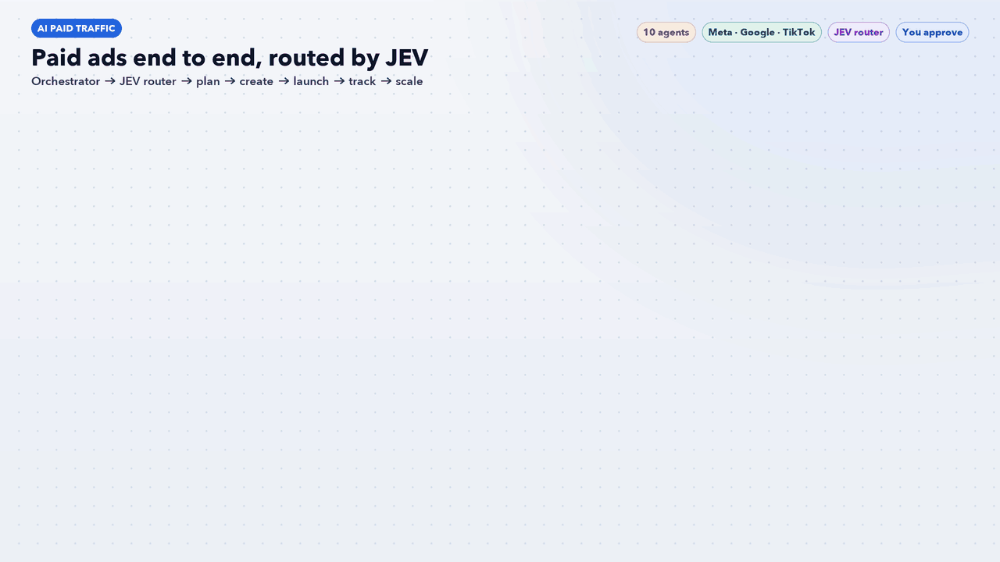

# AI Paid Traffic: 8 Agents, One Workflow



A team of 10 AI agents that runs paid ads end to end, from research to scaling, on **Meta, Google and TikTok**.

> **AI recommends. You approve.** These agents never launch, pause or change budgets. They write plans; a human makes every spend decision.

## How it works

| # | Agent | What it does | Output |
|---|---|---|---|
| 0 | *Brief* | Product, margin, budget, platforms, goal | `00-brief.md` |
| 1 | research-agent | Customer avatar, review mining, competitor ads, offer audit, keywords | `01-research.md` |
| 2 | strategy-agent | KPI targets, budget split, funnel, structure, 4-week test plan. **✋ You approve here.** | `02-strategy.md` |
| 3 | creative-agent | Hooks, ad copy, UGC scripts, static & video briefs | `03-creative.md` |
| 4 | meta-ads-agent | Advantage+, audiences, catalog ads, retargeting | `04-meta.md` |
| 5 | google-ads-agent | Search, Performance Max, negatives, YouTube | `05-google.md` |
| 6 | tiktok-ads-agent | TikTok setup, hook bank, Spark Ads, TikTok Shop | `06-tiktok.md` |
| 7 | tracking-agent | Pixel/CAPI, UTMs, conversion audit, landing page, attribution | `07-tracking.md` |
| 8 | scale-agent | Account audit, ROAS diagnosis, creative fatigue, scaling rules, weekly report | `08-scale.md` |

Agents 4–6 run **in parallel**, only for the platforms you use. Every agent reads the earlier files in `paid-traffic/`, so nothing is asked twice. The run ends with `00-action-plan.md`: this week's checklist.

**Modes**
- **Launch** (new account or product): 1 → 2 → 3 → 4/5/6 + 7
- **Optimize** (already spending, run weekly): 7 → 8 → 3 if creative is fatigued → 2 to update the test plan
- **Single task**: e.g. "write hooks" goes straight to the creative agent

## Requirements

- [Claude Code](https://claude.com/claude-code)
- The 40 **AI for Paid Traffic** skills by HeyOz, which the agents use. They are not included here; get them from HeyOz and copy each skill folder into `~/.claude/skills/`.

## Install

```bash
git clone https://github.com/anishdagdu/ai-paid-traffic-agents.git
cd ai-paid-traffic-agents
./install.sh
```

## Use

Open a new Claude Code session in your project folder and say:

```
Run the paid traffic workflow for <your product>
```

Or call one agent directly: `Use the scale-agent on these results.`

## JEV model router
`pt-jev-router` picks a model for every task before the orchestrator starts it: **Fast · Haiku** for lookups, checks and formatting, **Standard · Sonnet** for plans, writing and analysis, **Deep · Opus** for high-stakes or messy problems. It scores each task 0-2 on money at stake, ambiguity, reasoning depth, blast radius and novelty (0-2 fast, 3-5 standard, 6+ deep), starts low and escalates only on evidence, reuses outputs from the last 7 days, and caps deep work at 3 tasks per run. Every decision is logged to `outputs/jev-routing-log.csv`.

`pt-orchestrator` leads the team: it finds the biggest problem, routes tasks through JEV, briefs the specialists and returns one ranked action list for your approval.
