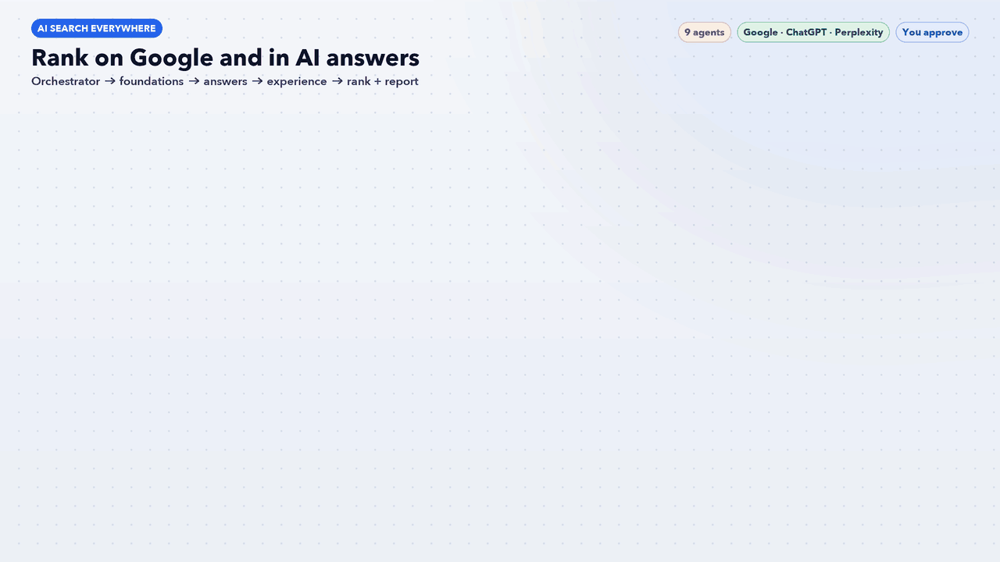

# AI Search Everywhere · 8 Claude skills + 9 agents

Search visibility across Google and AI answer engines: SEO, AEO, GEO, AIO and SXO, plus keyword ranking targets (top 5 in 2-3 months, top 3 in 6 months) and a one-page weekly report.

Stages: 1 SEO + AIO · 2 AEO + GEO · 3 SXO · 4 Rankings · then a Weekly Report every Monday.

## Install in Claude (claude.ai or the desktop app)
1. Open Settings > Capabilities and make sure code execution / file creation is on.
2. In the Skills section, click Upload skill.
3. Upload the zips from the `upload-to-claude` folder (one skill per zip). Upload `01-search-everywhere-workflow.zip` first; the others follow its shared rules.
4. Turn the skills on. Then just ask, for example: "Run the search everywhere workflow on https://example.com" or "Weekly report" (attach your Search Console export).

## Install in Claude Code
Copy the folders from `skills/` into `~/.claude/skills/` (or your project's `.claude/skills/`), and the files from `agents/` into `~/.claude/agents/` (or `.claude/agents/`). Agents let the stages run in parallel; without them the workflow runs each skill in order.

## Files
- `upload-to-claude/` - 8 numbered skill zips for upload
- `skills/` - the same skills as folders (Claude Code)
- `agents/` - 9 AI agents
- `tools/` - citability scorer + requirements (also bundled inside the AEO and GEO skills)
- `docs/` - workflow GIF and the script that builds it
- `RESEARCH.md`, `THIRD_PARTY_NOTICES.md`, `LICENSE` (MIT)

Menu names can change between app versions. If you can't find them, search Claude's help centre for "skills".

## Credits
Methods adapt ideas from [claude-seo](https://github.com/AgriciDaniel/claude-seo) and [geo-seo-claude](https://github.com/zubair-trabzada/geo-seo-claude) (both MIT). See THIRD_PARTY_NOTICES.md.

## JEV model router
`se-jev-router` picks a model for every task before the orchestrator starts it: **Standard · Haiku** for lookups, checks and formatting, **Medium · Sonnet** for plans, writing and analysis, **Deep · Opus** for high-stakes or messy problems. It scores each task 0-2 on money at stake, ambiguity, reasoning depth, blast radius and novelty (0-2 standard, 3-5 medium, 6+ deep), starts low and escalates only on evidence, reuses outputs from the last 7 days, and caps deep work at 3 tasks per run. Every decision is logged to `outputs/jev-routing-log.csv`.

`se-orchestrator` leads the team: it finds the biggest problem, routes tasks through JEV, briefs the specialists and returns one ranked action list for your approval.
