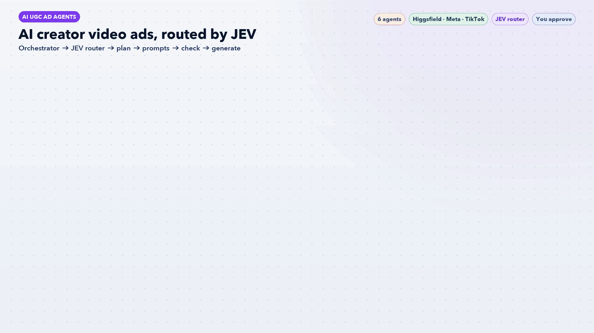

# AI UGC Ad Agents: AI Creator Video Ads on Higgsfield



Four AI agents and one workflow skill. They turn a product brief into AI UGC video ads: creators, hooks, angles, formats and scripts, then paste-ready prompts, a policy check, and finally the image and video on [Higgsfield](https://higgsfield.ai) (Soul 2.0 image → Seedance 2.0 video).

> **AI recommends. You approve.** Nothing is generated until the compliance check passes, and the browser agent stops before every Generate click to show you the credit cost and a screenshot. It never clicks Generate without your OK in chat.

## How it works

| # | Agent | What it does | Writes |
|---|---|---|---|
| 1 | `ugc-director` | Product facts, creators (varied age, look, setting), ad matrix of hook × angle × format, 15-second scripts | `output/<slug>/plan.md` |
| 2 | `prompt-engineer` | One Soul 2.0 character image prompt and one Seedance 2.0 video prompt per ad, using the 15 Higgsfield style skills | `output/<slug>/prompts.md` |
| 3 | `ad-compliance-checker` | Screens for health/result claims, personal-attribute call-outs, fake credentials, look-alikes, under-21 creators and image/video mismatch | `output/<slug>/compliance.md` |
| 4 | `higgsfield-operator` | Drives higgsfield.ai in a Playwright browser, one ad at a time, and pauses for approval before each Generate | screenshots, `SESSION-RESUME.md` |

The `ugc-campaign` workflow skill runs them in order. You approve the plan before prompts are written. Failed compliance items go back to the prompt engineer (max 2 rounds). You can stop after prompts and paste them into Higgsfield yourself.

## Guardrails

- No Generate click without your OK; batch approval only with a credit cap you set
- Nothing generated before compliance says `READY`
- Never types passwords; if Higgsfield isn't logged in, it stops and asks you
- No invented product claims, only what the brief or product page says
- Adult (21+) creators only, no real people or celebrity look-alikes
- Reminds you to label realistic AI people as AI-generated on Meta and TikTok

## Recommended Claude skills

These Claude Code skills pair well with this set. The lead agent uses them when they are installed.

- **For this set:** `ugc-script`, `creator-brief`, `hook-writer`, `tiktok-hook-bank`, `video-ad-brief`, `angle-finder`, `review-mining`
- **For every set:** `weekly-report`, `marketing:performance-report`, `marketing:competitive-brief`, `windsor-ai:windsor-insights`, `schedule`

Skills from `windsor-ai:*`, `marketing:*`, `small-business:*` and `design:*` need those plugins installed, and Windsor.ai or HubSpot skills only return data once those connectors are signed in.

## Install

```bash
git clone https://github.com/anishdagdu/ai-marketing-agents.git
bash ai-marketing-agents/ai-ugc-ad-agents/install.sh /path/to/your/project
```

The installer copies the agents to `.claude/agents/` and the workflow to `.claude/skills/`, then offers to download the 19 Higgsfield skills.

For generating on Higgsfield (optional, you can use prompts only):

```bash
claude mcp add playwright npx @playwright/mcp@latest
```

Then log in to higgsfield.ai in the Playwright browser.

## Run

```
/ugc-campaign vitamin C serum, women 25-40, TikTok, 5 ads
```

## Requirements

- [Claude Code](https://claude.com/claude-code)
- The 19 **Higgsfield skills** by AKCodez: [AKCodez/higgsfield-claude-skills](https://github.com/AKCodez/higgsfield-claude-skills) (not included)
- A Higgsfield account and the Playwright MCP, only for the generation step

## Notes

- The browser steps follow Higgsfield's page layout as documented in the Higgsfield skills. If Higgsfield changes its site, those steps may need updating.
- The compliance check is a policy screen, not legal advice.

## JEV model router
`ugc-jev-router` picks a model for every task before the orchestrator starts it: **Standard · Haiku** for lookups, checks and formatting, **Medium · Sonnet** for plans, writing and analysis, **Deep · Opus** for high-stakes or messy problems. It scores each task 0-2 on money at stake, ambiguity, reasoning depth, blast radius and novelty (0-2 standard, 3-5 medium, 6+ deep), starts low and escalates only on evidence, reuses outputs from the last 7 days, and caps deep work at 3 tasks per run. Every decision is logged to `outputs/jev-routing-log.csv`.

`ugc-orchestrator` leads the team: it finds the biggest problem, routes tasks through JEV, briefs the specialists and returns one ranked action list for your approval.
