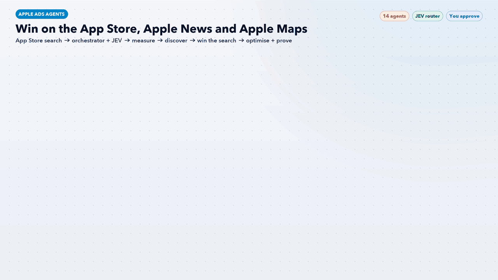

# Apple Ads Agents: An AI Team for Ads on the App Store, Apple News and Apple Maps



Fourteen Claude Code agents and one workflow skill that turn **Apple Ads** into a weekly list of profitable actions, across all three places Apple sells ads: the **App Store** (search results, Search tab, Today tab, product pages), **Apple News** (display and video ads in News and Stocks) and **Apple Maps** (ads for local businesses, US and Canada). Apple Ads reaches people while they search the App Store: about two-thirds of taps on search results ads become downloads, and AppsFlyer's Performance Index 2025 ranks it #1 on iOS. An orchestrator finds the biggest gap, and **JEV**, the model router, picks the cheapest Claude model that can do each task.

> **AI recommends. You approve.** Nothing changes in Apple Ads without your OK in chat. New campaigns start paused, bids and budgets move at most 20% per step, and the agents never delete anything or touch billing.

## How it works

| Stage | Agent | Default tier | What it does |
|---|---|---|---|
| Lead | [`aa-orchestrator`](agents/aa-orchestrator.md) | Standard | Finds the biggest gap, routes work and merges one ranked action list |
| Router | [`aa-jev-router`](agents/aa-jev-router.md) | Fast | JEV model router: fast Haiku, standard Sonnet or deep Opus per task |
| 1 Measure | [`aa-attribution`](agents/aa-attribution.md) | Standard | AdServices, MMP, App Store Connect, AdAttributionKit and SKAdNetwork agree |
|  | [`aa-account-architect`](agents/aa-account-architect.md) | Standard | Basic vs Advanced, campaigns by intent, placement and country |
| 2 Discover | [`aa-keyword-researcher`](agents/aa-keyword-researcher.md) | Standard | Search Popularity, recommendations, themes and match types |
|  | [`aa-search-match-miner`](agents/aa-search-match-miner.md) | Fast | Promotes winning search terms, adds negatives |
| 3 Win the search | [`aa-brand-defender`](agents/aa-brand-defender.md) | Standard | Brand impression share in both ad slots |
|  | [`aa-competitor-conquest`](agents/aa-competitor-conquest.md) | Standard | Rival keywords with "why switch" pages |
|  | [`aa-cpp-creative`](agents/aa-cpp-creative.md) | Standard | Custom product pages and ad variations per theme |
|  | [`aa-placements`](agents/aa-placements.md) | Standard | App Store placements, Apple News and Apple Maps ads |
| 4 Optimise + prove | [`aa-bid-budget`](agents/aa-bid-budget.md) | Standard | Bids, CPA goals, daily budgets and pacing |
|  | [`aa-incrementality-tester`](agents/aa-incrementality-tester.md) | Deep | Brand pause and geo holdout tests |
|  | [`aa-geo-expansion`](agents/aa-geo-expansion.md) | Standard | New countries out of the 91 available |
|  | [`aa-reporter`](agents/aa-reporter.md) | Standard | Weekly readout with JEV's cost summary |

The [`apple-ads-workflow`](workflow/apple-ads-workflow/SKILL.md) skill runs the stages in order. It stops at stage 1 if attribution is broken, and calls any keyword with fewer than 100 taps a hunch, not a finding.

## JEV: the model router

| Score | Tier | Model | Typical tasks |
|---|---|---|---|
| 0-2 | Fast | Haiku | Attribution token check, negatives sweep, impression share pulls, pacing |
| 3-5 | Standard | Sonnet | Keyword research, page briefs, bid changes, weekly readout |
| 6+ | Deep | Opus | Brand cannibalization tests, Apple Ads vs MMP disagreements, restructures |

**Efficiency rules:** start low and escalate on evidence · read Apple's free signals (Search Popularity, impression share, recommendations) first · reuse outputs from the last 7 days · batch small checks · at most 2 deep tasks per weekly run. Decisions are logged to `outputs/jev-routing-log.csv`.

**Works with the rest of this repo:** cross-channel budgets go to [AI Paid Traffic](../ai-paid-traffic-agents/), App Store page behaviour to [Behaviour Analytics Agents](../behavior-analytics-agents/), install checks to [MMP Agents](../mmp-agents/), and organic search to [AI Search Everywhere](../ai-search-everywhere-agents/).

## Where Apple ads run

| Surface | Placements | Goal | Main metric |
|---|---|---|---|
| App Store | Search results (two ad slots), Search tab, Today tab, product pages | Installs | Cost per install, ROAS |
| Apple News | Display and video in News and Stocks | Brand reach | Reach, viewability, lift |
| Apple Maps | Ads in Maps search (US and Canada) | Store visits | Directions, calls, website taps |

Learn more on Apple's own page: [ads.apple.com](https://ads.apple.com/app-store).

## Requirements

- [Claude Code](https://claude.com/claude-code)
- An Apple Ads account, with exports (CSV), Apple Ads Platform API read access or a signed-in dashboard
- Optional: an MMP (AppsFlyer, Adjust, Branch or Singular) for revenue and trials

## Install

```bash
./install.sh
```

Then, in a new Claude Code session, say **"run the Apple Ads workflow"**, or ask one agent directly, for example "use aa-brand-defender on my brand campaign".

## Files

- `agents/`: the 14 agent definitions (each has a default `model:` tier)
- `workflow/apple-ads-workflow/SKILL.md`: the orchestrator skill
- `apple-ads-workflow.gif`: workflow infographic
- `docs/make_gif.py`: regenerates the GIF (needs Pillow and `tools/gifkit.py`)
