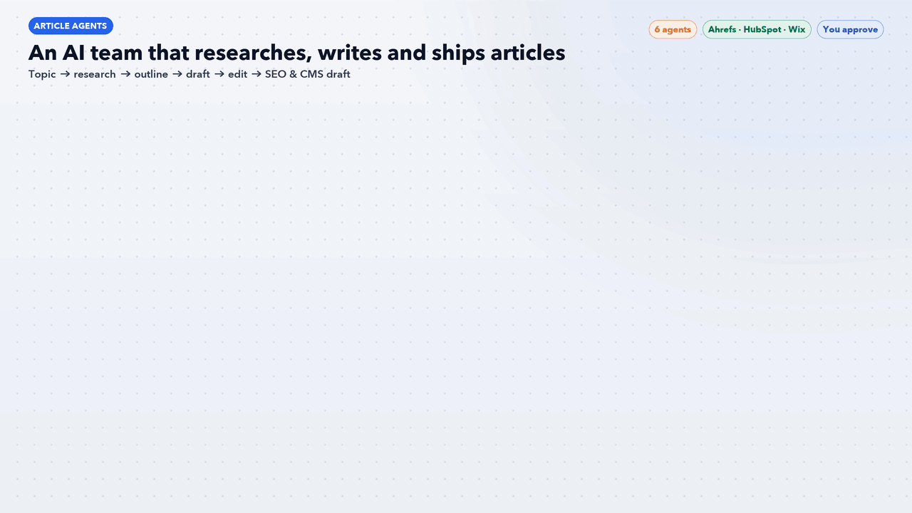

# Article Agents: AI Workflow for Researched, SEO-Ready Articles



Six Claude Code agents and one workflow skill. They take an article from "what should we write?" to a fact-checked, SEO-optimised draft in your CMS: brief, research, outline, draft, edit, publish.

> **AI drafts. You approve.** You sign off on the topic and the outline. Nothing goes to your CMS without a yes in chat, and it always lands as a **draft**. The agents never publish live.

## How it works

| # | Agent | What it does | Output |
|---|---|---|---|
| 1 | [`ar-topic-strategist`](agents/ar-topic-strategist.md) | Keyword, search intent, SERP gap and the content brief | `01-brief.md` |
| 2 | [`ar-researcher`](agents/ar-researcher.md) | Facts, stats, examples and quotes, each with a source | `02-research.md` |
| 3 | [`ar-outline-architect`](agents/ar-outline-architect.md) | H1/H2/H3 plan, points and sources per section, word budget. **You approve it** | `03-outline.md` |
| 4 | [`ar-writer`](agents/ar-writer.md) | Full draft in your brand voice with inline citations | `04-draft.md` |
| 5 | [`ar-editor`](agents/ar-editor.md) | Fact-check and 100-point score. Under 80 goes back to the writer (max 2 loops) | `05-edit-report.md`, `05-final.md` |
| 6 | [`ar-seo-publisher`](agents/ar-seo-publisher.md) | Meta, schema, internal links, AI-answer readiness, then a CMS draft after approval | `06-seo.md`, `article.html`, `article.md` |

The [`article-creation-workflow`](workflow/article-creation-workflow/SKILL.md) skill runs them in order. Everything is saved in `outputs/articles/<slug>/`, so you can re-run any step on its own.

**Guardrails in every agent**
- No invented facts, sources or quotes: gaps are marked `[NEEDS SOURCE]`
- Editor quality gate: a confirmed factual error caps the score at 69
- CMS writes are drafts only, and only after you say yes

## Requirements

- [Claude Code](https://claude.com/claude-code)
- Web search/fetch (built in)
- Optional: **Ahrefs** or **Semrush** connector for real keyword data (otherwise volumes are estimates)
- Optional: **HubSpot** or **Wix** connector to save the CMS draft
- Optional: a `brand-voice.md` in your project

## Install

```bash
./install.sh
```

Then, in a new Claude Code session, say **"run the article workflow on <topic>"**. Or ask for one step, like "write a brief for <keyword>" or "fact-check this draft".

## Files

- `agents/`: the 6 agent definitions
- `workflow/article-creation-workflow/SKILL.md`: the orchestrator skill
- `article-agents-workflow.gif`: workflow infographic
- `docs/make_gif.py`: regenerates the GIF with the shared `tools/gifkit.py` (needs Pillow): `python3 article-agents/docs/make_gif.py` from the repo root
- `.claude/skills/run-article-agents/`: smoke test that validates and test-installs the pack
