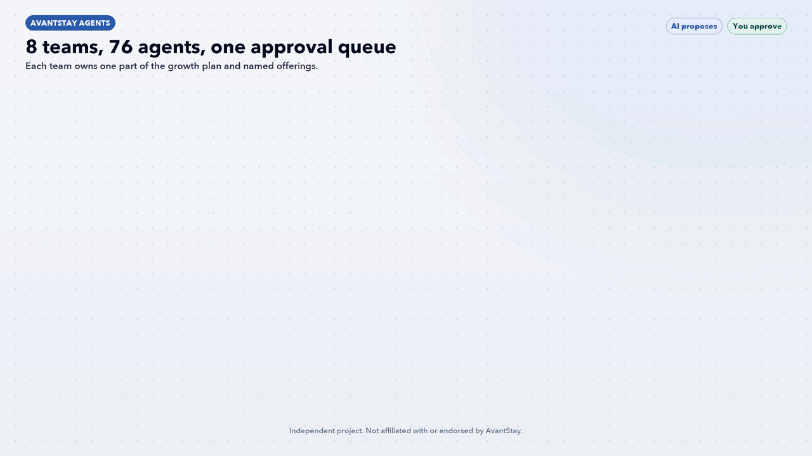
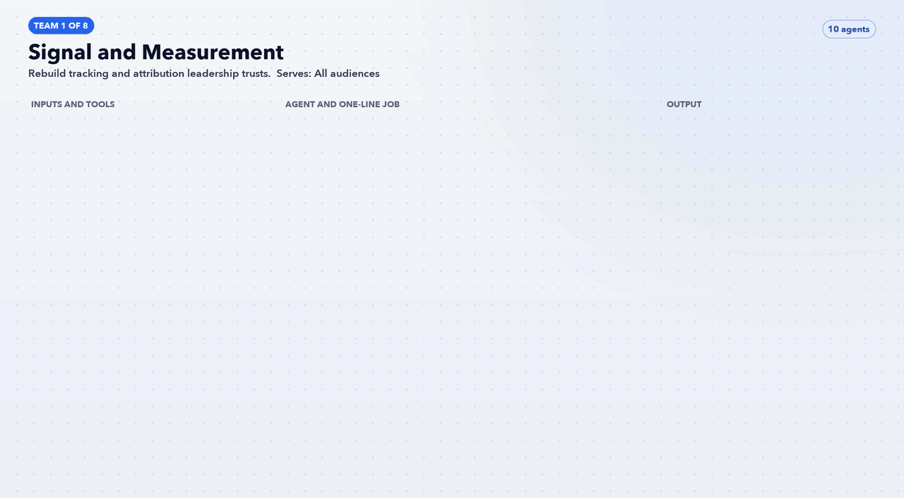
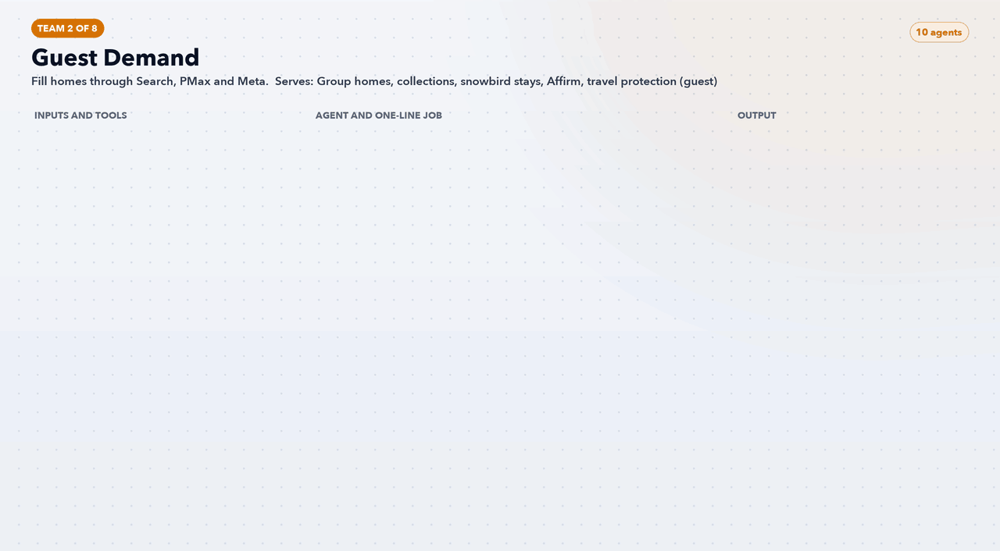
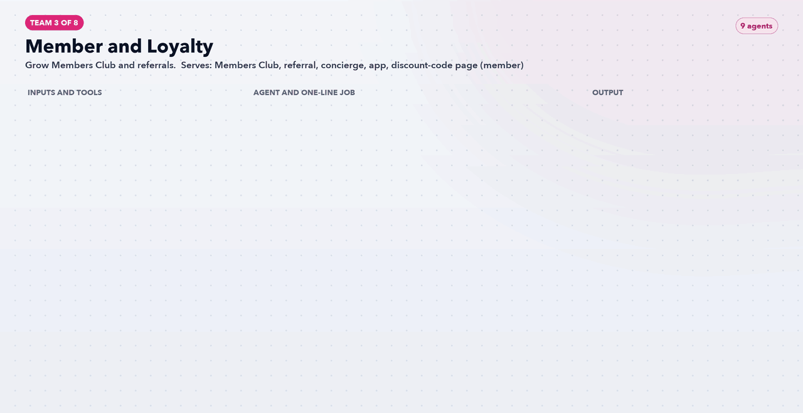
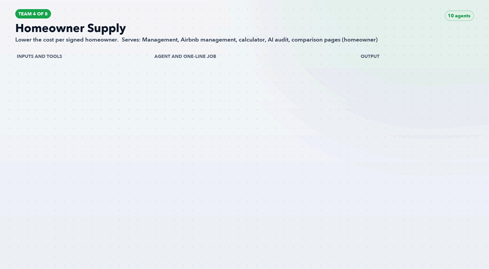
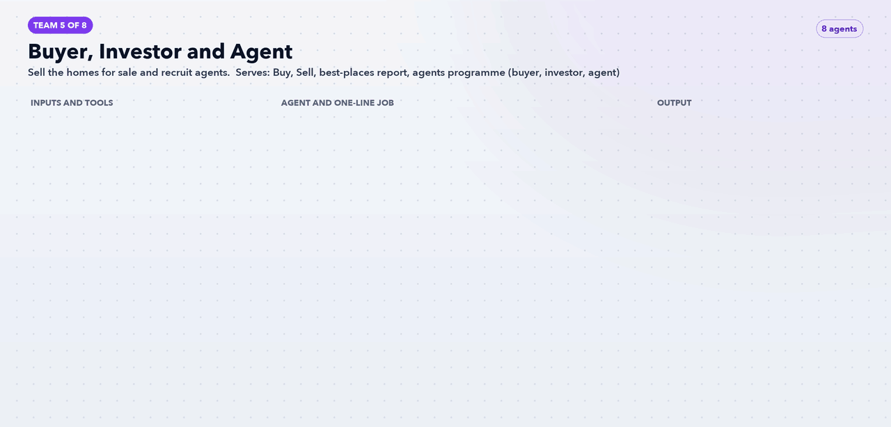
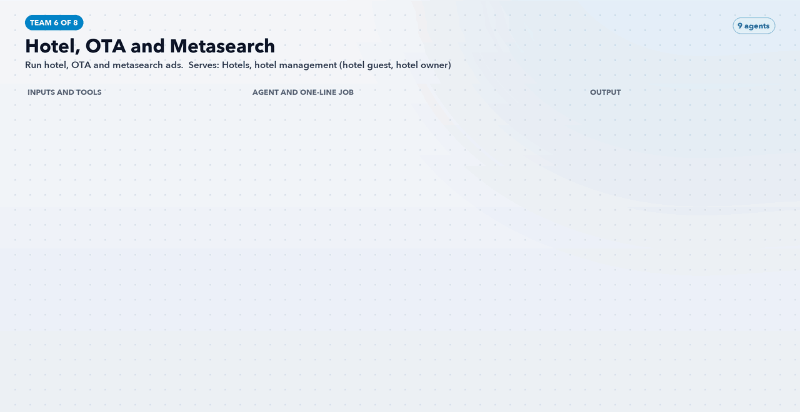
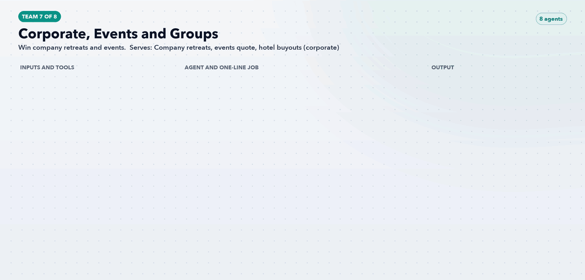
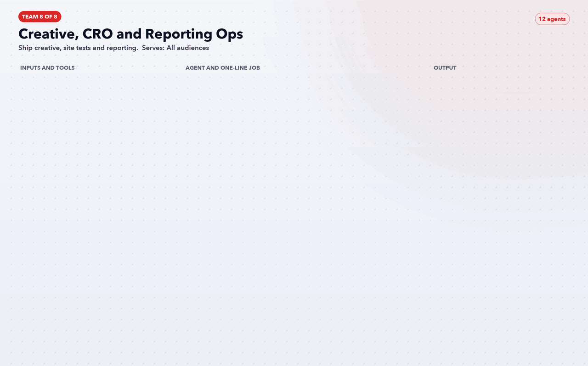

# AvantStay Agents: A Performance Marketing Team of 76 AI Agents



Eight teams and 76 Claude Code agents, designed around AvantStay's Head of Performance Marketing role. Each team answers one block of the job posting and owns named offerings on avantstay.com: group homes, Members Club, homeowner management, homes for sale, hotels and company retreats.

> **Independent project.** This pack is a candidate's own design. It is not affiliated with, endorsed by or built for AvantStay, and it has not been run on AvantStay's accounts. Offering terms were read from public pages on 12 November 2026 and may have changed. Hooks and offers are test ideas with no performance data behind them.

> **AI proposes. You approve.** No agent changes a budget, publishes a claim, uploads personal data or sends a message. Each one writes a proposal for a human to approve.

## The eight teams

| # | Team | Agents | Goal | Offerings and audience |
|---|---|---|---|---|
| 1 | [Signal and Measurement](teams/01-signal-and-measurement/) | 10 | Rebuild tracking and attribution leadership trusts | All audiences |
| 2 | [Guest Demand](teams/02-guest-demand/) | 10 | Fill homes through Search, PMax and Meta | Group homes, collections, snowbird stays, Affirm, travel protection (guest) |
| 3 | [Member and Loyalty](teams/03-member-and-loyalty/) | 9 | Grow Members Club and referrals | Members Club, referral, concierge, app, discount-code page (member) |
| 4 | [Homeowner Supply](teams/04-homeowner-supply/) | 10 | Lower the cost per signed homeowner | Management, Airbnb management, calculator, AI audit, comparison pages (homeowner) |
| 5 | [Buyer, Investor and Agent](teams/05-buyer-investor-and-agent/) | 8 | Sell the homes for sale and recruit agents | Buy, Sell, best-places report, agents programme (buyer, investor, agent) |
| 6 | [Hotel, OTA and Metasearch](teams/06-hotel-ota-and-metasearch/) | 9 | Run hotel, OTA and metasearch ads | Hotels, hotel management (hotel guest, hotel owner) |
| 7 | [Corporate, Events and Groups](teams/07-corporate-events-and-groups/) | 8 | Win company retreats and events | Company retreats, events quote, hotel buyouts (corporate) |
| 8 | [Creative, CRO and Reporting Ops](teams/08-creative-cro-and-reporting-ops/) | 12 | Ship creative, site tests and reporting | All audiences |

## How it works

1. **Data in.** Agents read Segment, GA4, BigQuery, Salesforce, the ad platforms and the public site.
2. **Team 1 goes first.** Signal and Measurement fixes tracking and sets one ledger of approved prices, terms and proof numbers. Every other agent must cite that ledger.
3. **Teams 2 to 7 work their audience.** Guests, members, homeowners, buyers, hotel guests and corporate planners each have a team.
4. **Team 8 ships and reports.** Creative, site tests, budget pacing and the weekly readout.
5. **One approval queue.** Every output lands as a proposal. A human approves it before anything changes.

The [`avantstay-growth-workflow`](workflow/avantstay-growth-workflow/SKILL.md) skill runs the teams in that order.

## Team workflows

### Team 1: Signal and Measurement



[Agents, inputs and outputs →](teams/01-signal-and-measurement/)

### Team 2: Guest Demand



[Agents, inputs and outputs →](teams/02-guest-demand/)

### Team 3: Member and Loyalty



[Agents, inputs and outputs →](teams/03-member-and-loyalty/)

### Team 4: Homeowner Supply



[Agents, inputs and outputs →](teams/04-homeowner-supply/)

### Team 5: Buyer, Investor and Agent



[Agents, inputs and outputs →](teams/05-buyer-investor-and-agent/)

### Team 6: Hotel, OTA and Metasearch



[Agents, inputs and outputs →](teams/06-hotel-ota-and-metasearch/)

### Team 7: Corporate, Events and Groups



[Agents, inputs and outputs →](teams/07-corporate-events-and-groups/)

### Team 8: Creative, CRO and Reporting Ops



[Agents, inputs and outputs →](teams/08-creative-cro-and-reporting-ops/)

## Install

```bash
git clone https://github.com/anishdagdu/ai-marketing-agents.git
```

```bash
bash ai-marketing-agents/avantstay-agents/install.sh
```

Then start a new Claude Code session and say "run the AvantStay workflow", or call any agent by name, for example `av-signal-tag-and-consent-auditor`.

## Rebuild

`docs/teams.json` holds every team and agent. Edit it, then run:

```bash
python3 avantstay-agents/docs/build.py
```

That rewrites the agent files, the team pages and all nine GIFs.
