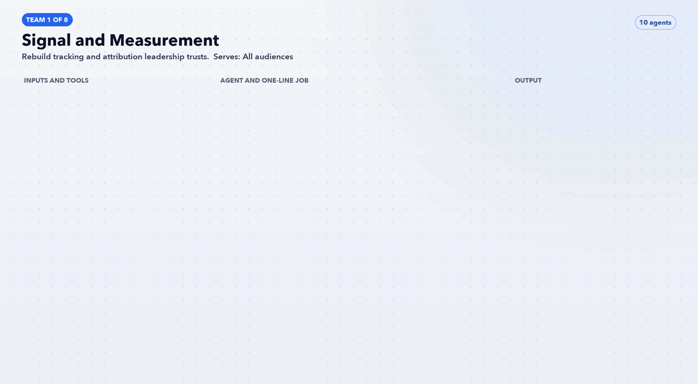

# Team 1: Signal and Measurement

**Goal:** Rebuild tracking and attribution leadership trusts.

**Part of the role it answers:** Rebuild GTM (web and server-side), Segment, GA4, Meta CAPI, enhanced conversions; Salesforce offline conversions; attribution leadership trusts; holdout, lift and geo tests

**Offerings and audience:** All audiences

## Agents (10)

| Agent | One-line job | Inputs / tools | Output |
|---|---|---|---|
| [`av-signal-terms-and-claims-ledger`](../../agents/av-signal-terms-and-claims-ledger.md) | Holds one approved value for every price, term and proof number | Site pages, T&Cs, legal sign-off | Versioned ledger other agents must cite |
| [`av-signal-tag-and-consent-auditor`](../../agents/av-signal-tag-and-consent-auditor.md) | Lists every tag firing and whether it fires before consent | Page source, network log, Transcend config | Tag inventory and defect list |
| [`av-signal-event-spec-writer`](../../agents/av-signal-event-spec-writer.md) | Defines one event schema for guest and owner funnels | Segment tracking plan, GA4 | Event spec with owners and tests |
| [`av-signal-sgtm-and-capi-planner`](../../agents/av-signal-sgtm-and-capi-planner.md) | Designs server-side routing with deduplication keys | Event spec, sGTM, Meta CAPI docs | Container plan and dedup test results |
| [`av-signal-enhanced-conversions-validator`](../../agents/av-signal-enhanced-conversions-validator.md) | Checks hashed first-party match quality on Google and Microsoft | Google Ads API, GA4 | Match-rate report and fixes |
| [`av-signal-salesforce-stage-mapper`](../../agents/av-signal-salesforce-stage-mapper.md) | Maps owner stages to offline conversions with click IDs and values | SF objects, BQ | Upload spec and daily upload file |
| [`av-signal-attribution-policy-writer`](../../agents/av-signal-attribution-policy-writer.md) | Writes the one-page rule for which number is reported where | BQ, finance input | Policy memo for leadership sign-off |
| [`av-signal-geo-holdout-designer`](../../agents/av-signal-geo-holdout-designer.md) | Picks matched markets and sample size for incrementality tests | BQ bookings by market | Test design and power estimate |
| [`av-signal-lift-readout-agent`](../../agents/av-signal-lift-readout-agent.md) | Reads test results and states what was incremental | Platform lift studies, BQ | Readout with confidence range |
| [`av-signal-discrepancy-monitor`](../../agents/av-signal-discrepancy-monitor.md) | Compares platform, BQ and SF counts daily | Ads APIs, BQ, SF | Three-way reconciliation and alerts |

[Back to all teams](../../README.md)
