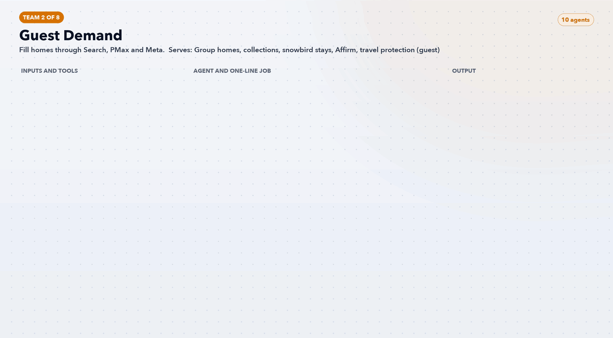

# Team 2: Guest Demand

**Goal:** Fill homes through Search, PMax and Meta.

**Part of the role it answers:** Google Search, PMax, Demand Gen, Microsoft, Meta; test new channels

**Offerings and audience:** Group homes, collections, snowbird stays, Affirm, travel protection (guest)

## Agents (10)

| Agent | One-line job | Inputs / tools | Output |
|---|---|---|---|
| [`av-guest-market-and-occasion-keyword-agent`](../../agents/av-guest-market-and-occasion-keyword-agent.md) | Builds keyword sets by market × occasion × group size | Search terms report, event guides | Keyword and negative lists |
| [`av-guest-search-builder`](../../agents/av-guest-search-builder.md) | Drafts ad groups and responsive ads with price and dates | Ledger, listing feed, Google Ads API | Campaign draft for approval |
| [`av-guest-per-guest-price-agent`](../../agents/av-guest-per-guest-price-agent.md) | Computes the page's per-guest nightly price for each home and date | Listing pages or pricing feed | Price feed with date stamp and footnote |
| [`av-guest-pmax-and-feed-agent`](../../agents/av-guest-pmax-and-feed-agent.md) | Maintains asset groups and the home catalogue feed | Listing feed, image library | Feed file and asset groups |
| [`av-guest-demand-gen-and-youtube-agent`](../../agents/av-guest-demand-gen-and-youtube-agent.md) | Plans short video placements by persona | Creative library, audience lists | Line-item plan |
| [`av-guest-meta-catalogue-agent`](../../agents/av-guest-meta-catalogue-agent.md) | Runs catalogue travel ads with per-home labels | Meta Marketing API, feed | Ad set and catalogue proposals |
| [`av-guest-microsoft-mirror-agent`](../../agents/av-guest-microsoft-mirror-agent.md) | Ports winning Google structures to Microsoft Ads | Google Ads export | Import file with adjustments |
| [`av-guest-abandoned-search-retargeter`](../../agents/av-guest-abandoned-search-retargeter.md) | Builds audiences from searches and checkouts not completed | Segment audiences | Audience definitions and sequences |
| [`av-guest-snowbird-and-long-stay-agent`](../../agents/av-guest-snowbird-and-long-stay-agent.md) | Markets 30+ night stays in low season | Snowbird pages, occupancy gaps | Seasonal campaign draft |
| [`av-guest-waste-and-negatives-agent`](../../agents/av-guest-waste-and-negatives-agent.md) | Finds spend with no qualified outcome | Search terms, BQ | Weekly cut list |

## Hooks and offers to test

Every row is a test idea, not a proven winner.

| Hook or offer | Modelled on | AvantStay number or term used |
|---|---|---|
| "19 of you. One house. $126.43 each a night." | Airbnb's one-home-beats-several-hotel-rooms idea (ShortTermRentalz) | Per-guest price printed on the property page [D], with dates and "before taxes" |
| "No wild cards": inspected, stocked, local team 24/7 | Vrbo's VrboCare guarantee as the offer (Expedia newsroom) | Line already in AvantStay's Google ad [D] (Transparency Center) |
| "Split it. Pay later with Affirm." on high-total homes | Airbnb pay-later adoption [3P]; Vrbo's reported Affirm filter (Rental Scale-Up) | Affirm line on homepage [D]; terms unpublished, so legal must supply them |
| Catalogue ads with per-home labels (sleeps, pool, per-guest price) | Accor on TikTok [3P] | Home feed plus Per-Guest Price Agent |

[Back to all teams](../../README.md)
