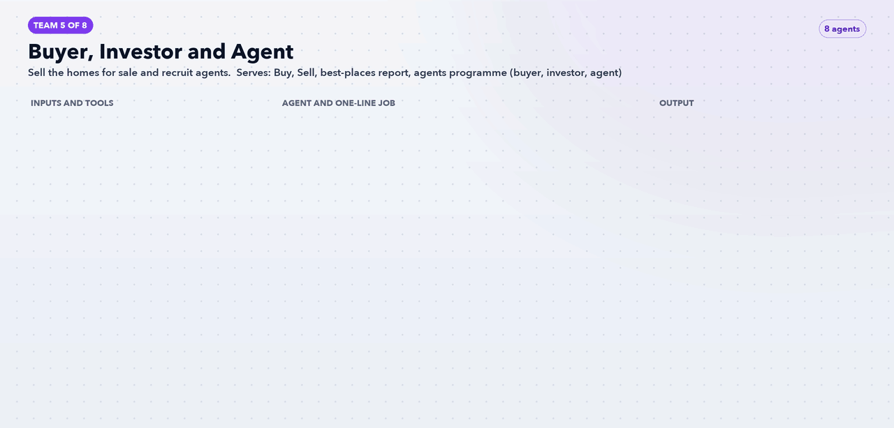

# Team 5: Buyer, Investor and Agent

**Goal:** Sell the homes for sale and recruit agents.

**Part of the role it answers:** Two-sided marketplace; LinkedIn; owner KPIs

**Offerings and audience:** Buy, Sell, best-places report, agents programme (buyer, investor, agent)

## Agents (8)

| Agent | One-line job | Inputs / tools | Output |
|---|---|---|---|
| [`av-buyer-listing-feed-agent`](../../agents/av-buyer-listing-feed-agent.md) | Turns the homes-for-sale list into an ad feed with price and estimated revenue | /buy listings | Feed with disclaimer text attached |
| [`av-buyer-yield-explainer-agent`](../../agents/av-buyer-yield-explainer-agent.md) | Writes plain-language revenue pages per market | Best-places data, ledger | Market pages and lead magnet |
| [`av-buyer-buyer-search-and-social-agent`](../../agents/av-buyer-buyer-search-and-social-agent.md) | Runs housing-category campaigns within platform rules | Google Ads, Meta APIs | Compliant campaign drafts |
| [`av-buyer-investor-outreach-agent`](../../agents/av-buyer-investor-outreach-agent.md) | Builds LinkedIn campaigns for family offices, funds and developers | LinkedIn API, SF | Account list and ads |
| [`av-buyer-seller-lead-agent`](../../agents/av-buyer-seller-lead-agent.md) | Markets the "sell with bookings in place" promise | Seller page, SF | Ads and form tests |
| [`av-buyer-agent-recruiter`](../../agents/av-buyer-agent-recruiter.md) | Recruits licensed agents into the referral network | State licence lists, LinkedIn | Agent outreach and sign-up tests |
| [`av-buyer-agent-enablement-agent`](../../agents/av-buyer-agent-enablement-agent.md) | Gives network agents a co-branded revenue estimate to share | Underwriting output | One-page estimate template |
| [`av-buyer-report-refresher`](../../agents/av-buyer-report-refresher.md) | Keeps dated reports and teasers current | Site crawl | Stale-content list ("2024", "2025") |

[Back to all teams](../../README.md)
