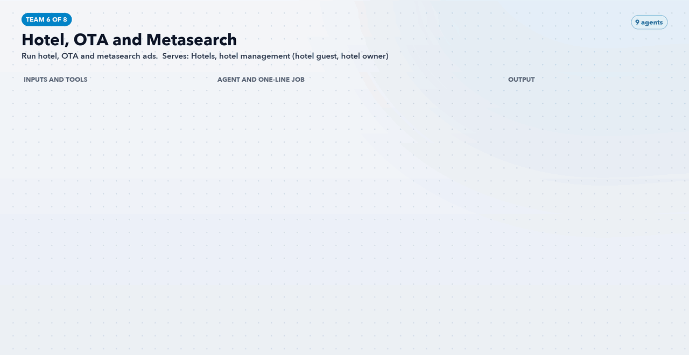

# Team 6: Hotel, OTA and Metasearch

**Goal:** Run hotel, OTA and metasearch ads.

**Part of the role it answers:** Google Hotel Ads, metasearch, Expedia TravelAds, Booking.com Sponsored Ads

**Offerings and audience:** Hotels, hotel management (hotel guest, hotel owner)

## Agents (9)

| Agent | One-line job | Inputs / tools | Output |
|---|---|---|---|
| [`av-hotel-hotel-feed-and-price-accuracy-agent`](../../agents/av-hotel-hotel-feed-and-price-accuracy-agent.md) | Checks hotel rates and availability match across feeds | Hotel Center, PMS rates | Mismatch list |
| [`av-hotel-free-booking-links-agent`](../../agents/av-hotel-free-booking-links-agent.md) | Confirms eligibility and coverage before any paid bid | Hotel Center | Coverage report |
| [`av-hotel-metasearch-bid-agent`](../../agents/av-hotel-metasearch-bid-agent.md) | Proposes bids by hotel, date and device | Hotel Ads API, BQ | Bid change proposals |
| [`av-hotel-travelads-agent`](../../agents/av-hotel-travelads-agent.md) | Rotates Expedia creative by booking window | Expedia TravelAds | Creative sets and reports |
| [`av-hotel-booking-sponsored-ads-agent`](../../agents/av-hotel-booking-sponsored-ads-agent.md) | Tests sponsored placement on Booking.com | Booking.com extranet | Test plan and readout |
| [`av-hotel-ota-vs-direct-margin-agent`](../../agents/av-hotel-ota-vs-direct-margin-agent.md) | Compares net margin per booking by channel | BQ, commission terms | Margin table and bid ceilings |
| [`av-hotel-hotel-launch-agent`](../../agents/av-hotel-hotel-launch-agent.md) | Builds the first 90 days of marketing for a new hotel | Hotel fact sheet | Launch plan |
| [`av-hotel-group-buyout-agent`](../../agents/av-hotel-group-buyout-agent.md) | Markets whole-hotel buyouts to planners | Hotels page, SF | Buyout campaign drafts |
| [`av-hotel-hotel-owner-lead-agent`](../../agents/av-hotel-hotel-owner-lead-agent.md) | Finds and messages boutique hotel owners and developers | LinkedIn, SF | Account list and ads |

[Back to all teams](../../README.md)
