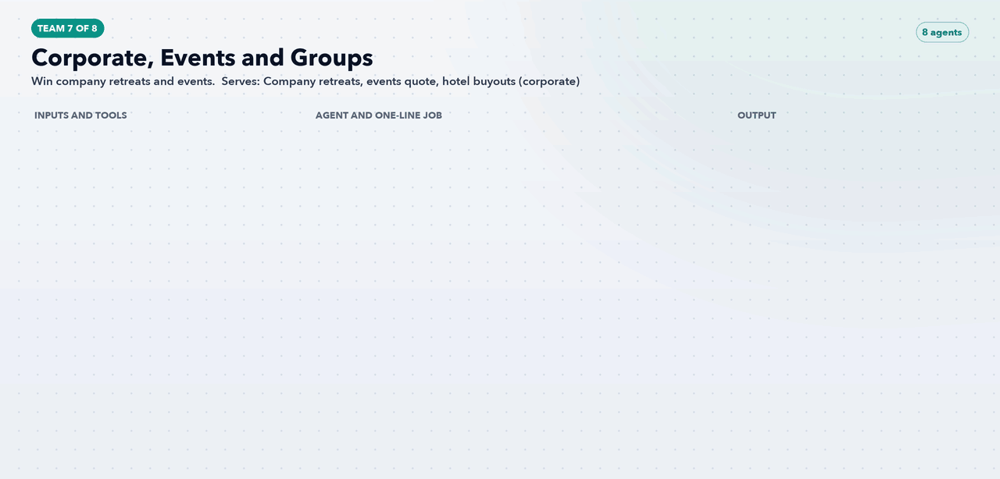

# Team 7: Corporate, Events and Groups

**Goal:** Win company retreats and events.

**Part of the role it answers:** LinkedIn; landing page tests; new channels

**Offerings and audience:** Company retreats, events quote, hotel buyouts (corporate)

## Agents (8)

| Agent | One-line job | Inputs / tools | Output |
|---|---|---|---|
| [`av-corp-retreat-account-finder`](../../agents/av-corp-retreat-account-finder.md) | Lists companies likely to run offsites by size and location | LinkedIn, firmographic data | Target account list |
| [`av-corp-retreat-campaign-agent`](../../agents/av-corp-retreat-campaign-agent.md) | Runs LinkedIn and search for offsite planners | Ledger, retreats page | Campaign drafts |
| [`av-corp-retreat-quote-agent`](../../agents/av-corp-retreat-quote-agent.md) | Drafts a priced proposal within one business day | SF, availability | Proposal draft for the sales manager |
| [`av-corp-rebook-agent`](../../agents/av-corp-rebook-agent.md) | Asks past retreat clients to rebook | SF history | Rebook sequence |
| [`av-corp-occasion-page-agent`](../../agents/av-corp-occasion-page-agent.md) | Builds pages for weddings, reunions and bachelorettes | Events form, home feed | Page drafts with proof and price cues |
| [`av-corp-occasion-search-agent`](../../agents/av-corp-occasion-search-agent.md) | Pairs each occasion page with search ad groups | Keyword data | Ad group drafts |
| [`av-corp-event-calendar-agent`](../../agents/av-corp-event-calendar-agent.md) | Ties campaigns to dated events in each market | 108 event guides | Dated campaign calendar |
| [`av-corp-quote-form-tester`](../../agents/av-corp-quote-form-tester.md) | Tests a shorter first step on the quote form | Statsig, form events | Test design and readout |

[Back to all teams](../../README.md)
