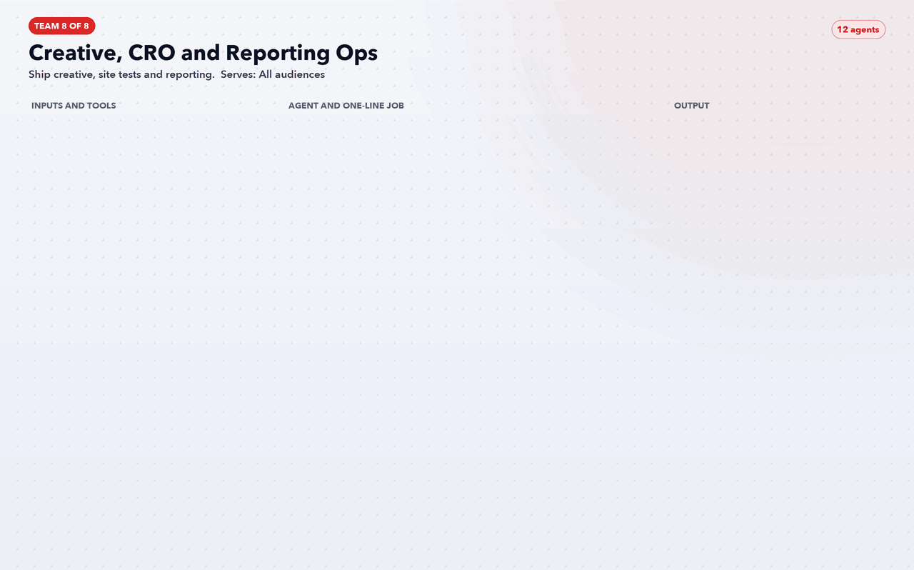

# Team 8: Creative, CRO and Reporting Ops

**Goal:** Ship creative, site tests and reporting.

**Part of the role it answers:** Copy, creative, landing pages, booking-flow tests; BigQuery reporting; budget allocation, forecasting, pacing and alerts; OOH and direct mail measured "as rigorously as digital"

**Offerings and audience:** All audiences

## Agents (12)

| Agent | One-line job | Inputs / tools | Output |
|---|---|---|---|
| [`av-ops-hook-and-angle-agent`](../../agents/av-ops-hook-and-angle-agent.md) | Writes hooks per audience, each tagged as a hypothesis with a KPI | Ledger, reviews | Hook bank |
| [`av-ops-video-and-gif-brief-agent`](../../agents/av-ops-video-and-gif-brief-agent.md) | Turns a home's page into a shot-by-shot brief | Property page, photo captions | Creative brief and script |
| [`av-ops-claims-guard`](../../agents/av-ops-claims-guard.md) | Blocks any creative whose number or term is not in the ledger | Ledger, draft ads | Pass or fail with the line at fault |
| [`av-ops-fatigue-agent`](../../agents/av-ops-fatigue-agent.md) | Flags creatives whose results are decaying | Ads APIs | Refresh list |
| [`av-ops-landing-page-agent`](../../agents/av-ops-landing-page-agent.md) | Drafts page variants matched to each ad group | Ad copy, page templates | Page drafts |
| [`av-ops-booking-flow-test-designer`](../../agents/av-ops-booking-flow-test-designer.md) | Prioritises checkout tests with Product | Funnel events, Statsig | Ranked backlog |
| [`av-ops-bigquery-model-builder`](../../agents/av-ops-bigquery-model-builder.md) | Writes and tests the SQL models behind every report | BQ, GA4 export, SF | Tested models |
| [`av-ops-pacing-and-anomaly-agent`](../../agents/av-ops-pacing-and-anomaly-agent.md) | Watches spend and conversion against plan | Ads APIs, BQ | Daily alert |
| [`av-ops-budget-and-forecast-agent`](../../agents/av-ops-budget-and-forecast-agent.md) | Proposes the monthly split and a forecast range | BQ, test readouts | Allocation memo |
| [`av-ops-ooh-and-mail-measurement-agent`](../../agents/av-ops-ooh-and-mail-measurement-agent.md) | Designs matched-market reads for offline media | Geo data, SF | Test design and readout |
| [`av-ops-leadership-readout-agent`](../../agents/av-ops-leadership-readout-agent.md) | Writes the weekly one-page summary | BQ, approval log | Weekly memo |
| [`av-ops-change-log-keeper`](../../agents/av-ops-change-log-keeper.md) | Records every approved change and who approved it | Approval queue | Audit trail |

[Back to all teams](../../README.md)
