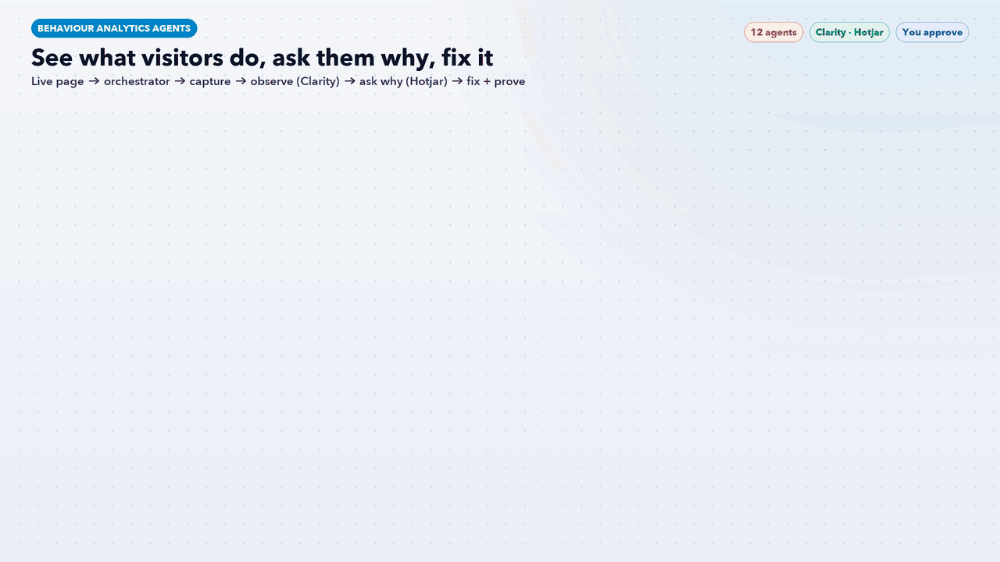

# Behaviour Analytics Agents: An AI Team for Microsoft Clarity and Hotjar



Twelve Claude Code agents and one workflow skill that turn **Microsoft Clarity** and **Hotjar** into a weekly list of fixes. Clarity shows *what* visitors do (heatmaps, recordings, rage clicks, errors, Copilot summaries). Hotjar asks them *why* (surveys, feedback, interviews, funnels). An orchestrator finds the biggest friction point, and **JEV**, the model router, picks the cheapest Claude model that can do each task.

> **AI recommends. You approve.** Nothing changes in Clarity or Hotjar without your OK in chat. Surveys, feedback widgets, interview invites, Slack posts and Jira tickets are saved as drafts. The agents never turn masking off, never edit your site and never delete recordings or responses.

## How it works

| Stage | Agent | Default tier | What it does |
|---|---|---|---|
| Lead | [`ba-orchestrator`](agents/ba-orchestrator.md) | Standard | Finds the biggest friction point, routes work and merges one ranked fix list |
| Router | [`ba-jev-router`](agents/ba-jev-router.md) | Fast | JEV model router: fast Haiku, standard Sonnet or deep Opus per task |
| 1 Capture | [`ba-install-privacy`](agents/ba-install-privacy.md) | Fast | Install, consent, masking, GA4 and Microsoft Ads integrations |
| 2 Observe | [`ba-heatmap-analyst`](agents/ba-heatmap-analyst.md) | Standard | Click, scroll and area heatmaps by device |
|  | [`ba-session-replay`](agents/ba-session-replay.md) | Standard | Recordings by segment, Clarity Copilot summaries first |
|  | [`ba-frustration-signals`](agents/ba-frustration-signals.md) | Fast | Rage clicks, dead clicks, excessive scrolling, quick backs |
|  | [`ba-error-tracker`](agents/ba-error-tracker.md) | Fast | JavaScript errors, sessions affected, revenue at risk |
| 3 Ask why | [`ba-survey-designer`](agents/ba-survey-designer.md) | Standard | Hotjar exit, post-purchase and NPS surveys, answer themes |
|  | [`ba-feedback-widget`](agents/ba-feedback-widget.md) | Fast | Page ratings and element-level comments |
|  | [`ba-interview-recruiter`](agents/ba-interview-recruiter.md) | Standard | Hotjar Engage screener, discussion guide, synthesis |
| 4 Fix + prove | [`ba-funnel-analyst`](agents/ba-funnel-analyst.md) | Standard | Funnels and trends joined with GA4 and Microsoft Ads |
|  | [`ba-cro-reporter`](agents/ba-cro-reporter.md) | Standard | ICE-ranked fixes, test hypotheses, weekly readout, draft tickets |

The [`behavior-insights-workflow`](workflow/behavior-insights-workflow/SKILL.md) skill runs the stages in order. It stops at stage 1 if tracking or masking is broken, and calls any pattern seen in fewer than 100 sessions a hunch, not a finding.

## JEV: the model router

| Score | Tier | Model | Typical tasks |
|---|---|---|---|
| 0-2 | Fast | Haiku | Install and masking checks, frustration counts, error lists, widget read-outs |
| 3-5 | Standard | Sonnet | Heatmap reads, replay themes, survey and interview design, weekly readout |
| 6+ | Deep | Opus | Root cause of a conversion drop, tools that disagree, fix prioritisation on checkout |

**Efficiency rules:** start low and escalate on evidence · use free Clarity Copilot summaries before paid model time · reuse outputs from the last 7 days · batch small checks · at most 2 deep tasks per weekly run. Decisions are logged to `outputs/jev-routing-log.csv`.

**Works with the rest of this repo:** `ba-install-privacy` hands tag checks to the [GTM Health Agent](../gtm-health-agent/), `ba-funnel-analyst` hands ad problems to [AI Paid Traffic](../ai-paid-traffic-agents/), and store fixes go to [Shopify Agents](../shopify-agents/).

## Recommended Claude skills

These Claude Code skills pair well with this set. The lead agent uses them when they are installed.

- **For this set:** `checkout-friction-finder-ecommerce`, `landing-page-audit`, `funnel-map`, `onsite-search-merchandising-review-ecommerce`, `design:user-research`, `design:research-synthesis`
- **For every set:** `weekly-report`, `marketing:performance-report`, `marketing:competitive-brief`, `windsor-ai:windsor-insights`, `schedule`

Skills from `windsor-ai:*`, `marketing:*`, `small-business:*` and `design:*` need those plugins installed, and Windsor.ai or HubSpot skills only return data once those connectors are signed in.

## Requirements

- [Claude Code](https://claude.com/claude-code)
- Microsoft Clarity (free) and/or Hotjar, with exports (CSV), API read access or a signed-in dashboard
- Optional: GA4 and Microsoft Ads through Windsor.ai

## Install

```bash
./install.sh
```

Then, in a new Claude Code session, say **"run the behaviour workflow"**, or ask one agent directly, for example "use ba-frustration-signals on the checkout page".

## Files

- `agents/`: the 12 agent definitions (each has a default `model:` tier)
- `workflow/behavior-insights-workflow/SKILL.md`: the orchestrator skill
- `behavior-analytics-workflow.gif`: workflow infographic
- `docs/make_gif.py`: regenerates the GIF (needs Pillow and `tools/gifkit.py`)
