# Carry1st Agents: One Growth Engine of 139 AI Agents

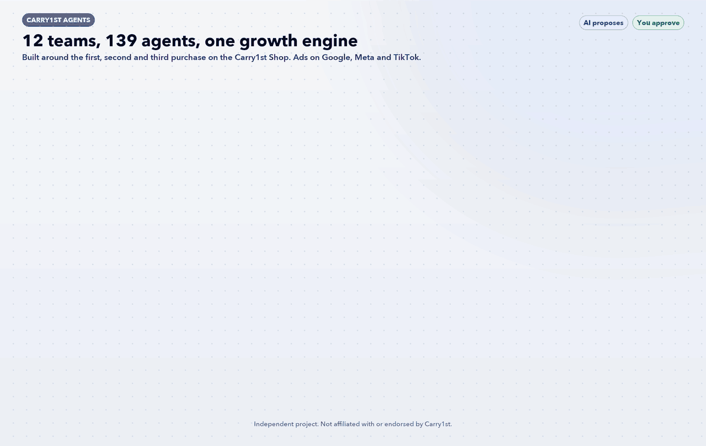

Twelve teams and 139 Claude Code agents, built as one growth engine for Carry1st: the Carry1st Shop (game top-ups and vouchers), Pay1st payments, Flow1st distribution and Publishing. Paid media is Google, Meta and TikTok only. The engine is organised around one event: a player's first, second and third purchase on the Shop.

> **Independent project.** This pack is a candidate's own design. It is not affiliated with, endorsed by or built for Carry1st, and it has not been run on Carry1st's accounts. Company facts were read from public pages on 14 November 2026 and may have changed. Workflows and KPIs are a recommended design with no performance data behind them.

> **AI proposes. You approve.** No agent changes a budget, price or offer, sends a message, uploads personal data or publishes anything. Each one writes a proposal for a human to approve.

## The twelve teams

| # | Team | Agents | Goal | Works with |
|---|---|---|---|---|
| 1 | [Growth Command](teams/01-growth-command/) | 11 | Orchestrate the engine, allocate budget and govern every change | All teams |
| 2 | [Measurement and Data Truth](teams/02-measurement-and-data-truth/) | 12 | Build one shared view of spend, purchases and customer value | Feeds every team |
| 3 | [Market and Player Intelligence](teams/03-market-and-player-intelligence/) | 11 | Watch demand, competitors, payment rails and rules | Creative, Shop, Discovery, B2B |
| 4 | [Creative Studio](teams/04-creative-studio/) | 12 | Ship distinct, localised, on-policy creative every week | Google, Meta, TikTok, Lifecycle, Discovery |
| 5 | [Google Ads](teams/05-google-ads/) | 12 | Run Search, Performance Max, Demand Gen and App campaigns through one writer | Command, Measurement, Creative, Discovery |
| 6 | [Meta Ads](teams/06-meta-ads/) | 12 | Feed Advantage+ and click-to-WhatsApp campaigns with clean signal | Command, Measurement, Creative, Shop |
| 7 | [TikTok Ads](teams/07-tiktok-ads/) | 11 | Run Smart+ and Spark Ads in the five eligible African markets | Command, Creative, Creators |
| 8 | [Lifecycle and CRM](teams/08-lifecycle-and-crm/) | 12 | Move buyers from their first purchase to their third | Shop, Measurement, Creative |
| 9 | [Shop Conversion and Payments](teams/09-shop-conversion-and-payments/) | 12 | Fix the checkout, offers and prices where spend is lost | Lifecycle, paid teams, Intelligence |
| 10 | [Store and Search Discovery](teams/10-store-and-search-discovery/) | 11 | Win app store listings, game-by-country pages and AI answers | Creative, Creators, Shop |
| 11 | [Creators, Community and Esports](teams/11-creators-community-and-esports/) | 12 | Turn creators, communities and the Africa Cup into Shop demand | TikTok, Creative, Discovery, B2B |
| 12 | [B2B Partner Growth](teams/12-b2b-partner-growth/) | 11 | Grow the Pay1st, Flow1st and Publishing partner pipeline | Intelligence, Creators, Command |

## How it works

1. **Data in.** Agents read Shop orders and payments, app and attribution data, the three ad platforms, CRM and WhatsApp, and market and community signals.
2. **Growth Command leads.** Team 1 keeps the beat calendar, the budget plan, the change ledger and the consent record. Every write proposal goes through it.
3. **Measurement sets the numbers.** Team 2 publishes one blended view of CAC, payback and repeat purchase. Every other agent cites it.
4. **Intelligence and Creative supply the rest.** Team 3 feeds insights; Team 4 turns them into creative for every channel.
5. **Three platform teams, one writer each.** Google, Meta and TikTok each have exactly one agent that prepares account changes, so two agents never change the same budget.
6. **Owned growth runs alongside.** Lifecycle, Shop, Discovery, Creators and B2B work the same beats as the paid teams.
7. **One approval queue.** Every output lands as a proposal. A human approves it before anything changes.

The [`carry1st-growth-workflow`](workflow/carry1st-growth-workflow/SKILL.md) skill runs the teams in that order.

**North-star metric:** the share of new Shop buyers who reach a third purchase, with blended first-purchase CAC and payback as the cost side. This is a hypothesis to check on real cohorts.

**Run it lean.** 139 is a count of defined roles, not of agents to run at once. Brief one to four agents per request; the full research behind the design is in [the report](../reports/Carry1st%20AI%20growth%20engine%20teams.md).

## Team workflows

### Team 1: Growth Command

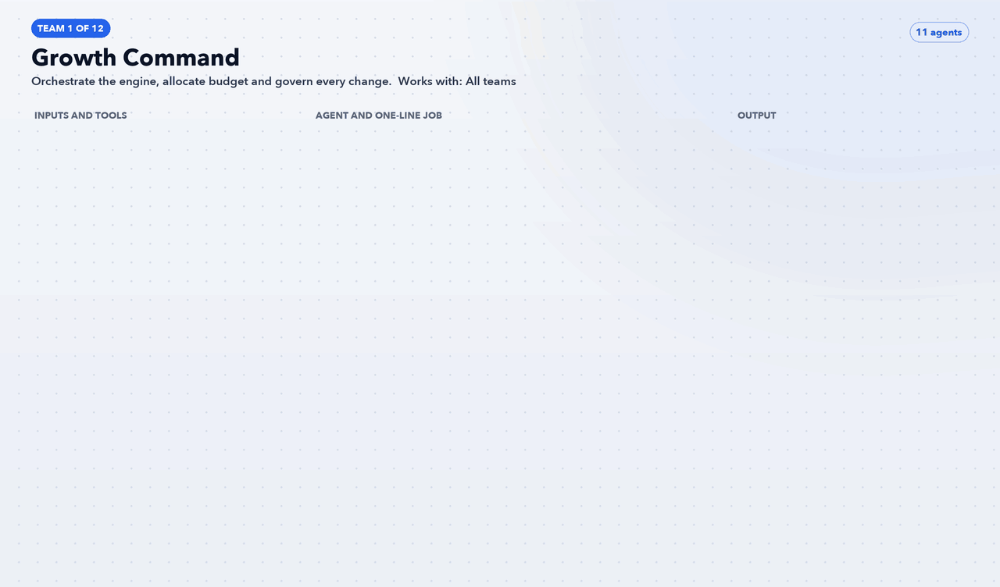

[Agents, workflows and KPIs →](teams/01-growth-command/)

### Team 2: Measurement and Data Truth

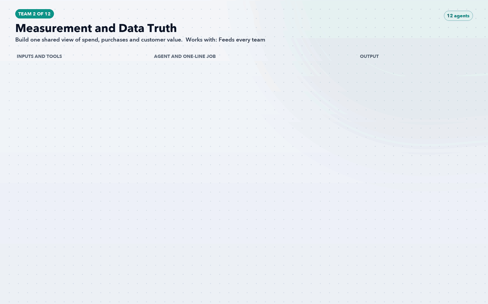

[Agents, workflows and KPIs →](teams/02-measurement-and-data-truth/)

### Team 3: Market and Player Intelligence

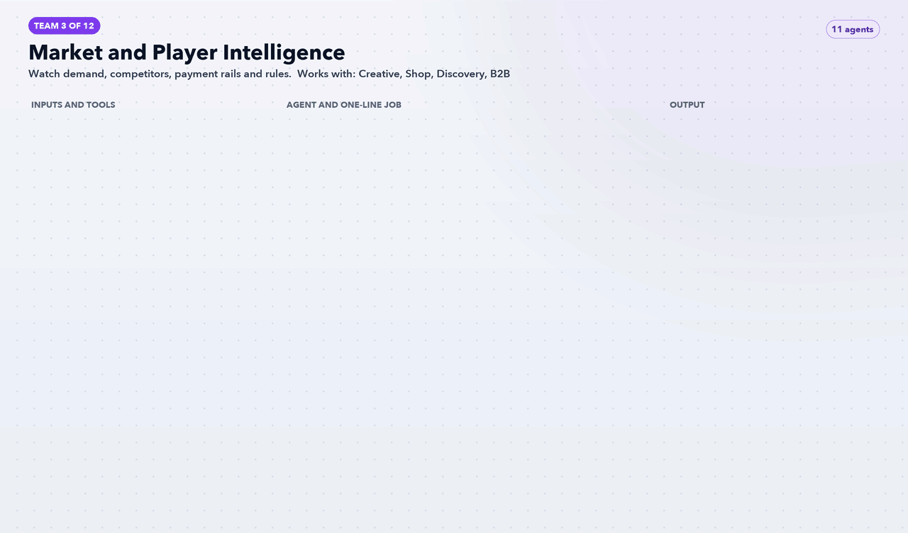

[Agents, workflows and KPIs →](teams/03-market-and-player-intelligence/)

### Team 4: Creative Studio

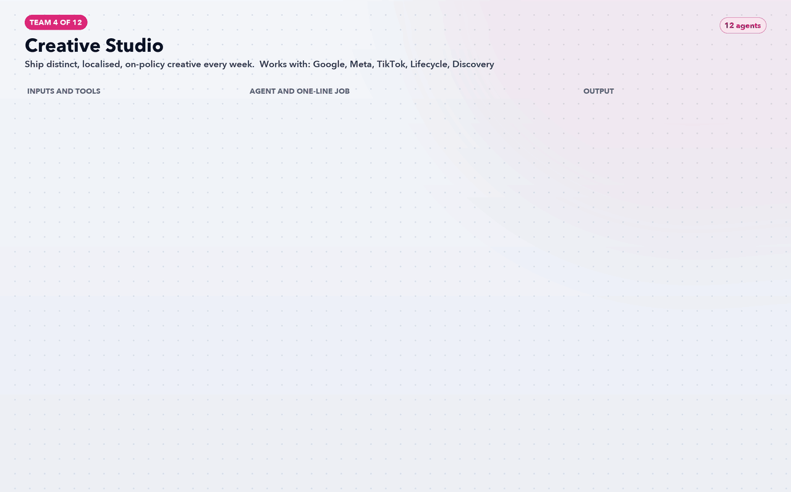

[Agents, workflows and KPIs →](teams/04-creative-studio/)

### Team 5: Google Ads

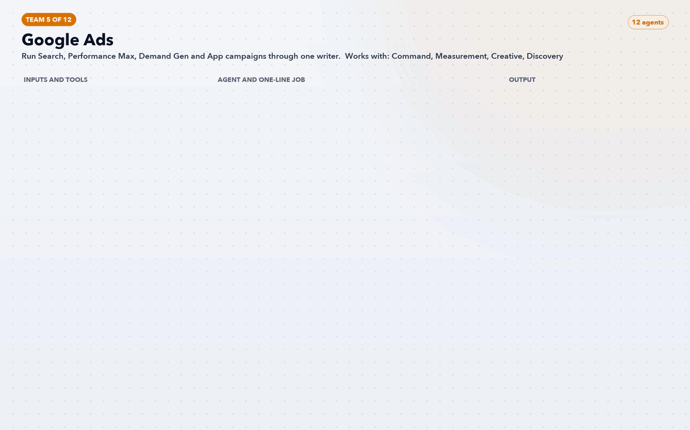

[Agents, workflows and KPIs →](teams/05-google-ads/)

### Team 6: Meta Ads

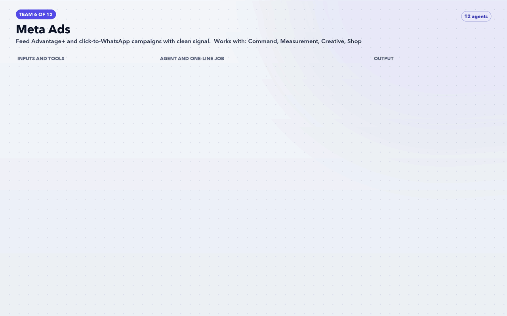

[Agents, workflows and KPIs →](teams/06-meta-ads/)

### Team 7: TikTok Ads

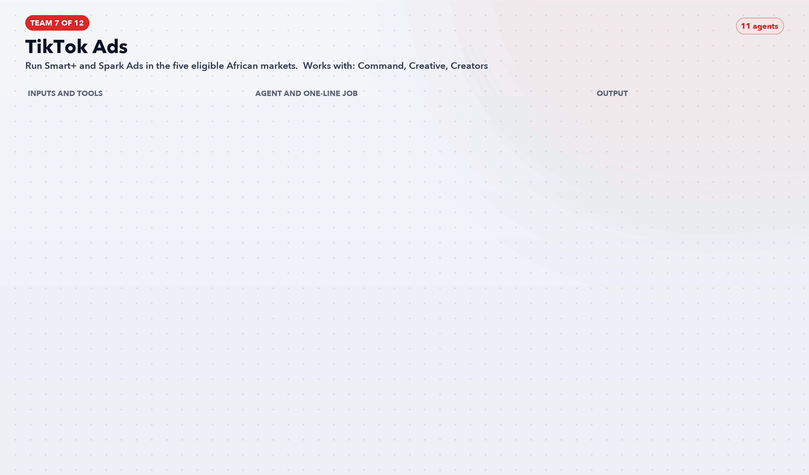

[Agents, workflows and KPIs →](teams/07-tiktok-ads/)

### Team 8: Lifecycle and CRM

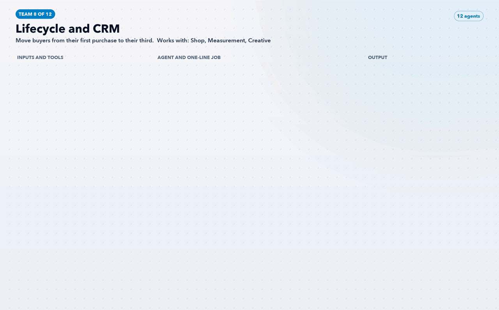

[Agents, workflows and KPIs →](teams/08-lifecycle-and-crm/)

### Team 9: Shop Conversion and Payments

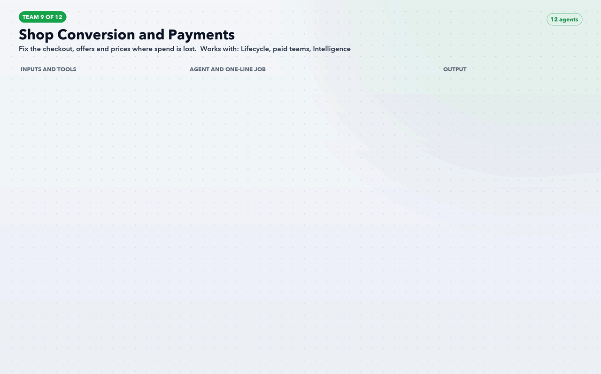

[Agents, workflows and KPIs →](teams/09-shop-conversion-and-payments/)

### Team 10: Store and Search Discovery

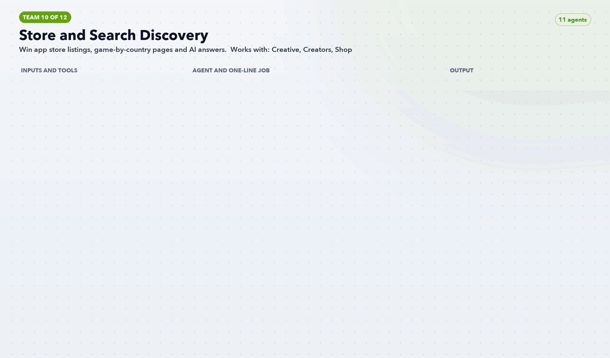

[Agents, workflows and KPIs →](teams/10-store-and-search-discovery/)

### Team 11: Creators, Community and Esports

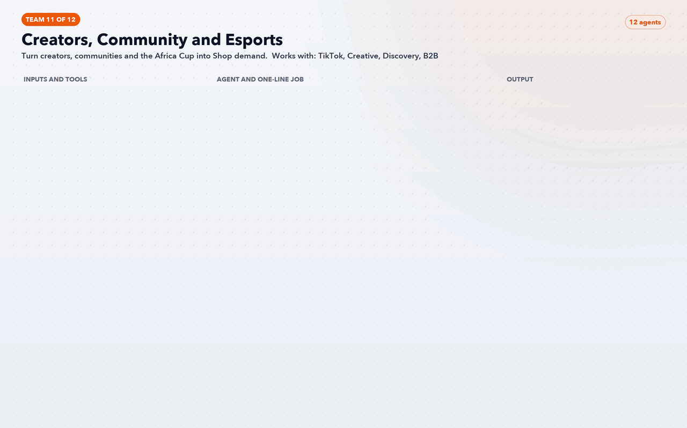

[Agents, workflows and KPIs →](teams/11-creators-community-and-esports/)

### Team 12: B2B Partner Growth

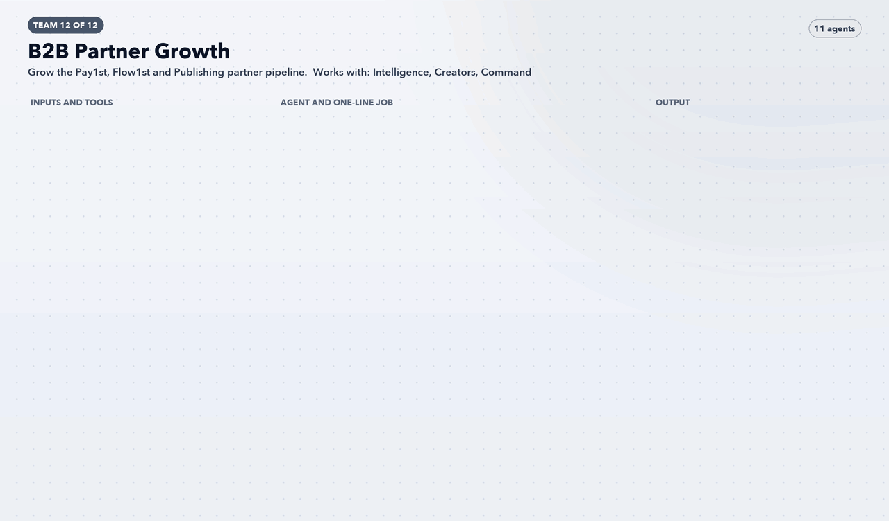

[Agents, workflows and KPIs →](teams/12-b2b-partner-growth/)

## Install

```bash
git clone https://github.com/anishdagdu/ai-marketing-agents.git
```

```bash
bash ai-marketing-agents/carry1st-agents/install.sh
```

Then start a new Claude Code session and say "run the Carry1st workflow", or call any agent by name, for example `c1-command-budget-allocator`.

## Rebuild

`docs/teams.json` holds every team, agent, workflow and KPI. Edit it, then run:

```bash
python3 carry1st-agents/docs/build.py
```

That rewrites the agent files, the team pages and all 13 GIFs.
