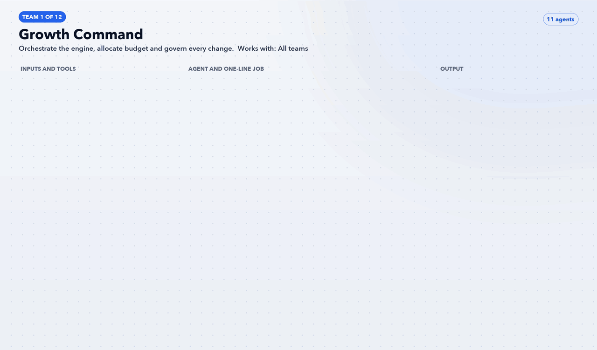

# Team 1: Growth Command

**Goal:** Orchestrate the engine, allocate budget and govern every change.

**Works with:** All teams

## Agents (11)

| Agent | One-line job | Inputs / tools | Output |
|---|---|---|---|
| [`c1-command-engine-orchestrator`](../../agents/c1-command-engine-orchestrator.md) | Routes requests to team leads and resolves competing proposals before anything is written | Team proposals, change ledger, guardrail tables | Routed brief or approve, queue or reject decision |
| [`c1-command-beat-calendar-keeper`](../../agents/c1-command-beat-calendar-keeper.md) | Keeps one calendar of game seasons, battle-pass resets, Africa Cup stages, paydays and holidays per country | Publisher roadmaps, esports schedule, country holiday lists | Dated beat calendar with owners |
| [`c1-command-budget-allocator`](../../agents/c1-command-budget-allocator.md) | Proposes the weekly spend split across Google, Meta and TikTok by country and title | Blended CAC, payback and pLTV view, platform pacing, beat calendar | Weekly budget plan for approval |
| [`c1-command-change-ledger-clerk`](../../agents/c1-command-change-ledger-clerk.md) | Records every proposed and applied change with old value, new value, proposer and approver | Write proposals, platform change history | Change ledger and entity locks |
| [`c1-command-guardrail-sentinel`](../../agents/c1-command-guardrail-sentinel.md) | Enforces spend caps, edit cool-downs and country-eligibility tables in code | Ledger, platform spend, eligibility tables | Pass or block verdict on each proposal |
| [`c1-command-consent-and-privacy-gatekeeper`](../../agents/c1-command-consent-and-privacy-gatekeeper.md) | Blocks any send or audience upload that lacks a valid consent record | Consent records, NDPA and POPIA rules, segment files | Clearance decision and impact-assessment register |
| [`c1-command-experiment-registrar`](../../agents/c1-command-experiment-registrar.md) | Holds the single test backlog and prevents overlapping tests | Test proposals from every team, live test list | Scheduled test slots with hypotheses and results |
| [`c1-command-agent-evaluator`](../../agents/c1-command-agent-evaluator.md) | Scores agent outputs with end-state checks and a human-reviewed sample | Agent outputs, scoring rubric, reviewer notes | Quality scorecard per agent and team |
| [`c1-command-cost-controller`](../../agents/c1-command-cost-controller.md) | Sets token budgets per team and assigns cheaper models to worker roles | Usage logs, task completion counts | Cost per completed task report and model plan |
| [`c1-command-incident-responder`](../../agents/c1-command-incident-responder.md) | Pauses, rolls back and writes the post-mortem when a cap, policy or data incident fires | Alerts, change ledger, platform status | Rollback proposal and post-mortem |
| [`c1-command-weekly-readout-writer`](../../agents/c1-command-weekly-readout-writer.md) | Writes one growth readout for the Head of Growth from all team outputs | Team reports, blended view, test results | Weekly growth readout |

## Workflows

| Workflow | Trigger | Inputs | Hand-offs | Output | Human gate |
|---|---|---|---|---|---|
| Weekly budget allocation | Monday, after Measurement publishes the blended view | Blended CAC, payback and pLTV by country and channel; beat calendar; pacing | Allocator proposes, Orchestrator checks ledger and guardrails, approved plan goes to the three platform writers | Signed weekly budget plan | Head of Growth approves every reallocation |
| Beat planning | 21 days before each calendar beat | Calendar entry, last comparable beat's results, offers and creative in stock | Brief fans out to Creative, Shop, Lifecycle, Discovery, Creators and the paid teams | One beat brief with owners and dates | Human team leads confirm scope |
| Change arbitration | Any write proposal from any team | Proposal, ledger history, entity locks | Approve, queue or reject back to the proposing lead | Ledger entry and decision | Human approval above set thresholds |

## KPIs

- Blended first-purchase CAC and payback by country
- Share of new buyers reaching a third purchase
- Duplicate or conflicting actions
- Human override and rollback rate
- Cost per completed task
- Incidents (cap breaches, policy rejections)

[Back to all teams](../../README.md)
