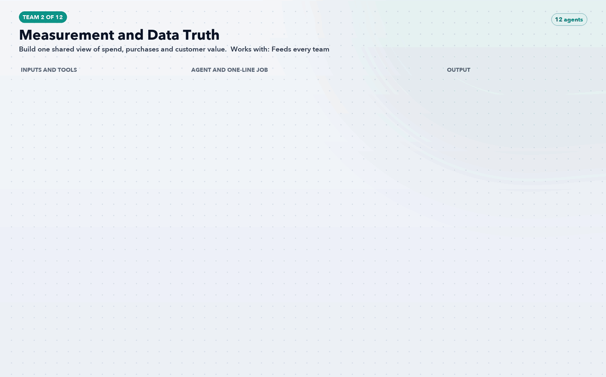

# Team 2: Measurement and Data Truth

**Goal:** Build one shared view of spend, purchases and customer value.

**Works with:** Feeds every team

## Agents (12)

| Agent | One-line job | Inputs / tools | Output |
|---|---|---|---|
| [`c1-measure-measurement-lead`](../../agents/c1-measure-measurement-lead.md) | Plans the team's work and publishes the weekly blended view to Growth Command | Team outputs, Command questions | Weekly blended view release note |
| [`c1-measure-event-taxonomy-steward`](../../agents/c1-measure-event-taxonomy-steward.md) | Keeps one event and UTM naming standard across web, app and WhatsApp | Event logs, tracking plan, campaign URLs | Event and UTM standard with defect list |
| [`c1-measure-mmp-integrity-monitor`](../../agents/c1-measure-mmp-integrity-monitor.md) | Checks install and in-app event flow, link health and app-ID mappings daily | MMP dashboard and raw data, deep links | Daily MMP health report |
| [`c1-measure-server-side-signal-agent`](../../agents/c1-measure-server-side-signal-agent.md) | Verifies web purchases reach Meta, Google and TikTok server-side with value, currency and dedup IDs | Server event logs, platform diagnostics | Signal scorecard per platform and country |
| [`c1-measure-identity-stitcher`](../../agents/c1-measure-identity-stitcher.md) | Links Shop account, app user and WhatsApp number into one customer record | Shop accounts, app IDs, WhatsApp opt-ins | Stitched customer table and match rate |
| [`c1-measure-fx-normaliser`](../../agents/c1-measure-fx-normaliser.md) | Converts naira, rand, shilling, cedi, pound and dirham purchase values to one reporting currency | Order values, dated FX rates | Normalised revenue table |
| [`c1-measure-blended-roas-modeller`](../../agents/c1-measure-blended-roas-modeller.md) | Computes CAC, payback and contribution margin after payment fees by country, channel and title | Spend, orders, fees, FX table | CAC, payback and margin tables |
| [`c1-measure-pltv-forecaster`](../../agents/c1-measure-pltv-forecaster.md) | Predicts customer value from early purchase behaviour for value bidding | Purchase history, cohort tables | pLTV score per customer and cohort |
| [`c1-measure-incrementality-designer`](../../agents/c1-measure-incrementality-designer.md) | Designs and reads geo holdout tests by country or region | Orders by region, spend plan | Test design and lift estimate with confidence range |
| [`c1-measure-media-mix-analyst`](../../agents/c1-measure-media-mix-analyst.md) | Maintains a mix model as a sanity check once spend history allows | Weekly spend and revenue history | Channel contribution estimate |
| [`c1-measure-anomaly-detector`](../../agents/c1-measure-anomaly-detector.md) | Flags spend, conversion and payment-success breaks within hours | Hourly spend, order and payment feeds | Alert with likely cause and owner |
| [`c1-measure-platform-reconciler`](../../agents/c1-measure-platform-reconciler.md) | Compares platform-reported results against warehouse truth and reports the gap | Ads platform reports, warehouse orders | Reconciliation table by platform and country |

## Workflows

| Workflow | Trigger | Inputs | Hand-offs | Output | Human gate |
|---|---|---|---|---|---|
| Daily signal health | 06:00 daily | Event logs, platform diagnostics, MMP data | Faults go to the owning platform team and to Shop engineering | Signal scorecard per platform and country | Data owner signs off schema changes |
| Blended view build | Weekly, and on demand | Spend, attributed purchases, FX, fees, pLTV | Published to Command and all team leads by reference | CAC, payback and repeat tables | Finance confirms margin inputs monthly |
| Incrementality test | Experiment Registrar schedules it | Test design, holdout geography, spend plan | Paid teams hold out the region; results go back to the Budget Allocator | Lift estimate with confidence range | Head of Growth approves holdouts |

## KPIs

- Share of web purchases received server-side with value and currency
- Identity match rate between Shop and app
- Gap between platform-reported and warehouse-attributed purchases
- Completed lift tests per quarter

[Back to all teams](../../README.md)
