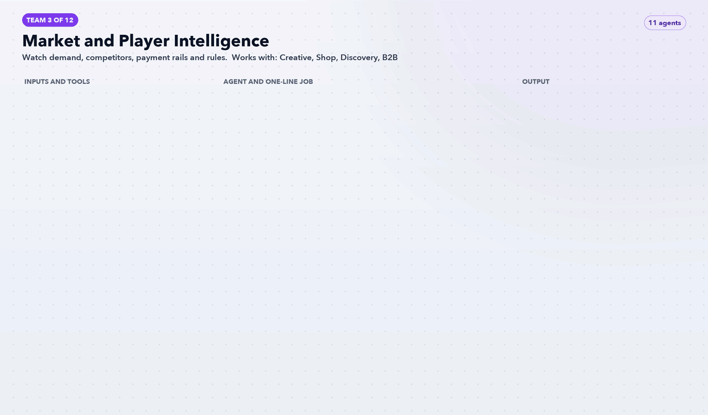

# Team 3: Market and Player Intelligence

**Goal:** Watch demand, competitors, payment rails and rules.

**Works with:** Creative, Shop, Discovery, B2B

## Agents (11)

| Agent | One-line job | Inputs / tools | Output |
|---|---|---|---|
| [`c1-intel-intelligence-lead`](../../agents/c1-intel-intelligence-lead.md) | Sets the research agenda from Command's questions and publishes the weekly brief | Command questions, team findings | Weekly intelligence brief |
| [`c1-intel-country-market-analyst`](../../agents/c1-intel-country-market-analyst.md) | Tracks market size, player counts and spend per player for each core country | Newzoo and Carry1st reports, GSMA data | Country fact sheet with dated sources |
| [`c1-intel-competitor-shop-watcher`](../../agents/c1-intel-competitor-shop-watcher.md) | Monitors Codashop, Eneba, Razer Gold and web-shop vendors for catalogue, price and payment changes | Competitor sites, press releases | Competitor change log |
| [`c1-intel-price-and-bonus-benchmarker`](../../agents/c1-intel-price-and-bonus-benchmarker.md) | Compares Carry1st's price and bonus per top-up SKU with rivals and in-app prices | Shop price list, competitor prices, in-app prices | Price gap table by SKU and country |
| [`c1-intel-payment-rail-scout`](../../agents/c1-intel-payment-rail-scout.md) | Tracks new wallets, bank rails and card rules per country | Fintech news, provider docs, Pay1st method list | Payment rail gap list by country |
| [`c1-intel-title-demand-ranker`](../../agents/c1-intel-title-demand-ranker.md) | Ranks games by top-up demand using Shop sales, search interest and community chatter | Shop sales, search trends, community themes | Ranked title list per country |
| [`c1-intel-voice-of-customer-miner`](../../agents/c1-intel-voice-of-customer-miner.md) | Extracts themes from app reviews, support tickets and chat transcripts | Store reviews, support tickets, WhatsApp chats | Theme report with verbatim quotes |
| [`c1-intel-community-listener`](../../agents/c1-intel-community-listener.md) | Summarises sentiment and questions from Discord, the Facebook group and creator comments | Discord, Facebook group, comment exports | Weekly sentiment summary |
| [`c1-intel-policy-and-regulation-watcher`](../../agents/c1-intel-policy-and-regulation-watcher.md) | Tracks store billing rules, ad policies, privacy law and WhatsApp pricing changes | Platform policy pages, regulator notices | Dated policy change alerts |
| [`c1-intel-fx-and-macro-watcher`](../../agents/c1-intel-fx-and-macro-watcher.md) | Alerts on currency moves that require repricing | FX feed, margin floors | Repricing alert |
| [`c1-intel-insight-librarian`](../../agents/c1-intel-insight-librarian.md) | Stores every finding with date and source so agents cite it by reference | All team findings | Searchable insight library |

## Workflows

| Workflow | Trigger | Inputs | Hand-offs | Output | Human gate |
|---|---|---|---|---|---|
| Weekly intelligence brief | Friday | Competitor scans, voice-of-customer themes, demand ranking | Angles to Creative; price gaps to Shop; rail gaps to B2B | One dated brief | Lead reviews before distribution |
| Repricing alert | A currency moves beyond a set band | FX feed, current price list, margin floor | To Shop's Price Refresh Agent through Command | Repricing recommendation | Commercial lead approves prices |
| New-title assessment | Publisher launch or demand spike | Demand rank, partner status, SKU availability | To Shop Merchandiser, Discovery and B2B | Go or wait recommendation | Partnerships lead decides |

## KPIs

- Time from competitor change to brief
- Share of creative concepts and offers traceable to a logged insight
- Accuracy of the title demand rank

[Back to all teams](../../README.md)
