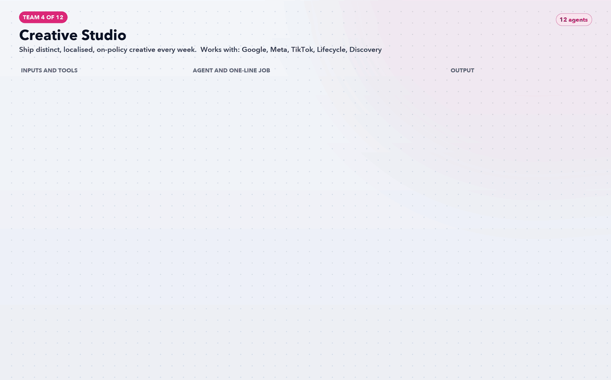

# Team 4: Creative Studio

**Goal:** Ship distinct, localised, on-policy creative every week.

**Works with:** Google, Meta, TikTok, Lifecycle, Discovery

## Agents (12)

| Agent | One-line job | Inputs / tools | Output |
|---|---|---|---|
| [`c1-creative-creative-lead`](../../agents/c1-creative-creative-lead.md) | Turns beat briefs and insights into a weekly production plan | Beat brief, insight library, creative results | Weekly production plan |
| [`c1-creative-concept-strategist`](../../agents/c1-creative-concept-strategist.md) | Proposes distinct angles such as local payment proof, delivery speed, price versus in-app and season hype | Insights, winning and losing concepts | Concept list with hypotheses |
| [`c1-creative-hook-and-script-writer`](../../agents/c1-creative-hook-and-script-writer.md) | Writes openers, scripts and ad copy per concept and platform | Approved concepts, platform specs | Hooks, scripts and copy variants |
| [`c1-creative-localisation-adapter`](../../agents/c1-creative-localisation-adapter.md) | Adapts copy and voice for English, Pidgin, Arabic, French and Swahili audiences | Winning copy, language notes | Localised drafts for native review |
| [`c1-creative-static-producer`](../../agents/c1-creative-static-producer.md) | Builds image and carousel variants from approved concepts | Concepts, brand kit, partner asset kits | Static and carousel files |
| [`c1-creative-video-assembler`](../../agents/c1-creative-video-assembler.md) | Cuts short vertical videos from gameplay, screen recordings and creator footage | Scripts, gameplay capture, creator clips | Vertical video cuts |
| [`c1-creative-footage-repurposer`](../../agents/c1-creative-footage-repurposer.md) | Mines Africa Cup, Creators College and affiliate content for ad-ready clips | Tournament streams, creator posts with rights | Clip library with rights status |
| [`c1-creative-similarity-screener`](../../agents/c1-creative-similarity-screener.md) | Rejects near-duplicates before upload so concepts do not cannibalise each other | New assets, live creative library | Pass or reject list with reasons |
| [`c1-creative-policy-and-brand-checker`](../../agents/c1-creative-policy-and-brand-checker.md) | Pre-checks every asset against platform policy, partner brand rules and Carry1st guidelines | Assets, platform policies, partner brand rules | Compliance verdict per asset |
| [`c1-creative-format-packager`](../../agents/c1-creative-format-packager.md) | Sizes and bundles assets to each platform's limits and naming standard | Approved assets, platform specs | Packaged batch per platform and country |
| [`c1-creative-creative-analyst`](../../agents/c1-creative-creative-analyst.md) | Tags assets and joins them to performance by creative ID across platforms | Creative IDs, platform asset reports | Concept and format ranking |
| [`c1-creative-fatigue-forecaster`](../../agents/c1-creative-fatigue-forecaster.md) | Predicts which live concepts need replacing and when | Asset-level trend data | Replacement schedule |

## Workflows

| Workflow | Trigger | Inputs | Hand-offs | Output | Human gate |
|---|---|---|---|---|---|
| Weekly creative sprint | Monday plan, or a beat brief | Insights, last week's creative results, partner asset kits | Concept, script, production, similarity screen, policy check and packaging, then to the platform teams | Packaged batches per platform and country | Creative director approves concepts; brand sign-off before release |
| Fatigue replacement | A platform team flags fatigue | Asset-level trends | Request back to the Concept Strategist; replacement goes to the flagged platform | Replacement concepts | Creative director and brand sign-off |
| Localisation pass | New market or language | Winning concepts | Adapter drafts; a native reviewer or creator edits | Localised variants | Native-speaker approval |

## KPIs

- Distinct concepts shipped per week
- Time from brief to live test
- Share of spend on creative under three weeks old
- Policy rejection rate
- Win rate of new concepts against the control

[Back to all teams](../../README.md)
