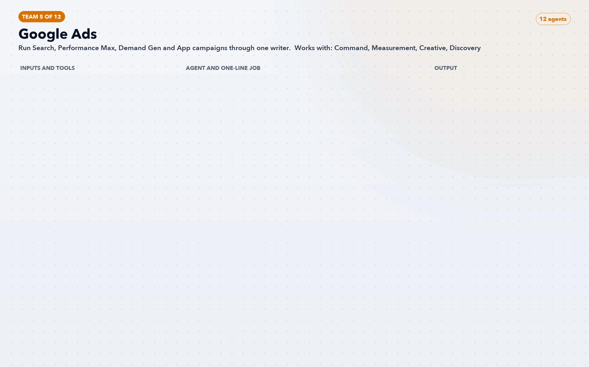

# Team 5: Google Ads

**Goal:** Run Search, Performance Max, Demand Gen and App campaigns through one writer.

**Works with:** Command, Measurement, Creative, Discovery

## Agents (12)

| Agent | One-line job | Inputs / tools | Output |
|---|---|---|---|
| [`c1-google-google-lead`](../../agents/c1-google-google-lead.md) | Plans the Google programme and submits proposals to Growth Command | Budget plan, team findings | Weekly Google plan and proposals |
| [`c1-google-search-and-ai-max-builder`](../../agents/c1-google-search-and-ai-max-builder.md) | Drafts game-plus-currency search campaigns per country, such as CP, UC and diamonds terms | Keyword list, landing pages, price feed | Search campaign draft |
| [`c1-google-keyword-and-negative-curator`](../../agents/c1-google-keyword-and-negative-curator.md) | Mines search-term reports for new keywords and waste | Search-term report, blended CAC by theme | Keyword and negative list |
| [`c1-google-feed-and-pmax-agent`](../../agents/c1-google-feed-and-pmax-agent.md) | Maintains the SKU feed by game, denomination, country and currency and drafts Performance Max asset groups | SKU and price feed, creative batch | Clean feed and asset group draft |
| [`c1-google-app-campaign-manager`](../../agents/c1-google-app-campaign-manager.md) | Drafts install, in-app action and value campaigns for the Shop app | MMP events, budget plan, creative batch | App campaign draft |
| [`c1-google-bid-readiness-checker`](../../agents/c1-google-bid-readiness-checker.md) | Blocks moves to target-based bidding until conversion volume and value data qualify | Conversion counts, value quality checks | Ready or not-ready verdict |
| [`c1-google-demand-gen-and-shorts-planner`](../../agents/c1-google-demand-gen-and-shorts-planner.md) | Drafts video-led Demand Gen and YouTube Shorts activity from Creative Studio batches | Video batch, audience signals | Demand Gen and Shorts draft |
| [`c1-google-asset-rotation-agent`](../../agents/c1-google-asset-rotation-agent.md) | Replaces low-rated assets using asset reports and top-combination data | Asset reports, creative library | Asset swap proposal |
| [`c1-google-web-to-app-agent`](../../agents/c1-google-web-to-app-agent.md) | Keeps deep links and app conversion credit working for web campaigns | Deep link tests, app conversion data | Link health report and fixes |
| [`c1-google-experiment-runner`](../../agents/c1-google-experiment-runner.md) | Sets up API-created experiments registered with Command | Test slot, hypothesis, campaign settings | Experiment spec and result |
| [`c1-google-pacing-monitor`](../../agents/c1-google-pacing-monitor.md) | Watches budget-limited status and spend against plan | Daily spend, budget plan | Pacing alert and reallocation request |
| [`c1-google-google-writer`](../../agents/c1-google-google-writer.md) | Holds the only Google write scope and applies approved changes through a capped API wrapper | Approved proposals, change ledger | Applied change with ledger entry |

## Workflows

| Workflow | Trigger | Inputs | Hand-offs | Output | Human gate |
|---|---|---|---|---|---|
| Search waste sweep | Weekly | Search-term report, blended CAC by keyword theme | Curator proposes; Writer applies after approval | Negative and keyword changes | UA manager approves the batch |
| Campaign launch | Beat brief or new title | Budget plan, creative batch, feed, eligibility check | Draft to Command; Writer creates after approval; Measurement confirms events | Live campaign with ledger entry | A human activates spend |
| Bid strategy change | Readiness check passes | Conversion volume, value quality, comparable results | Proposal to Command; Writer applies; 7 to 14 day stabilisation lock | Bid strategy change | UA manager approves |

## KPIs

- Cost per first purchase and payback by country
- Share of spend on non-converting search terms
- Impression share on brand-plus-game terms
- Share of campaigns budget-limited
- Asset replacement rate

[Back to all teams](../../README.md)
