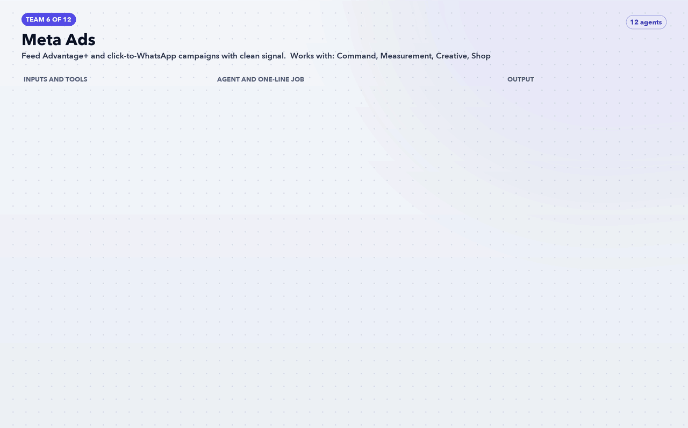

# Team 6: Meta Ads

**Goal:** Feed Advantage+ and click-to-WhatsApp campaigns with clean signal.

**Works with:** Command, Measurement, Creative, Shop

## Agents (12)

| Agent | One-line job | Inputs / tools | Output |
|---|---|---|---|
| [`c1-meta-meta-lead`](../../agents/c1-meta-meta-lead.md) | Plans the Meta programme and submits proposals to Growth Command | Budget plan, team findings | Weekly Meta plan and proposals |
| [`c1-meta-structure-architect`](../../agents/c1-meta-structure-architect.md) | Keeps one consolidated campaign per objective and country cluster with the automation levers set | Account structure, conversion volumes | Structure map and consolidation proposal |
| [`c1-meta-sales-campaign-manager`](../../agents/c1-meta-sales-campaign-manager.md) | Drafts web shop purchase and value-optimised campaigns | Budget plan, pLTV signal, creative batch | Sales campaign draft |
| [`c1-meta-app-campaign-manager`](../../agents/c1-meta-app-campaign-manager.md) | Drafts Shop app install and in-app purchase campaigns | MMP events, creative batch | App campaign draft |
| [`c1-meta-whatsapp-ads-manager`](../../agents/c1-meta-whatsapp-ads-manager.md) | Drafts click-to-WhatsApp campaigns and switches optimisation to purchases once events flow | WhatsApp Shop events, creative batch | Click-to-WhatsApp draft |
| [`c1-meta-catalog-agent`](../../agents/c1-meta-catalog-agent.md) | Maintains the product catalog for dynamic top-up and voucher ads | SKU and price feed, catalog diagnostics | Clean catalog and product sets |
| [`c1-meta-creative-slotting-agent`](../../agents/c1-meta-creative-slotting-agent.md) | Places Creative Studio batches into ad sets and retires clustered duplicates | Creative batch, ad-level results | Slotting plan |
| [`c1-meta-signal-quality-monitor`](../../agents/c1-meta-signal-quality-monitor.md) | Checks event match, deduplication and value completeness with dataset diagnostics | Events Manager diagnostics, server events | Signal quality report |
| [`c1-meta-audience-and-exclusion-agent`](../../agents/c1-meta-audience-and-exclusion-agent.md) | Builds consent-cleared buyer exclusions and re-engagement audiences | Lifecycle segments, consent check result | Audience file for upload approval |
| [`c1-meta-learning-guard`](../../agents/c1-meta-learning-guard.md) | Enforces the daily edit lock and minimum conversion volume per ad set | Change ledger, ad set conversion counts | Edit allow or block verdict |
| [`c1-meta-fatigue-monitor`](../../agents/c1-meta-fatigue-monitor.md) | Flags falling click-through, rising cost per purchase and rising frequency | Ad-level trends | Fatigue flag list |
| [`c1-meta-meta-writer`](../../agents/c1-meta-meta-writer.md) | Holds the only Meta write scope and creates entities paused for human activation | Approved proposals, change ledger | Paused entity with ledger entry |

## Workflows

| Workflow | Trigger | Inputs | Hand-offs | Output | Human gate |
|---|---|---|---|---|---|
| Creative refresh | Fatigue flag or weekly batch | Creative batch, asset-level results | Slotting Agent drafts; Writer creates paused ads; Command logs | Refreshed ad sets | A human activates in Ads Manager |
| WhatsApp purchase switch | Messaging purchase events reach a stable volume | Event counts from Measurement and the WhatsApp Shop | Proposal to Command; Writer applies | Optimisation goal change | UA manager approves |
| Audience upload | New consent-cleared segment | Segment from Lifecycle, consent check result | Gatekeeper clears; Writer uploads | Audience in the account | Privacy owner approves every upload |

## KPIs

- Cost per first purchase by country
- Purchases through messaging per click-to-WhatsApp spend
- Event match and deduplication rates
- Distinct concepts live per campaign
- Edits blocked by the learning lock

[Back to all teams](../../README.md)
