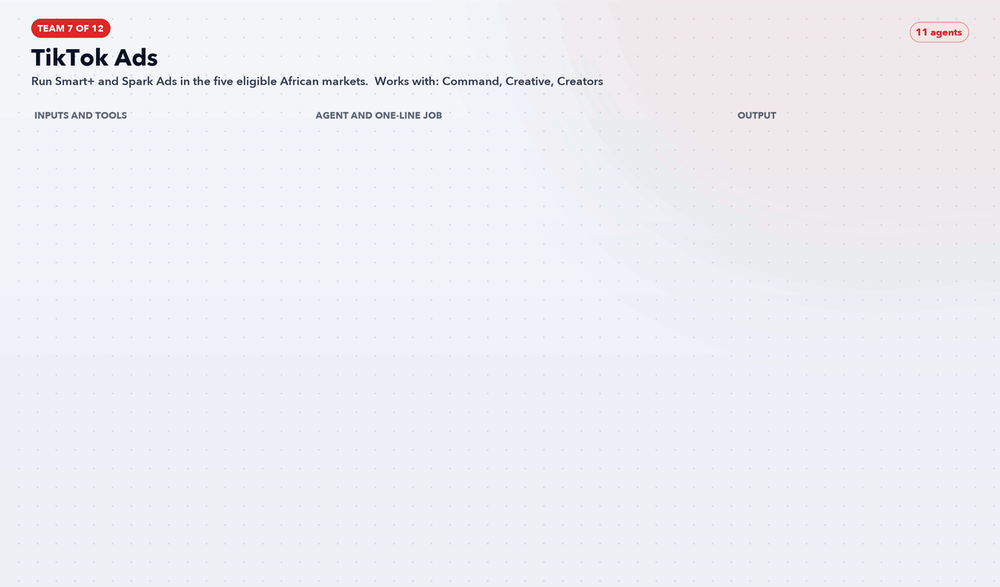

# Team 7: TikTok Ads

**Goal:** Run Smart+ and Spark Ads in the five eligible African markets.

**Works with:** Command, Creative, Creators

## Agents (11)

| Agent | One-line job | Inputs / tools | Output |
|---|---|---|---|
| [`c1-tiktok-tiktok-lead`](../../agents/c1-tiktok-tiktok-lead.md) | Plans the TikTok programme and submits proposals to Growth Command | Budget plan, team findings | Weekly TikTok plan and proposals |
| [`c1-tiktok-country-eligibility-guard`](../../agents/c1-tiktok-country-eligibility-guard.md) | Blocks any plan for a country not confirmed in the live account's location list | Account location list, budget plan | Eligible or blocked verdict per country |
| [`c1-tiktok-smart-builder`](../../agents/c1-tiktok-smart-builder.md) | Drafts Sales and App Promotion campaigns with the chosen level of automation | Budget plan, creative batch, events check | Smart+ campaign draft |
| [`c1-tiktok-asset-group-packager`](../../agents/c1-tiktok-asset-group-packager.md) | Organises creative into asset groups with the right URL and product set per group | Creative batch, landing pages, SKU feed | Asset group plan |
| [`c1-tiktok-spark-ads-coordinator`](../../agents/c1-tiktok-spark-ads-coordinator.md) | Requests creator post authorisations and turns organic posts into ads | Cleared creator posts, authorisation codes | Spark ad ready to launch |
| [`c1-tiktok-symphony-operator`](../../agents/c1-tiktok-symphony-operator.md) | Uses platform tools for resizing, dubbing and variants and routes outputs through the policy check | Approved videos, language list | Resized and dubbed variants |
| [`c1-tiktok-trend-and-hook-scout`](../../agents/c1-tiktok-trend-and-hook-scout.md) | Feeds native trends, sounds and openers to Creative Studio | TikTok trend pages, top gaming posts | Weekly trend and hook list |
| [`c1-tiktok-events-pipeline-monitor`](../../agents/c1-tiktok-events-pipeline-monitor.md) | Checks web events and app events arrive against the right app ID | Events API logs, MMP data | Events completeness report |
| [`c1-tiktok-placement-controller`](../../agents/c1-tiktok-placement-controller.md) | Reviews placement mix, including Pangle, and brand-safety settings | Placement reports, brand-safety settings | Placement recommendation |
| [`c1-tiktok-creative-reporter`](../../agents/c1-tiktok-creative-reporter.md) | Reports by material ID to the shared creative taxonomy | Material-ID results, creative IDs | Creative ranking for TikTok |
| [`c1-tiktok-tiktok-writer`](../../agents/c1-tiktok-tiktok-writer.md) | Holds the only TikTok write scope and prepares change sets a human applies | Approved proposals, change ledger | Change set with ledger entry |

## Workflows

| Workflow | Trigger | Inputs | Hand-offs | Output | Human gate |
|---|---|---|---|---|---|
| Spark pipeline | A creator post passes a view or engagement bar | Post list from the Creators team, authorisation status | Coordinator requests the code; Packager adds it to an asset group; Writer prepares the change | Spark ad ready to launch | A human launches; creator consent on file |
| Country launch | The budget plan names a TikTok market | Eligibility table, creative batch, events check | Guard clears; Builder drafts; Command approves | Campaign change set | A human applies and activates |
| Weekly creative read | Monday | Material-ID results | To the Creative Analyst and Fatigue Forecaster | Creative ranking | None (read-only) |

## KPIs

- Cost per first purchase in the five eligible markets
- Share of spend on creator-made content
- Time from creator post to Spark ad
- Events pipeline completeness

[Back to all teams](../../README.md)
