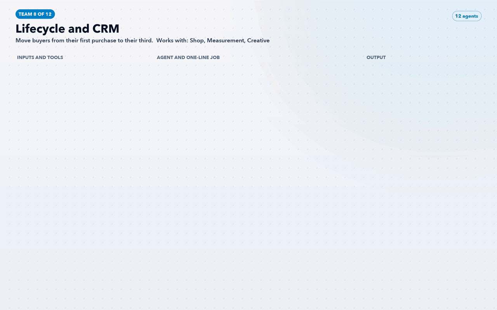

# Team 8: Lifecycle and CRM

**Goal:** Move buyers from their first purchase to their third.

**Works with:** Shop, Measurement, Creative

## Agents (12)

| Agent | One-line job | Inputs / tools | Output |
|---|---|---|---|
| [`c1-crm-lifecycle-lead`](../../agents/c1-crm-lifecycle-lead.md) | Plans journeys against the beat calendar and the third-purchase target | Beat calendar, repeat-rate tables | Journey roadmap |
| [`c1-crm-segment-builder`](../../agents/c1-crm-segment-builder.md) | Maintains segments by purchase count, title, country, payment method and points balance | Stitched customer table, order history | Segment definitions and sizes |
| [`c1-crm-onboarding-agent`](../../agents/c1-crm-onboarding-agent.md) | Drives account creation and email verification at first purchase so points can be claimed | First-purchase events, account status | Onboarding journey draft |
| [`c1-crm-repeat-purchase-nudger`](../../agents/c1-crm-repeat-purchase-nudger.md) | Times second and third purchase prompts using points balance and usual top-up interval | Purchase intervals, points balances | Timed nudge plan |
| [`c1-crm-season-reminder-agent`](../../agents/c1-crm-season-reminder-agent.md) | Schedules top-up reminders for season starts and battle-pass resets | Beat calendar, title segments | Reminder schedule |
| [`c1-crm-payment-recovery-agent`](../../agents/c1-crm-payment-recovery-agent.md) | Follows up abandoned bank-transfer and mobile-money payments with utility messages | Pending and failed orders, consent status | Recovery message queue |
| [`c1-crm-win-back-agent`](../../agents/c1-crm-win-back-agent.md) | Re-engages lapsed buyers with points or bonus offers | Lapsed segments, approved offers | Win-back journey draft |
| [`c1-crm-cross-sell-agent`](../../agents/c1-crm-cross-sell-agent.md) | Recommends adjacent products such as vouchers after a game top-up | Purchase history, catalogue | Cross-sell rules and messages |
| [`c1-crm-channel-mix-optimiser`](../../agents/c1-crm-channel-mix-optimiser.md) | Chooses push, email, SMS or WhatsApp per user by cost, consent and response | Channel costs, consent, response history | Channel assignment per segment |
| [`c1-crm-message-writer`](../../agents/c1-crm-message-writer.md) | Drafts templates and copy in the brand voice per language | Journey plan, brand voice, offers | Message templates for approval |
| [`c1-crm-send-governor`](../../agents/c1-crm-send-governor.md) | Applies consent checks, frequency caps and quiet hours before any send | Send queue, consent records, cap rules | Cleared or blocked send list |
| [`c1-crm-lifecycle-analyst`](../../agents/c1-crm-lifecycle-analyst.md) | Measures every journey against a holdout group | Send logs, orders, holdout groups | Lift and cost report per journey |

## Workflows

| Workflow | Trigger | Inputs | Hand-offs | Output | Human gate |
|---|---|---|---|---|---|
| First-to-third purchase journey | First purchase event | Customer record, points balance, title, country | Onboarding, then Nudger; offers requested from Shop's Offer Designer | Sequenced messages with a holdout | CRM manager approves each new journey and template |
| Payment recovery | A payment is pending or failed beyond a time limit | Order state, method, consent | Recovery Agent queues a utility message; unresolved cases go to support | Recovered orders | Template approved once; no per-send gate |
| Season campaign | Beat brief | Segment sizes, channel costs, creative | Channel Mix selects; Send Governor clears; Analyst reads | Campaign with cost and lift report | A human approves any paid WhatsApp marketing send |

## KPIs

- Share of first-time buyers reaching purchase two and three within a set window
- Recovered payment rate
- Reactivation rate
- Messaging cost per incremental purchase
- Opt-out rate
- Sends blocked for missing consent

[Back to all teams](../../README.md)
