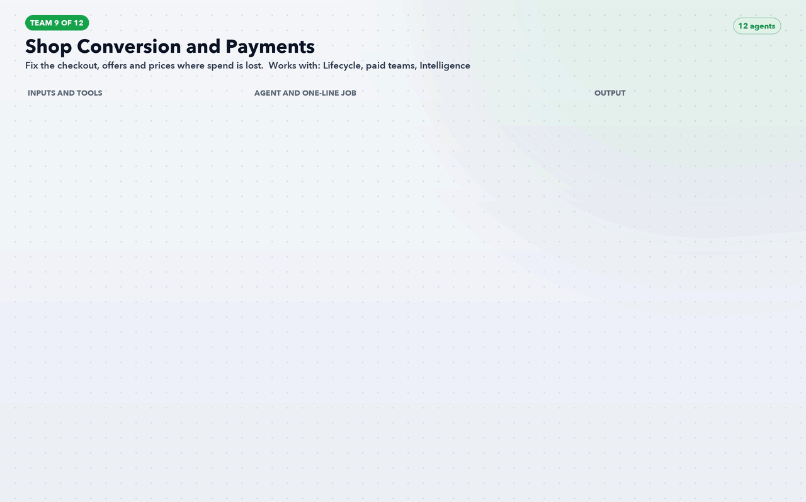

# Team 9: Shop Conversion and Payments

**Goal:** Fix the checkout, offers and prices where spend is lost.

**Works with:** Lifecycle, paid teams, Intelligence

## Agents (12)

| Agent | One-line job | Inputs / tools | Output |
|---|---|---|---|
| [`c1-shop-shop-lead`](../../agents/c1-shop-shop-lead.md) | Prioritises conversion work and coordinates with engineering and commercial owners | Funnel data, incident log, beat calendar | Ranked conversion backlog |
| [`c1-shop-funnel-analyst`](../../agents/c1-shop-funnel-analyst.md) | Measures drop-off from landing to first purchase by country, device and method | Web and app analytics, order data | Funnel report with biggest leaks |
| [`c1-shop-payment-method-sequencer`](../../agents/c1-shop-payment-method-sequencer.md) | Orders checkout methods per country by success rate and cost | Method success rates, fees | Method order proposal per country |
| [`c1-shop-payment-success-monitor`](../../agents/c1-shop-payment-success-monitor.md) | Tracks success and timeout rates per method and provider in near real time | Payment provider feeds | Success-rate alert and trend |
| [`c1-shop-delivery-and-id-monitor`](../../agents/c1-shop-delivery-and-id-monitor.md) | Watches player-ID validation errors and top-up delivery times | Order logs, publisher delivery status | Delivery and ID error report |
| [`c1-shop-offer-designer`](../../agents/c1-shop-offer-designer.md) | Drafts points multipliers, first-purchase bonuses, third-purchase rewards and season bundles within margin floors | Margin by SKU, past offer results, benchmarks | Offer sheet with margin impact |
| [`c1-shop-price-refresh-agent`](../../agents/c1-shop-price-refresh-agent.md) | Proposes local-currency price updates when FX or supplier cost moves | FX alerts, supplier costs, price list | Price change proposal |
| [`c1-shop-merchandiser`](../../agents/c1-shop-merchandiser.md) | Arranges storefront categories, banners and deals for each beat and country | Beat brief, demand rank, offers | Storefront layout plan |
| [`c1-shop-whatsapp-shop-operator`](../../agents/c1-shop-whatsapp-shop-operator.md) | Maintains the chat catalogue and flow and reports chat-to-purchase conversion | WhatsApp catalogue, chat logs | Flow fixes and conversion report |
| [`c1-shop-loyalty-economist`](../../agents/c1-shop-loyalty-economist.md) | Models points cost, liability and effect on repeat rate | Points ledger, repeat-rate cohorts | Points economics model |
| [`c1-shop-fraud-and-abuse-flagger`](../../agents/c1-shop-fraud-and-abuse-flagger.md) | Flags suspicious order, promo and affiliate patterns to the risk team | Order, promo and affiliate logs | Case list for the risk team |
| [`c1-shop-support-triage-agent`](../../agents/c1-shop-support-triage-agent.md) | Drafts answers to routine order questions and routes payment disputes to human agents | Support tickets, order lookup, help articles | Draft replies and escalations |

## Workflows

| Workflow | Trigger | Inputs | Hand-offs | Output | Human gate |
|---|---|---|---|---|---|
| Payment incident | Success rate for a method drops below its normal band | Method-level success data | Sequencer proposes demoting the method; paid teams and Lifecycle are told through Command | Incident note and checkout change proposal | Payments owner approves checkout changes |
| Offer design for a beat | Beat brief | Margin by SKU, past offer results, competitor benchmark | Offer goes to Lifecycle, Creative and the Merchandiser | Offer sheet with margin impact | Commercial lead approves every offer and price |
| Funnel test | Experiment Registrar slot | Funnel data, hypothesis | Variant spec to engineering; result to the Registrar | Test result | Product owner approves release |

## KPIs

- Landing-to-first-purchase conversion
- Payment success rate by method and country
- Delivery time
- Contribution margin after fees and points
- WhatsApp chat-to-purchase rate
- Share of support contacts resolved without a human, read beside satisfaction on escalated cases

[Back to all teams](../../README.md)
