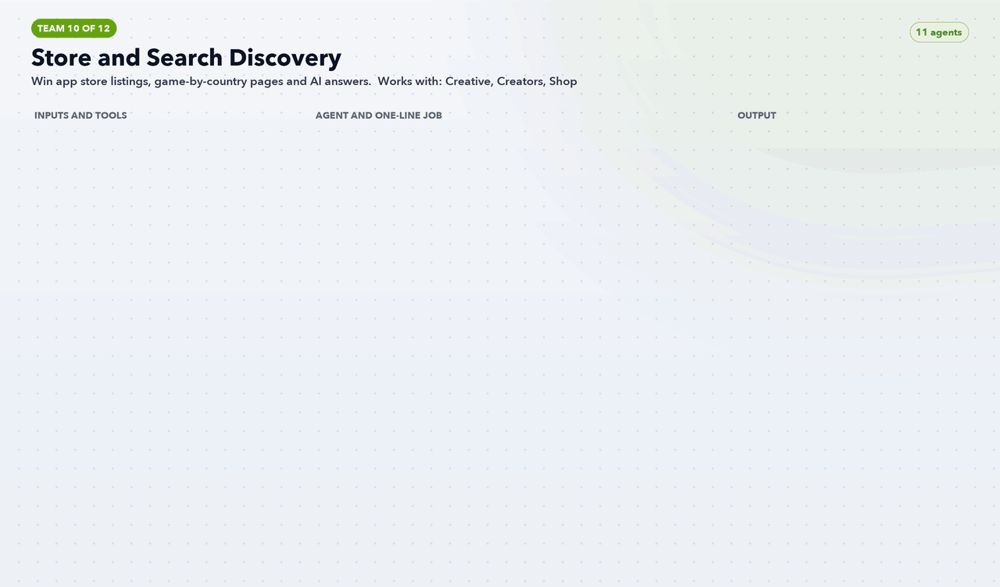

# Team 10: Store and Search Discovery

**Goal:** Win app store listings, game-by-country pages and AI answers.

**Works with:** Creative, Creators, Shop

## Agents (11)

| Agent | One-line job | Inputs / tools | Output |
|---|---|---|---|
| [`c1-discover-discovery-lead`](../../agents/c1-discover-discovery-lead.md) | Plans listing, content and visibility work against the beat calendar | Beat calendar, organic results | Discovery roadmap |
| [`c1-discover-store-listing-builder`](../../agents/c1-discover-store-listing-builder.md) | Drafts country custom listings showing local payment methods, prices and esports imagery | Play Console data, creative library | Custom store listing drafts |
| [`c1-discover-listing-experiment-runner`](../../agents/c1-discover-listing-experiment-runner.md) | Runs store listing tests registered with Command | Test slot, listing variants | Listing test result |
| [`c1-discover-review-responder`](../../agents/c1-discover-review-responder.md) | Drafts replies to app reviews and escalates payment or delivery complaints | New reviews, order lookup, response policy | Reply drafts and escalations |
| [`c1-discover-promotional-content-scheduler`](../../agents/c1-discover-promotional-content-scheduler.md) | Prepares in-store events and offers timed to beats | Beat calendar, offer sheet | Promotional content submissions |
| [`c1-discover-programmatic-page-builder`](../../agents/c1-discover-programmatic-page-builder.md) | Generates game-by-country-by-payment-method pages with live prices, steps and FAQs | SKU and price feed, payment steps | Page drafts from an approved template |
| [`c1-discover-keyword-opportunity-agent`](../../agents/c1-discover-keyword-opportunity-agent.md) | Finds query gaps from search-term data, Search Console and competitor pages | Search Console, Semrush or Ahrefs, search terms | Keyword gap list by country |
| [`c1-discover-guide-writer`](../../agents/c1-discover-guide-writer.md) | Drafts game guides, season reviews and esports recaps on a steady cadence | Keyword gaps, event content, insights | Guide and recap drafts |
| [`c1-discover-site-hygiene-agent`](../../agents/c1-discover-site-hygiene-agent.md) | Finds broken links, placeholder copy, stale events and inconsistent claims across Carry1st sites | Site crawl, claims list | Defect list with fixes |
| [`c1-discover-ai-visibility-tracker`](../../agents/c1-discover-ai-visibility-tracker.md) | Runs a prompt set per engine, country and game and logs where Carry1st is cited | Prompt set, answer engine responses | Citation scorecard per engine |
| [`c1-discover-third-party-proof-agent`](../../agents/c1-discover-third-party-proof-agent.md) | Builds review-site profiles and tracks press and creator mentions that answer engines cite | Review sites, press and creator mentions | Proof gap list and outreach drafts |

## Workflows

| Workflow | Trigger | Inputs | Hand-offs | Output | Human gate |
|---|---|---|---|---|---|
| Review response | New review | Review text, order lookup, response policy | Routine replies drafted; disputes to Support Triage; themes to Intelligence | Reply ready to publish | A human approves any reply on a payment dispute |
| Page matrix build | New title, country or method | SKU and price feed, payment steps, partner status | Page draft to the editor; internal links to guides; Google team told of new landing pages | Page ready to publish | Editor approves templates and spot-checks pages |
| AI visibility sweep | Monthly | Prompt set, engine responses | Gaps to the Guide Writer and Third-Party Proof Agent | Citation scorecard per engine | None (read-only) |

## KPIs

- Store listing conversion by country
- App rating and reply rate
- Non-brand organic sessions and first purchases from organic
- Ranking coverage of game-plus-currency queries per country
- AI citation share per engine
- Open site defects

[Back to all teams](../../README.md)
