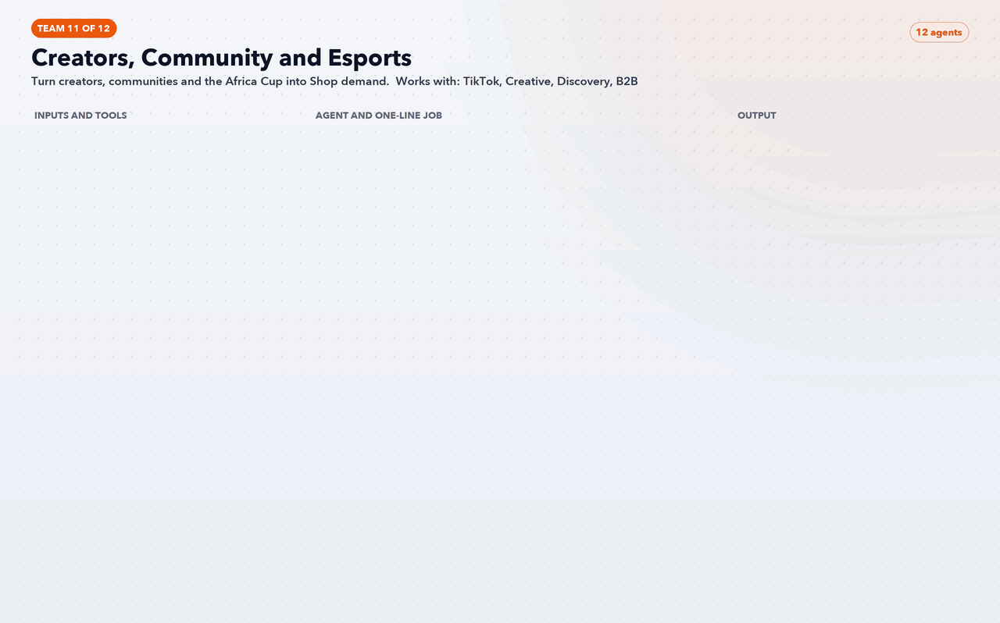

# Team 11: Creators, Community and Esports

**Goal:** Turn creators, communities and the Africa Cup into Shop demand.

**Works with:** TikTok, Creative, Discovery, B2B

## Agents (12)

| Agent | One-line job | Inputs / tools | Output |
|---|---|---|---|
| [`c1-community-community-lead`](../../agents/c1-community-community-lead.md) | Plans creator, community and event activity against the beat calendar | Beat calendar, community results | Community and creator plan |
| [`c1-community-creator-scout`](../../agents/c1-community-creator-scout.md) | Finds and scores micro and mid-size gaming creators per country and title | TikTok, YouTube and Instagram profiles | Scored creator shortlist |
| [`c1-community-creator-brief-writer`](../../agents/c1-community-creator-brief-writer.md) | Drafts monthly content briefs tied to seasons, offers and tournaments | Beat brief, offers, creative results | Creator briefs |
| [`c1-community-affiliate-ops-agent`](../../agents/c1-community-affiliate-ops-agent.md) | Onboards affiliates, issues links, answers dashboard questions and prepares payout files | Affiliate applications, link and sales data | Onboarding pack and payout file for approval |
| [`c1-community-affiliate-integrity-checker`](../../agents/c1-community-affiliate-integrity-checker.md) | Flags self-referral, coupon leakage and abnormal conversion patterns | Affiliate orders, coupon use | Integrity case list |
| [`c1-community-spark-rights-broker`](../../agents/c1-community-spark-rights-broker.md) | Collects usage rights and ad authorisations and passes cleared posts to TikTok and Creative | Creator posts, rights requests | Cleared post list with rights on file |
| [`c1-community-tournament-ops-agent`](../../agents/c1-community-tournament-ops-agent.md) | Handles registration queries, schedules, bracket communications and results posts | Registrations, brackets, match results | Schedules, bracket updates and results drafts |
| [`c1-community-content-repurposer`](../../agents/c1-community-content-repurposer.md) | Turns matches, recaps and creator posts into clips, articles and CRM content | Match footage, results, creator posts | Content pack per stage |
| [`c1-community-community-moderator`](../../agents/c1-community-community-moderator.md) | Drafts answers to routine questions in Discord and groups and escalates abuse or payment issues | Discord and group messages, help articles | Reply drafts and escalations |
| [`c1-community-campus-programme-coordinator`](../../agents/c1-community-campus-programme-coordinator.md) | Supports campus leaders with kits, calendars and reporting | Campus leader list, beat calendar | Campus kits and activity report |
| [`c1-community-sponsor-pipeline-agent`](../../agents/c1-community-sponsor-pipeline-agent.md) | Researches and drafts proposals for brand sponsors of events and content | Event reach data, sponsor research | Sponsor proposals |
| [`c1-community-community-analyst`](../../agents/c1-community-community-analyst.md) | Attributes purchases to creators and events and maps registrations by country | Affiliate sales, registrations with consent | Creator and event attribution report |

## Workflows

| Workflow | Trigger | Inputs | Hand-offs | Output | Human gate |
|---|---|---|---|---|---|
| Creator cycle | Monthly, and each beat | Scout list, briefs, offers, affiliate results | Briefs out; cleared posts to TikTok Spark and Creative; results to Measurement | Creator content and affiliate sales | A human signs creator agreements and approves payouts |
| Event content pipeline | Each tournament stage | Match footage, results, player stories | Clips to Creative; recaps to Discovery; highlights to Lifecycle | Content pack per stage | Community manager approves public posts |
| Registration to market map | After each registration window | Registration data by country, with consent | Country demand to Intelligence and B2B | Demand map for payment expansion | Privacy owner approves data use |

## KPIs

- Affiliate-attributed first purchases and repeat rate
- Active affiliates
- Cost per creator-driven purchase
- Content pieces reused by other teams
- Community response time
- Sponsor revenue against event cost

[Back to all teams](../../README.md)
