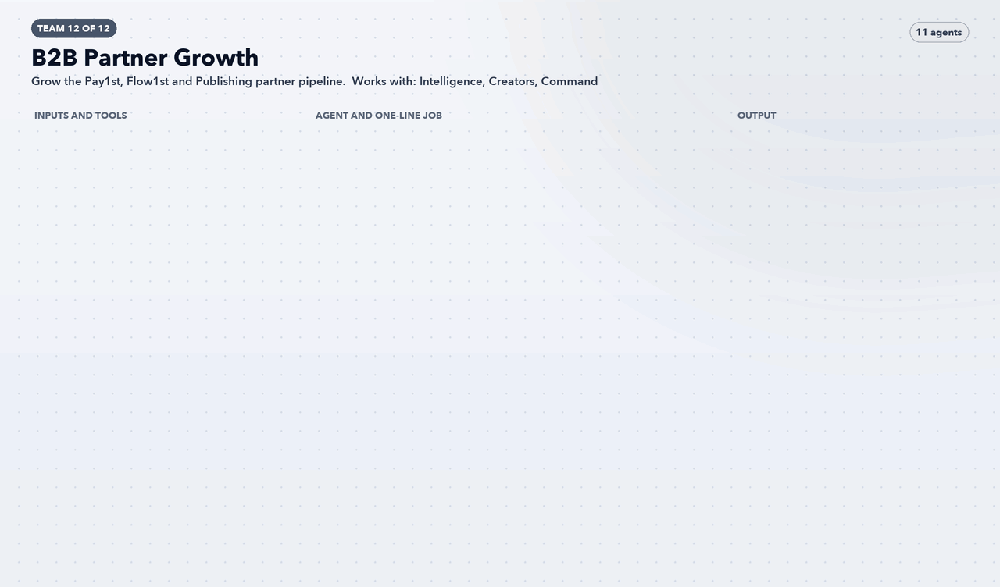

# Team 12: B2B Partner Growth

**Goal:** Grow the Pay1st, Flow1st and Publishing partner pipeline.

**Works with:** Intelligence, Creators, Command

## Agents (11)

| Agent | One-line job | Inputs / tools | Output |
|---|---|---|---|
| [`c1-b2b-partner-lead`](../../agents/c1-b2b-partner-lead.md) | Prioritises target accounts across Pay1st, Flow1st and Publishing | Pipeline, demand rank, partner list | Ranked target account list |
| [`c1-b2b-account-researcher`](../../agents/c1-b2b-account-researcher.md) | Profiles publishers, subscription apps, telcos and wallets against fit criteria | Company sites, store data, press | Account profiles |
| [`c1-b2b-payment-gap-modeller`](../../agents/c1-b2b-payment-gap-modeller.md) | Estimates per title and country the payers a partner cannot reach with card-based billing | Card penetration data, title audiences | Payment gap estimate per account |
| [`c1-b2b-flow1st-prospector`](../../agents/c1-b2b-flow1st-prospector.md) | Builds and qualifies reseller targets by region and volume tier | Telco, fintech and marketplace lists | Qualified reseller list |
| [`c1-b2b-outreach-drafter`](../../agents/c1-b2b-outreach-drafter.md) | Drafts personalised emails and meeting notes for sales staff to send | Account profiles, proof points | Outreach drafts |
| [`c1-b2b-case-study-builder`](../../agents/c1-b2b-case-study-builder.md) | Turns anonymised engine results into proof points and decks | Blended results, payment success data | Case studies and deck slides |
| [`c1-b2b-event-pipeline-agent`](../../agents/c1-b2b-event-pipeline-agent.md) | Prepares meeting lists and follow-ups for industry conferences | Conference attendee lists, target accounts | Meeting list and follow-up drafts |
| [`c1-b2b-inbound-lead-router`](../../agents/c1-b2b-inbound-lead-router.md) | Scores and routes form submissions from the Pay1st, Shop and Flow1st pages | Form submissions, fit criteria | Scored lead with owner |
| [`c1-b2b-integration-concierge`](../../agents/c1-b2b-integration-concierge.md) | Answers documentation questions and tracks partners from Shop listing to gateway upgrade | Integration docs, partner status | Answer drafts and onboarding tracker |
| [`c1-b2b-co-marketing-planner`](../../agents/c1-b2b-co-marketing-planner.md) | Packages esports, creator and paid support into partner launch proposals | Beat calendar, creator and paid plans | Partner launch proposal |
| [`c1-b2b-partner-health-monitor`](../../agents/c1-b2b-partner-health-monitor.md) | Tracks partner volumes and flags expansion or churn risk | Partner volume data | Partner health report |

## Workflows

| Workflow | Trigger | Inputs | Hand-offs | Output | Human gate |
|---|---|---|---|---|---|
| Target account build | Quarterly, or a new-title alert from Intelligence | Demand rank, partner list, payment-gap model | Researcher and Modeller to the Outreach Drafter | Account brief and draft outreach | Sales lead sends all outreach |
| Partner launch | Signed partner | SKU list, countries, launch date | Co-marketing plan to Command, which adds a calendar beat | Launch plan across teams | Partnerships lead and Head of Growth approve |
| Proof refresh | Monthly | Blended results, payment success by method | Case Study Builder to Discovery for site updates | Updated proof points | Legal and partner approval before publishing |

## KPIs

- Qualified pipeline by product
- Lead response time
- Pilot-to-gateway conversion
- Partner volume growth
- Proof points published

[Back to all teams](../../README.md)
