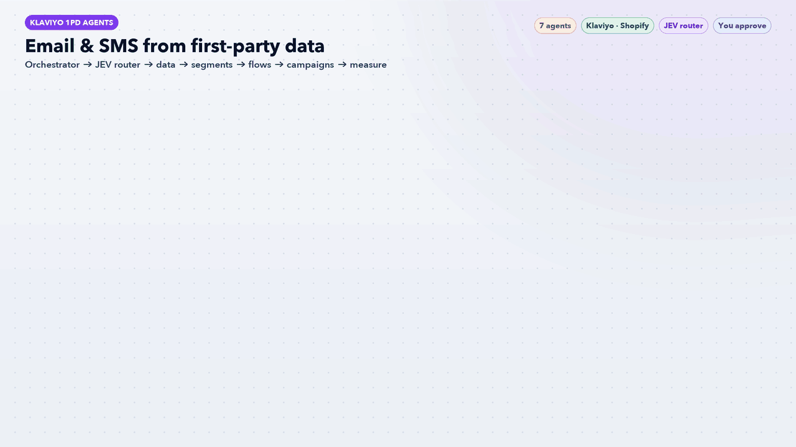

# Klaviyo 1PD Agents: High-Converting Email & SMS from First-Party Data



Five AI agents and one workflow skill. They turn your Klaviyo **first-party data** (site behaviour, orders, consent, form answers) into segments, revenue flows and campaigns, then measure the results every week and feed them back in.

> **AI recommends. You approve.** Nothing is created in Klaviyo without your OK in chat. New flows and campaigns are saved as **drafts**. The agents never send campaigns, never turn flows on, and never suppress, delete or merge profiles.

## How it works

| # | Agent | What it does | Writes to Klaviyo? |
|---|---|---|---|
| 1 | [`kl-data-foundation`](agents/kl-data-foundation.md) | Audits events, catalog, identity, consent and zero-party fields. Gives a 1PD readiness score and a setup plan | No |
| 2 | [`kl-segment-architect`](agents/kl-segment-architect.md) | Engaged/unengaged, hot browsers, cart abandoners, VIP, at-risk, predictive, and ad seed/exclusion audiences | Creates segments after approval |
| 3 | [`kl-flow-builder`](agents/kl-flow-builder.md) | Welcome, abandoned checkout and cart, browse abandonment, post-purchase, replenishment, win-back, sunset | Drafts only |
| 4 | [`kl-campaign-strategist`](agents/kl-campaign-strategist.md) | 4-week calendar, one segment per send, personalised copy, subject-line and offer A/B tests | Drafts only, you send |
| 5 | [`kl-performance-analyst`](agents/kl-performance-analyst.md) | Weekly revenue per recipient, deliverability and list health. Routes each problem to the agent that should fix it | No |

The [`klaviyo-growth-workflow`](workflow/klaviyo-growth-workflow/SKILL.md) skill runs them in order. It stops at step 1 if the store isn't sending key events yet (for example Placed Order), because flows and segments would have nothing to trigger on.

**Guardrails in every agent**
- Show the full list of changes before any write
- Mail consented profiles only, and exclude anyone unengaged for 180 days from campaigns
- Name everything created with the prefix `AI · ` and tag it `ai-workflow`, so it's easy to audit or roll back
- Deliverability limits: bounce < 1%, spam < 0.08%, unsubscribe < 0.3% per send

## Recommended Claude skills

These Claude Code skills pair well with this set. The lead agent uses them when they are installed.

- **For this set:** `windsor-ai:klaviyo`, `marketing:email-sequence`, `repeat-purchase-flow-review-ecommerce`, `ltv-cohort-read-ecommerce`, `subscription-churn-review-ecommerce`
- **For every set:** `weekly-report`, `marketing:performance-report`, `marketing:competitive-brief`, `windsor-ai:windsor-insights`, `schedule`

Skills from `windsor-ai:*`, `marketing:*`, `small-business:*` and `design:*` need those plugins installed, and Windsor.ai or HubSpot skills only return data once those connectors are signed in.

## Requirements

- [Claude Code](https://claude.com/claude-code)
- The **Klaviyo MCP connector**, signed in to your Klaviyo account
- For the revenue flows: an e-commerce integration (Shopify, WooCommerce, etc.) or onsite tracking sending Viewed Product, Added to Cart, Started Checkout and Placed Order

## Install

```bash
./install.sh
```

Then, in a new Claude Code session, say **"run the Klaviyo workflow"**. Or ask for a single step, for example "who should I email this week" or "set up abandoned cart".

## Files

- `agents/`: the 5 agent definitions
- `workflow/klaviyo-growth-workflow/SKILL.md`: the orchestrator skill
- `klaviyo-agents-workflow.gif`: workflow infographic
- `docs/make_gif.py`: regenerates the GIF (needs Pillow)

## JEV model router
`kl-jev-router` picks a model for every task before the orchestrator starts it: **Standard · Haiku** for lookups, checks and formatting, **Medium · Sonnet** for plans, writing and analysis, **Deep · Opus** for high-stakes or messy problems. It scores each task 0-2 on money at stake, ambiguity, reasoning depth, blast radius and novelty (0-2 standard, 3-5 medium, 6+ deep), starts low and escalates only on evidence, reuses outputs from the last 7 days, and caps deep work at 3 tasks per run. Every decision is logged to `outputs/jev-routing-log.csv`.

`kl-orchestrator` leads the team: it finds the biggest problem, routes tasks through JEV, briefs the specialists and returns one ranked action list for your approval.
