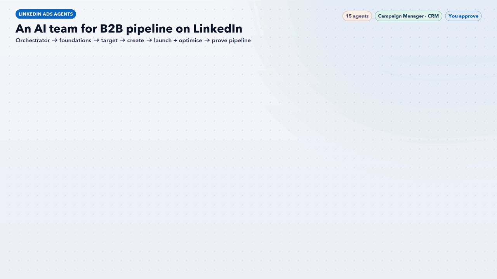

# LinkedIn Ads Agents: An AI Team for B2B Pipeline



Fifteen Claude Code agents and one workflow skill for LinkedIn Ads. They cover the whole job: account setup, Insight Tag and CAPI, ICP and ABM lists, audiences, copy, formats, Thought Leader Ads, Lead Gen Forms, campaign builds, bidding, creative fatigue, CRM follow-up and pipeline reporting. An orchestrator finds the biggest pipeline leak each week and sends the right specialists after it.

> **AI recommends. You approve.** Nothing changes in Campaign Manager without your OK in chat. Campaigns and ads are built as **drafts or paused**. The agents never change budgets, never launch campaigns, never accept terms, never enter billing details and never delete anything.

## How it works

| Stage | Agent | What it does |
|---|---|---|
| Lead | [`li-orchestrator`](agents/li-orchestrator.md) | Finds the biggest pipeline leak, briefs the right agents, returns one ranked action list |
| 1 Foundations | [`li-account-setup`](agents/li-account-setup.md) | Account structure, naming, roles, Audience Expansion and Audience Network defaults |
| | [`li-tracking-capi`](agents/li-tracking-capi.md) | Insight Tag, conversion actions, Conversions API, UTMs |
| 2 Target | [`li-icp-persona`](agents/li-icp-persona.md) | ICP and buying committee from closed-won deals |
| | [`li-abm-lists`](agents/li-abm-lists.md) | Tiered company and contact lists, exclusions |
| | [`li-audience-builder`](agents/li-audience-builder.md) | Job title, seniority, Matched, predictive and retargeting audiences |
| 3 Create | [`li-copywriter`](agents/li-copywriter.md) | Intro text, headlines, CTAs, Conversation Ad flows |
| | [`li-creative-formats`](agents/li-creative-formats.md) | Image, carousel, document, video, Event and Conversation ad briefs |
| | [`li-thought-leader`](agents/li-thought-leader.md) | Thought Leader Ads from founders and executives |
| | [`li-lead-gen-forms`](agents/li-lead-gen-forms.md) | Offer, form fields, qualifying questions, CRM routing |
| 4 Launch + optimise | [`li-campaign-builder`](agents/li-campaign-builder.md) | Objectives, targeting, bids and ads, built as drafts |
| | [`li-bid-budget-pacing`](agents/li-bid-budget-pacing.md) | Bid strategy, delivery, budget moves |
| | [`li-fatigue-frequency`](agents/li-fatigue-frequency.md) | CTR decay, frequency, refresh calendar |
| 5 Prove pipeline | [`li-crm-pipeline`](agents/li-crm-pipeline.md) | Lead routing, speed to lead, offline conversions |
| | [`li-reporting-attribution`](agents/li-reporting-attribution.md) | Weekly report: CPL, cost per SQL, pipeline, revenue |

The [`linkedin-ads-workflow`](workflow/linkedin-ads-workflow/SKILL.md) skill runs the stages in order. It stops at stage 1 if the Insight Tag, conversions or CRM sync are broken, because LinkedIn clicks are expensive and spend you can't measure can't be optimised.

**Works with the rest of this repo:** `li-tracking-capi` hands tag checks to the [GTM Health Agent](../gtm-health-agent/), `li-crm-pipeline` works with the [HubSpot Agents](../hubspot-agents/), and creative angles are shared with [AI Paid Traffic](../ai-paid-traffic-agents/) and [Content Agents](../content-agents/).

**Guardrails in every agent**
- Show the full list of changes before any write
- Drafts or paused for anything new; you launch, unpause and change budgets
- Only consented first-party lists; no scraping
- Name everything created with the prefix `AI · ` so it's easy to audit or roll back
- Every number comes from a tool call or export, never from memory

## Requirements

- [Claude Code](https://claude.com/claude-code)
- LinkedIn Ads data through the **Windsor.ai** connector, or Campaign Manager CSV exports
- Optional: HubSpot or Salesforce connector for pipeline, Canva for creative

## Install

```bash
./install.sh
```

Then, in a new Claude Code session, say **"run the LinkedIn workflow"**. Or ask one agent directly, for example "use li-abm-lists, here are our 200 target accounts" or "use li-orchestrator, why is our CPL so high?".

## Files

- `agents/`: the 15 agent definitions
- `workflow/linkedin-ads-workflow/SKILL.md`: the orchestrator skill
- `linkedin-ads-agents-workflow.gif`: workflow infographic
- `docs/make_gif.py`: regenerates the GIF (needs Pillow and `tools/gifkit.py`)
