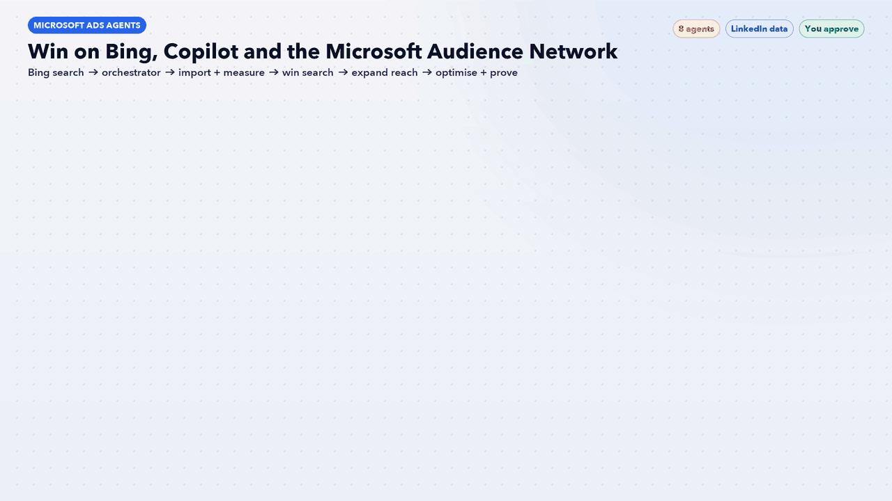

# Microsoft Ads Agents: An AI Team for Bing, Copilot and the Microsoft Audience Network



Eight Claude Code agents, the **JEV** model router and one workflow skill that turn **Microsoft Advertising** into a weekly list of profitable actions. The team is built around the 10 things Microsoft Ads does better than most channels: an older, higher-income, desktop-heavy audience, cheaper clicks, **LinkedIn profile targeting** on search, ads inside **Copilot**, reach across Bing, Yahoo, AOL, DuckDuckGo and the **Microsoft Audience Network**, one-click **Google Import**, controls Google removed, full Shopping and Performance Max, first-party audience data, and a real account team. The orchestrator finds the biggest gap, and JEV picks the cheapest Claude model that can do each task.

> **AI recommends. You approve.** Nothing changes in Microsoft Advertising without your OK in chat. Imports and new campaigns start paused, bids and budgets move at most 20% per step, and the agents never delete anything or touch billing.

## How it works

| Stage | Agent | Default tier | What it does | Strengths used |
|---|---|---|---|---|
| Lead | [`ms-orchestrator`](agents/ms-orchestrator.md) | Standard | Finds the biggest gap, routes work and merges one ranked action list | All |
| Router | [`ms-jev-router`](agents/ms-jev-router.md) | Fast | JEV model router: fast Haiku, standard Sonnet or deep Opus per task | – |
| 1 Import + measure | [`ms-import-tracking`](agents/ms-import-tracking.md) | Standard | Google Import, scheduled sync, UET, offline conversions, Clarity | Google Import |
| 2 Win search | [`ms-search-optimizer`](agents/ms-search-optimizer.md) | Standard | Cheaper clicks, ad-group controls, partner exclusions, search terms | Audience quality, lower CPCs, extra controls |
|  | [`ms-linkedin-b2b`](agents/ms-linkedin-b2b.md) | Standard | Company, industry and job function targeting on search | LinkedIn profile targeting |
| 3 Expand reach | [`ms-copilot-ai`](agents/ms-copilot-ai.md) | Standard | Ads in Copilot and AI answers, AI-ready assets | Copilot and AI answers |
|  | [`ms-audience-network`](agents/ms-audience-network.md) | Standard | Native and remarketing on MSN, Outlook, Edge and partners | Syndication and native reach, audience data |
|  | [`ms-shopping-pmax`](agents/ms-shopping-pmax.md) | Standard | Merchant Center feed, Shopping, Performance Max, dynamic remarketing | Ecommerce tooling |
| 4 Optimise + prove | [`ms-optimizer-reporter`](agents/ms-optimizer-reporter.md) | Standard | Bids, budgets, Microsoft vs Google lift, account rep asks, weekly readout | Account team support |

The [`microsoft-ads-workflow`](workflow/microsoft-ads-workflow/SKILL.md) skill runs the stages in order. It stops at stage 1 if UET or conversions are broken, and calls anything with fewer than 100 clicks or 15 conversions a hunch, not a finding.

## JEV: the model router

JEV is part of the workflow but not shown in the GIF.

| Score | Tier | Model | Typical tasks |
|---|---|---|---|
| 0-2 | Fast | Haiku | UET checks, import sync errors, partner site exclusions, pacing |
| 3-5 | Standard | Sonnet | Keyword and bid plans, LinkedIn targeting, Copilot assets, feed fixes, weekly readout |
| 6+ | Deep | Opus | Microsoft vs Google incrementality, conversions that disagree with the CRM, restructures |

**Efficiency rules:** start low and escalate on evidence · copy what already works on Google before fresh research · read Microsoft's free signals (recommendations, share of voice, Keyword Planner, Clarity) first · reuse outputs from the last 7 days · batch small checks · at most 2 deep tasks per weekly run. Decisions are logged to `outputs/jev-routing-log.csv`.

**Works with the rest of this repo:** cross-channel budgets go to [AI Paid Traffic](../ai-paid-traffic-agents/), Google and Meta to [Google + Meta Ads OS](../google-meta-ads-os/), and B2B follow-up to [LinkedIn Ads Agents](../linkedin-ads-agents/).

## Where Microsoft ads run

| Surface | Placements | Goal | Main metric |
|---|---|---|---|
| Search | Bing, Yahoo, AOL, DuckDuckGo and search partners | Sales and leads | CPA, ROAS |
| Copilot | Ads in Copilot and Bing's AI answers | Sales and leads | Conversion rate vs search |
| Audience Network | Native, display and video on MSN, Outlook, Edge, Start and partners | Prospecting and remarketing | CPA, reach |
| Shopping | Shopping, Performance Max, dynamic remarketing | Product sales | ROAS |

Learn more on Microsoft's own page: [ads.microsoft.com](https://ads.microsoft.com).

## Requirements

- [Claude Code](https://claude.com/claude-code)
- A Microsoft Advertising account, with exports (CSV), API read access or a signed-in dashboard
- Optional: Google Ads exports for comparison, a CRM for offline conversions, Microsoft Merchant Center for Shopping

## Install

```bash
./install.sh
```

Then, in a new Claude Code session, say **"run the Microsoft Ads workflow"**, or ask one agent directly, for example "use ms-linkedin-b2b on my SaaS search campaign".

## Files

- `agents/`: the 8 agent definitions plus the JEV router (each has a default `model:` tier)
- `workflow/microsoft-ads-workflow/SKILL.md`: the orchestrator skill
- `microsoft-ads-workflow.gif`: workflow infographic
- `docs/make_gif.py`: regenerates the GIF (needs Pillow and `tools/gifkit.py`)
