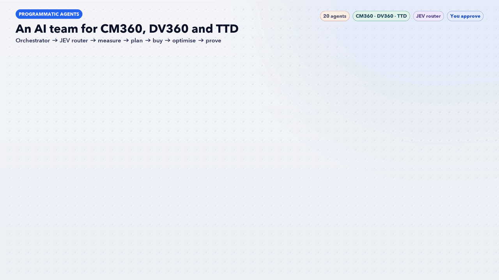

# Programmatic Agents: An AI Team for CM360, DV360 and The Trade Desk



Twenty Claude Code agents and one workflow skill for programmatic advertising. **CM360** serves and measures, **DV360** and **The Trade Desk** buy. An orchestrator finds the biggest leak each week, and **JEV**, a model router, decides which Claude model each task needs, so cheap tasks run on Haiku and only high-stakes decisions use Opus.

> **AI recommends. You approve.** Nothing changes in CM360, DV360 or TTD without your OK in chat. New campaigns, line items and ad groups are built **paused**. The agents never launch, unpause or change budgets, never accept deal terms and never delete data.

## How it works

| Stage | Agent | Default tier | What it does |
|---|---|---|---|
| Lead | [`pg-orchestrator`](agents/pg-orchestrator.md) | Standard | Entry point for the programmatic team (CM360, DV360, The Trade Desk) |
| Router | [`pg-jev-router`](agents/pg-jev-router.md) | Standard | JEV model router. Decides which Claude model tier each programmatic task needs (standard Haiku, medium Sonnet, deep Opus) so the team spends tokens only where judgement matters |
| 1 Measure first | [`pg-floodlight-tracking`](agents/pg-floodlight-tracking.md) | Standard | Owns conversion tracking: Floodlight activities and variables, gtag/GTM implementation, enhanced conversions, consent mode, and CM360 versus DSP conversion reconciliation |
|  | [`pg-verification`](agents/pg-verification.md) | Fast | Checks brand safety, suitability, invalid traffic (IVT), viewability and MFA (made-for-advertising) sites using CM360 verification, Active View and DSP or third-party verification data |
|  | [`pg-cm360-trafficking`](agents/pg-cm360-trafficking.md) | Fast | Traffics in CM360: advertisers, campaigns, sites, placements, creatives, ads, rotation, tag sheets and naming conventions, using bulk tools or the API |
| 2 Plan | [`pg-media-planner`](agents/pg-media-planner.md) | Standard | Builds the programmatic media plan: goals, KPIs, budget split across DV360 and TTD, channels (display, video, CTV, audio, DOOH, retail), flighting and forecasts |
|  | [`pg-audience-identity`](agents/pg-audience-identity.md) | Standard | Designs audiences and identity: Google affinity/in-market/Customer Match in DV360, UID2/EUID, first-party and third-party data segments in TTD, lookalikes and exclusions |
|  | [`pg-deals-supply`](agents/pg-deals-supply.md) | Standard | Finds and manages supply: PMPs, preferred and programmatic guaranteed deals, TTD OpenPath and Sincera quality scores, supply-path optimisation and inventory lists |
| 3 Buy | [`pg-dv360-buyer`](agents/pg-dv360-buyer.md) | Standard | Builds and audits DV360 structure: advertisers, campaigns, insertion orders, line items, targeting, Google audiences, bid strategies and SDF bulk files |
|  | [`pg-ttd-buyer`](agents/pg-ttd-buyer.md) | Standard | Builds and audits The Trade Desk: campaigns, ad groups, Kokai (Koa) optimisations, bid lists, data segments, UID2 targeting and channel set-up |
|  | [`pg-youtube-video`](agents/pg-youtube-video.md) | Standard | Plans and optimises YouTube and online video through DV360: in-stream, Shorts, bumpers, YouTube on CTV, video reach and action campaigns, Brand Lift |
|  | [`pg-ctv-audio-dooh`](agents/pg-ctv-audio-dooh.md) | Standard | Plans CTV, streaming audio, podcast and digital out-of-home buys, mostly through The Trade Desk: premium CTV supply, household frequency, audio and DOOH screens |
|  | [`pg-retail-media`](agents/pg-retail-media.md) | Standard | Uses retail media data off-site through The Trade Desk (Walmart Connect, Kroger, Target and other retailer data) with closed-loop sales measurement |
| 4 Optimise | [`pg-bidding-algorithms`](agents/pg-bidding-algorithms.md) | Deep | Designs bidding: DV360 custom bidding scripts (weighting Floodlight events by business value), TTD Kokai goals and bid factors, bid strategy tests |
|  | [`pg-frequency-reach`](agents/pg-frequency-reach.md) | Fast | Manages frequency and unique reach across DV360, TTD and CM360: caps by channel and household, overlap between platforms, and the reach curve |
|  | [`pg-pacing-budget`](agents/pg-pacing-budget.md) | Fast | Monitors pacing and spend across CM360, DV360 and TTD: under- and over-delivery, flight end dates, budget versus plan, and reallocation suggestions |
|  | [`pg-dynamic-creative`](agents/pg-dynamic-creative.md) | Standard | Plans and QAs dynamic creative: CM360 Studio feeds, rules by audience/geo/weather/funnel stage, creative versions, and sizes and specs for each DSP |
| 5 Prove | [`pg-attribution-dedup`](agents/pg-attribution-dedup.md) | Deep | Owns attribution: CM360 deduplicated conversions across DV360, TTD, search and social; path-to-conversion; data-driven versus rule-based models; reconciling platform claims |
|  | [`pg-incrementality-lift`](agents/pg-incrementality-lift.md) | Deep | Designs incrementality tests: conversion lift, Brand Lift, geo holdouts and PSA/ghost-ad controls across DV360 and TTD |
|  | [`pg-clean-room-reporting`](agents/pg-clean-room-reporting.md) | Standard | Builds the weekly programmatic readout and data plumbing: CM360 Data Transfer to BigQuery, Ads Data Hub, TTD clean rooms and Windsor.ai dashboards |

The [`programmatic-growth-workflow`](workflow/programmatic-growth-workflow/SKILL.md) skill runs the stages in order. It stops at stage 1 if Floodlights are broken, platforms disagree on conversions by more than 20%, or invalid traffic is above 5%, because optimising on bad data wastes budget.

## JEV: the model router

Every task gets a 0-10 score on money at stake, ambiguity, reasoning depth, blast radius and novelty.

| Score | Tier | Model | Typical tasks |
|---|---|---|---|
| 0-2 | Standard | Haiku | Tag QA, naming checks, pacing read-outs, report pulls |
| 3-5 | Medium | Sonnet | Media plans, audience and deal strategy, briefs, weekly readout |
| 6+ | Deep | Opus | Attribution disputes, custom bidding scripts, budget reallocation, lift-test design |

**Efficiency rules:** start low and escalate only on evidence · split a task into cheap and expensive parts · reuse outputs from the last 7 days · batch small checks · at most 3 deep tasks per weekly run. Every decision is logged to `outputs/jev-routing-log.csv`, and the weekly readout shows the estimated saving versus running everything on Opus.

**Works with the rest of this repo:** `pg-floodlight-tracking` hands container checks to the [GTM Health Agent](../gtm-health-agent/), `pg-audience-identity` takes consented seed lists from [Klaviyo 1PD Agents](../klaviyo-1pd-agents/) and [HubSpot Agents](../hubspot-agents/), and `pg-dynamic-creative` shares angles with [AI Paid Traffic](../ai-paid-traffic-agents/).

**Guardrails in every agent**
- Show the full list of changes before any write
- Build new items paused; you launch, unpause and change budgets
- Name everything created with the prefix `AI · ` and tag it `ai-workflow`
- Every number comes from a tool call or an export, never from memory

## Recommended Claude skills

These Claude Code skills pair well with this set. The lead agent uses them when they are installed.

- **For this set:** `windsor-ai:campaign-report`, `budget-planner`, `attribution-report`, `youtube-ads`, `weekly-report`
- **For every set:** `marketing:performance-report`, `marketing:competitive-brief`, `windsor-ai:windsor-insights`, `schedule`

Skills from `windsor-ai:*`, `marketing:*`, `small-business:*` and `design:*` need those plugins installed, and Windsor.ai or HubSpot skills only return data once those connectors are signed in.

## Requirements

- [Claude Code](https://claude.com/claude-code)
- Read access to CM360, DV360 and The Trade Desk, through **Windsor.ai**, report exports (CSV) or the platform APIs
- Optional: BigQuery / Ads Data Hub for log-level analysis

## Install

```bash
./install.sh
```

Then, in a new Claude Code session, say **"run the programmatic workflow"**. Or ask one agent directly, for example "use pg-attribution-dedup, DV360 and TTD both claim the same sales" or "use pg-jev-router, route this week's tasks".

## Files

- `agents/`: the 20 agent definitions (each has a default `model:` tier)
- `workflow/programmatic-growth-workflow/SKILL.md`: the orchestrator skill
- `programmatic-agents-workflow.gif`: workflow infographic
- `docs/make_gif.py`: regenerates the GIF (needs Pillow and `tools/gifkit.py`)
