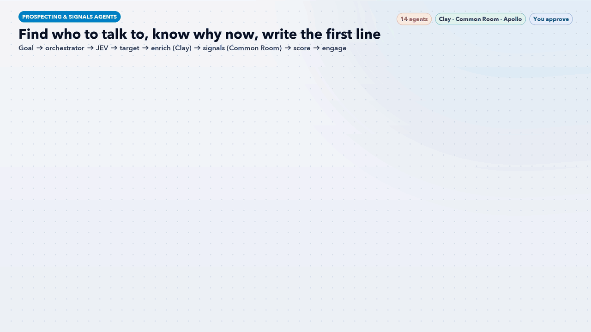

# Prospecting & Signals Agents: An AI Team for Clay, Common Room and Apollo



Fourteen Claude Code agents and one workflow skill that do what **Clay**, **Common Room** and **Apollo** do best, together: find the right accounts and people, enrich and verify them, spot who is in-market *now*, score and route them, and draft outreach. **JEV**, the router, picks the cheapest Claude model *and* the cheapest data path for each task, so credits go to the accounts that matter.

> **AI recommends. You approve.** Nothing is sent, enrolled in a sequence or written to your CRM without your OK in chat. Outreach is saved as drafts. Business contact data only; opt-outs, customers and open deals are always excluded.

## How it works

| Stage | Agent | Default tier | What it does |
|---|---|---|---|
| Lead | [`pr-orchestrator`](agents/pr-orchestrator.md) | Standard | Sets the play and credit budget, routes work, merges one ranked account list |
| Router | [`pr-jev-router`](agents/pr-jev-router.md) | Fast | JEV: model tier (Haiku · Sonnet · Opus) and cheapest data path per task |
| 1 Target | [`pr-icp-builder`](agents/pr-icp-builder.md) | Standard | ICP from closed-won deals, lookalike companies, personas |
|  | [`pr-list-builder`](agents/pr-list-builder.md) | Fast | Apollo and Clay search, with customers and do-not-contact removed |
|  | [`pr-buying-committee`](agents/pr-buying-committee.md) | Standard | Decision-maker, champion, budget holder and blockers per account |
| 2 Enrich | [`pr-contact-waterfall`](agents/pr-contact-waterfall.md) | Fast | Clay waterfall for verified work emails and phones |
|  | [`pr-enrichment`](agents/pr-enrichment.md) | Fast | Firmographics, funding, tech stack, hiring |
|  | [`pr-ai-researcher`](agents/pr-ai-researcher.md) | Standard | Claygent-style research questions with sources |
| 3 Signals | [`pr-intent-signals`](agents/pr-intent-signals.md) | Standard | Intent topics, website visitors, pricing-page visits |
|  | [`pr-community-signals`](agents/pr-community-signals.md) | Standard | Common Room community, product and social activity, one profile per person |
|  | [`pr-trigger-alerts`](agents/pr-trigger-alerts.md) | Fast | Champion job changes, funding, new leaders, hiring spikes |
| 4 Score | [`pr-lead-scorer`](agents/pr-lead-scorer.md) | Standard | Fit × intent priority, reasons and routing |
| 5 Engage | [`pr-crm-sync`](agents/pr-crm-sync.md) | Fast | Dedupe, opt-outs, field mapping, HubSpot/Salesforce sync |
|  | [`pr-outreach-writer`](agents/pr-outreach-writer.md) | Standard | Personal first lines and multichannel sequences, as drafts |

The [`prospecting-signals-workflow`](workflow/prospecting-signals-workflow/SKILL.md) skill runs the stages in order. Replies and meetings feed back into scoring every week. The default weekly play is **signal-first** (signals → score → enrich only what scored → engage), which is the cheapest way to a meeting.

## JEV: model tier + data path

| Score | Tier | Model | Typical tasks |
|---|---|---|---|
| 0-2 | Fast | Haiku | Searches, verification, field fills, dedupe, trigger checks |
| 3-5 | Standard | Sonnet | ICP, buying committees, research, signal digests, scoring, outreach |
| 6+ | Deep | Opus | Top-account plans, tools that disagree, rebuilding the scoring model |

**Data path, cheapest first:** CRM and recent outputs → Apollo built-in data → Common Room signals → Clay waterfall (cheapest provider first) → Claygent only for fit 70+. Decisions and credits are logged to `outputs/jev-routing-log.csv`, with cost per meeting reported weekly.

**Works with the rest of this repo:** CRM hand-offs go to [HubSpot Agents](../hubspot-agents/), paid retargeting of in-market accounts to [LinkedIn Ads Agents](../linkedin-ads-agents/), and website behaviour to [Behaviour Analytics Agents](../behavior-analytics-agents/).

## Requirements

- [Claude Code](https://claude.com/claude-code)
- At least one of Clay, Common Room or Apollo, with exports (CSV), API/MCP access or a signed-in dashboard
- Optional: HubSpot or Salesforce

## Install

```bash
./install.sh
```

Then, in a new Claude Code session, say **"run the prospecting workflow"**, or ask one agent directly, for example "use pr-trigger-alerts to find champions who changed jobs".

## Files

- `agents/`: the 14 agent definitions (each has a default `model:` tier)
- `workflow/prospecting-signals-workflow/SKILL.md`: the orchestrator skill
- `prospecting-signals-workflow.gif`: workflow infographic
- `docs/make_gif.py`: regenerates the GIF (needs Pillow and `tools/gifkit.py`)
